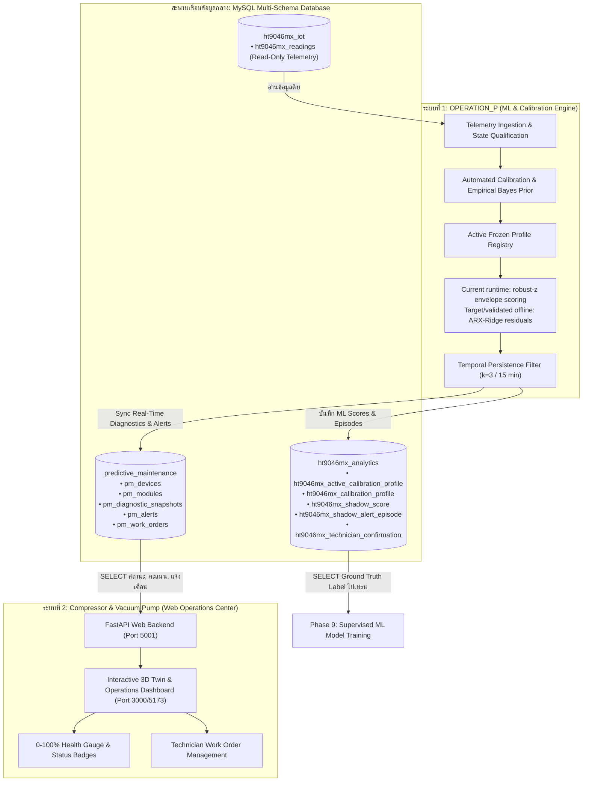

# Database Architecture & Integration Specification
## OPERATION P (ML & Calibration Engine) ↔ Compressor & Vacuum Pump (Web Operations Center)

**Last updated:** 2026-10-02
**Applies to:** วิศวกร ML, Backend Developer, Data Engineer และ Maintenance Supervisor
**Status:** v1 implementation snapshot; staging/production acceptance still open

## Reference-review jobs — 2 October 2026

Explicit analytics-only migration `deployment/mysql_reference_review.sql` adds `ht9046mx_reference_review_job` for asynchronous manual review. It stores UUID job ID, unique request idempotency key/digest, actor, machine/module, status, request/selection/preview/result JSON, input digest, progress/error, lease and UTC `DATETIME(6)` timestamps. Reference/Shadow/exclusion timestamps inside selection remain declared source-local `[start,end)`; do not interpret them as job UTC timestamps.

Build rechecks selection/policy and model-input minute digest, then commits existing Calibration Candidate/Shadow tables and job completion atomically using the same connection. Reviewer/exclusion reasons/selected dates/source digest are also frozen in profile validation and batch manifest JSON. Job identity is not a foreign key to PM work/alerts and does not confer authentication/Active approval. Queue/retry/lease states and Server steps: `deployment/REFERENCE_REVIEW_WORKFLOW.md`. Actual QA writes only the isolated localhost schema `ht9046mx_reference_review_qa_20261001`, Active0; no target Server DDL or regular source/analytics/PM writes performed.

## Latest selected contract — 1 October 2026

Historical diagrams below describe the v1 snapshot, not the currently selected scorer. Current selected path is observed raw seconds → qualified completed **1-minute Cold windows** → matching human-reviewed Active Profile → robust-z/max deviation + **3 consecutive minute** persistence; 5 minutes is delivery/refresh cadence, not a 15-minute persistence window. ARX/Empirical Bayes/cause confidence in older designs are not the active detector.

Added local `ht9046mx_rehearsal_episode` and `ht9046mx_rehearsal_raw_evidence` downstream archive tables; they are not production Alert tables. Dashboard `predictive_maintenance.pm_work_orders` adds nullable report origin/occurrence start/end/timezone/precision; `pm_maintenance_logs.incident_context_json` freezes original report context at service submission. Work Order creation/closure does not certify anomaly/cause/recovery. `source_alert_id` refers only to `pm_alerts.id`; no analytics Episode foreign key is implied. Explicit live bridge and identity mapping remain to implement. All fields, transaction boundary, migration and QA are detailed in [Episode/Dashboard workflow](deployment/EPISODE_ARCHIVE_DASHBOARD_WORKFLOW.md).

> Runtime provenance warning: the current live inference path calculates a max-absolute robust-z envelope score, although the compatibility record may still contain the historical `ARX-Ridge__seed_13` label. The portable ARX-Ridge artifact is not loaded on that path. Resolve this mismatch before enabling production Compressor alerts. See `docs/V1_ARCHITECTURE_AND_DEPLOYMENT.md`.

---

## 1. สถาปัตยกรรมระบบและการเชื่อมโยง (System Architecture Overview)

ระบบถูกออกแบบตามหลักการ **Decoupled Two-Tier Architecture (สถาปัตยกรรมแบบแยกส่วนผ่าน Data Contract)** โดยแบ่งความรับผิดชอบออกเป็น 2 ระบบชัดเจน เพื่อประสิทธิภาพและความเสถียรสูงสุด:



---

## 2. การเก็บข้อมูลแบบ Map กับเวลาจริง (Time-Aligned Ground Truth) สำหรับ Supervised ML


1. **ป้องกัน Data Leakage และ Lookahead Bias (การรั่วไหลของข้อมูลข้ามเวลา)**:
   - ในโมเดล Time-Series / Predictive Maintenance การทำนาย ณ เวลา $t$ จะต้องใช้ข้อมูลที่เกิดขึ้น **ก่อนเวลา $t$ เท่านั้น**
   - หากไม่มีแกนเวลาจริงที่แม่นยำระดับวินาที (`DATETIME(6)` พร้อม Timezone Asia/Bangkok / UTC) โมเดลที่นำไปเทรนจะเกิดปัญหา Lookahead Bias ทำให้ผลการทดสอบบนกระดาษดูดี แต่เมื่อนำไปรันจริงหน้างานจะล้มเหลว
2. **Point-in-Time As-Of Join (การผูก Label ของช่างเข้ากับสัญญาณเซนเซอร์)**:
   - เมื่อช่างเดินไปตรวจเครื่องจริง ณ เวลา $T_{\text{confirm}}$ แล้วยืนยันว่า `EQUIPMENT_ANOMALY`

### 2.2 สิ่งที่ "จำเป็นต้องเก็บ" ลงฐานข้อมูลเพื่อใช้เทรน Supervised ML

| หมวดหมู่ข้อมูล | ตัวแปร / คอลัมน์ที่ต้องบันทึก | ความสำคัญสำหรับการเทรน Supervised ML |
|---|---|---|
| **1. แกนเวลาอ้างอิง** | `event_time`, `recorded_at` (`DATETIME(6)`) | เป็น Key หลักในการทำ Time-Series Join และป้องกันการเรียงลำดับเวลาสลับกัน |
| **2. ระบุพิกัดเครื่อง** | `machine_number`, `module` (1–8) | ใช้ทำ Group Split (Leave-One-Machine-Out: LOMO Validation) ป้องกัน Overfitting ข้ามเครื่อง |
| **3. สภาวะการทำงาน (State)** | `status` (`Run`/`Stop`), `busy` (0/1), `sv_state` (`Off`/`On`), `state_code` | ใช้กรองสภาวะ Steady State ออกจาก Transient / Manual Valve Change |
| **4. สัญญาณเซนเซอร์ดิบ** | $Hp_1, Lp_1, \Delta P_1, Hp_2, Lp_2, \Delta P_2, \text{Valve}, T_{\text{hi}}, T_{\text{lo}}$ | เป็นข้อมูลตั้งต้นทางกายภาพ (Physical Features) สำหรับสกัด Time-Domain / Frequency Features |
| **5. ค่า Baseline ณ จุดเวลานั้น** | `active_profile_id`, `median_i`, `scale_i`, `threshold_tau` | บันทึกว่าขณะเกิดเหตุ เครื่องใช้เกณฑ์ปกติค่าใดในการตัดสิน เพื่อตรวจย้อนหลังได้ 100% |
| **6. สัญญาณที่แปลงแล้ว (Normalized)** | $rz_{hp1}, rz_{lp1}, rz_{hp2}, rz_{lp2}, rz_{valve}$, Residuals | ตัวแปรอิสระ ($X$) ที่ขจัดความต่างระหว่างเครื่องแล้ว พร้อมเข้า Model ทันที |
| **7. ผลลัพธ์จาก Unsupervised Model** | `ml_score`, `raw_flag`, `persistent_flag`, `dominant_feature` | ใช้เป็น Meta-Features หรือ Prior Evidence ในการเทรน Ensemble / Stacking Classifier |
| **8. ป้ายเฉลยจริงของช่าง (Target Label)** | `confirmation_status` (`EQUIPMENT_ANOMALY` / `NO_EQUIPMENT_ANOMALY`), `confirmed_at`, `technician_id` | **เป็น Target $y$ (Ground Truth)** ที่ช่างหน้างานยืนยันจากการตรวจเครื่องจริง |

---

## 3. พจนานุกรมตารางฐานข้อมูล (Database Schema & Table Dictionary)

### Schema 1: `ht9046mx_iot` (Raw Telemetry Source — Read-Only)

#### ตาราง `ht9046mx_readings`
* **หน้าที่**: บันทึก Telemetry ดิบทุกวินาที/รอบนาทีของเครื่องจักรทุกเครื่อง
* **คอลัมน์สำคัญ**:
  - `machine_number` (VARCHAR): รหัสเครื่อง เช่น `'MX080'`, `'057'`
  - `recorded_at` (DATETIME): เวลาที่บันทึกข้อมูลหน้างาน
  - `Status` (VARCHAR): สถานะระบบรวม เช่น `'Run'`, `'Stop'`
  - `Hp_1st_1` .. `Hp_1st_8`, `Lp_1st_1` .. `Lp_1st_8`: ความดัน Discharge/Suction สเตจ 1 (R507A)
  - `Hp_2nd_1` .. `Hp_2nd_8`, `Lp_2nd_1` .. `Lp_2nd_8`: ความดัน Discharge/Suction สเตจ 2 (R23)
  - `Valve_1` .. `Valve_8`: คำสั่งเปิดวาล์วอิเล็กทรอนิกส์ EEV (%)
  - `TempHi_1` .. `TempHi_8`, `TempLo_1` .. `TempLo_8`: อุณหภูมิฝั่งร้อน/เย็น (°C)
  - `Status_1` .. `Status_8`, `Busy_1` .. `Busy_8`, `SV_1` .. `SV_8`: สถานะเฉพาะโมดูล

#### 2. ตาราง `compressor_health_scores` (v1 compatibility output; ownership debt)
* **หน้าที่**: สัญญาณออก (Output Contract) อ่านผลคะแนน ML Health Score โดยตรงสำหรับ `Compressor and Vacuum Pump`
* **คอลัมน์สำคัญ**:
  - `machine_number` (VARCHAR): เช่น `'MX080'`, `'HT9046MX-080'`
  - `module_id` (VARCHAR): เช่น `'compressor-m1'` ถึง `'compressor-m8'`
  - `recorded_at` (DATETIME): เวลาที่ประเมินผล
  - `health_score` (FLOAT): คะแนนสุขภาพ 0-100%
  - `condition` (VARCHAR): สถานะ `'NORMAL'`, `'WATCH'`, `'WARNING'`, `'MAINTENANCE_REQUIRED'`
  - `model_version` (VARCHAR): เวอร์ชันโมเดล เช่น `'ARX-Ridge__seed_13'`

---

### Schema 2: `ht9046mx_analytics` (ML Analytics & Calibration Engine)
ฐานข้อมูลสำหรับระบบวิเคราะห์ ML (ระบบ OPERATION P):

#### 1. ตาราง `ht9046mx_active_calibration_profile`
* **หน้าที่**: ชี้ว่าเครื่องไหนและโมดูลไหน กำลังใช้โปรไฟล์ชุดใดในการคำนวณออนไลน์ (Production Registry)
* **คอลัมน์สำคัญ**:
  - `machine_number`, `module`, `sv_state`, `state_code` (Primary Key ร่วม)
  - `active_profile_id` (INT): ชี้ไปยัง `ht9046mx_calibration_profile.profile_id`
  - `activated_at` (DATETIME(6)): เวลาที่อนุมัติใช้งาน
  - `activated_by` (VARCHAR): รหัสผู้อนุมัติ เช่น `'APPROVER-01'`
  - `rollback_mode` (VARCHAR): `'PREVIOUS_ACTIVE_PROFILE'` หรือ `'NO_ACTIVE_PROFILE_FAIL_CLOSED'`
  - `rollback_profile_id` (INT NULL): โปรไฟล์สำรองกรณีย้อนกลับฉุกเฉิน

#### 2. ตาราง `ht9046mx_calibration_profile`
* **หน้าที่**: เก็บค่าพารามิเตอร์ Envelope Baseline สถิติ และ Threshold ที่ผ่านการคำนวณ
* **คอลัมน์สำคัญ**:
  - `profile_id` (INT AUTO_INCREMENT Primary Key)
  - `profile_version` (VARCHAR): รหัสเวอร์ชัน เช่น `'autocalibration-v1-f70b982e'`
  - `profile_status` (VARCHAR): `'ACTIVE_FROZEN'`, `'READY_FOR_APPROVAL'`, `'FLEET_PROVISIONAL'`
  - `statistics_json` (JSON): ค่า Median, Scale, P10, P90, และ Correlation Matrix ของทั้ง 8 Features
  - `threshold_json` (JSON): ค่า Cutoff Threshold เช่น `{"deviation_score_q995": 3.50}`

#### 3. ตาราง `ht9046mx_shadow_score`
* **หน้าที่**: บันทึกผลคะแนน Anomaly Score และ Flag ทุกรอบการรัน (ทุก 5 นาที)
* **คอลัมน์สำคัญ**:
  - `score_id` (BIGINT AUTO_INCREMENT Primary Key)
  - `machine_number`, `module`, `event_time` (DATETIME(6))
  - `anomaly_score` (DOUBLE): ค่าคะแนนความเบี่ยงเบนจากโมเดล (ML Score)
  - `threshold_value` (DOUBLE): ค่าเกณฑ์ ณ ขณะนั้น
  - `raw_flag` (TINYINT(1)): 1 เมื่อคะแนนหลุดเกณฑ์ชั่วคราว
  - `persistent_flag` (TINYINT(1)): 1 เมื่อหลุดเกณฑ์ต่อเนื่อง 3 รอบ (15 นาที)
  - `evidence_json` (JSON): ค่าเซนเซอร์จริง vs Median เพื่อตรวจสอบย้อนกลับ

#### 4. ตาราง `ht9046mx_shadow_alert_episode`
* **หน้าที่**: บันทึกรอบเหตุการณ์ผิดปกติ (Alert Incident Episode) ที่ผ่านการกรอง Persistence แล้ว
* **คอลัมน์สำคัญ**:
  - `alert_id` (BIGINT AUTO_INCREMENT Primary Key)
  - `machine_number`, `module`
  - `episode_start` (DATETIME(6)): เวลาเริ่มต้นที่ตรวจพบความผิดปกติ
  - `detected_at` (DATETIME(6)): เวลาที่ความผิดปกติได้รับการยืนยันครบ 15 นาที
  - `alert_status` (VARCHAR): `'OPEN'`, `'RESOLVED'`, `'SUPPRESSED'`

#### 5. ตาราง `ht9046mx_technician_confirmation`
* **หน้าที่**: เก็บผลการตรวจจริงของช่างหน้างาน (Gold Standard Dataset)
* **คอลัมน์สำคัญ**:
  - `confirmation_id` (BIGINT AUTO_INCREMENT Primary Key)
  - `alert_id` (BIGINT): ผูกกับ `ht9046mx_shadow_alert_episode.alert_id`
  - `confirmation_status` (VARCHAR): `'EQUIPMENT_ANOMALY'`, `'NO_EQUIPMENT_ANOMALY'`, `'UNRESOLVED'`
  - `technician_id` (VARCHAR): รหัสช่าง เช่น `'TECH-014'`
  - `technician_note` (TEXT): บันทึกบริบทหน้างาน (เก็บเพื่อ Audit)
  - `confirmed_at` (DATETIME(6)): เวลาที่ช่างบันทึกผลจริง

---

### Schema 3: `predictive_maintenance` (Main Web Operations Center)
ฐานข้อมูลของระบบแสดงผลหน้าเว็บหลัก (`Compressor and Vacuum Pump`):

#### 1. ตาราง `pm_devices` & `pm_modules`
* **หน้าที่**: ทะเบียนเครื่องจักรและโมดูลคอมเพรสเซอร์ทั้ง 8 โมดูล
* **คอลัมน์สำคัญ**:
  - `id`, `device_uid` (เช่น `'HT9046MX-080'`), `machine_code`, `status` (`'NORMAL'`, `'WATCH'`, `'WARNING'`)
  - `pm_modules`: `module_code` (เช่น `'compressor-m1'` ถึง `'compressor-m8'`), `status`

#### 2. ตาราง `pm_diagnostic_snapshots` (สะพานเชื่อมหลักสำหรับหน้าเว็บ)
* **หน้าที่**: ตารางที่หน้าเว็บหลักอ่านค่าไปแสดงบนเข็มไมล์ Gauge 0-100%, แสดงสถานะ และรายละเอียด AI
* **คอลัมน์สำคัญ**:
  - `device_id`, `module_id`, `recorded_at`
  - `health_score` (INT 0–100): คะแนนสุขภาพคอมเพรสเซอร์สำหรับแสดงบนเข็มไมล์ Gauge
  - `condition_state` (ENUM): `'NORMAL'`, `'WATCH'`, `'WARNING'`, `'MAINTENANCE_REQUIRED'`
  - `pressure_kpa`, `temperature_c`: ค่ากายภาพหลัก
  - `ai_model_version` (VARCHAR): รหัสโมเดล เช่น `'ARX-Ridge__seed_13'`
  - `ai_condition` (VARCHAR): สรุปสภาวะ เช่น `'Hp2 Discharge Drop'`, `'Normal Operation'`
  - `ai_confidence` (DOUBLE): ค่าความเชื่อมั่น (0.0 – 1.0)
  - `ai_notes` (TEXT): ข้อความอธิบายสถานะให้ผู้ใช้งานเข้าใจง่าย

#### 3. ตาราง `pm_alerts`
* **หน้าที่**: รายการแจ้งเตือนสดที่หน้าเว็บหลักนำไปเด้งเตือน Notification และส่งต่อเข้าคิว Work Order
* **คอลัมน์สำคัญ**:
  - `device_id`, `module_id`, `diagnostic_id`
  - `severity` (`'info'`, `'warning'`, `'critical'`)
  - `title`: หัวข้อเตือน เช่น `'HT9046MX-080 M6: Persistent Pressure Deviation'`
  - `message`: รายละเอียดความผิดปกติและค่าที่ตรวจพบ
  - `acknowledged` (TINYINT): สถานะว่าช่างกดรับทราบหรือยัง

---

## 4. โฟลว์การเชื่อมต่อระหว่าง 2 ระบบ (Integration Workflow)

```
[ht9046mx_iot.ht9046mx_readings]
               │
               ▼
[OPERATION_P: Inference Engine (ทุก 5 นาที)]
 ├── 1. กรองสภาวะ Cold Run + SV Off
 ├── 2. โหลด Active Profile (ht9046mx_active_calibration_profile)
 ├── 3. คำนวณ Robust Relative Coordinate (rz)
 ├── 4. v1 runtime คำนวณ max(abs(robust-z)); portable ARX ยังไม่ถูกโหลด
 ├── 5. คำนวณ Anomaly/Health compatibility output และ Condition State
 ├── 6. ตรวจ Persistence Filter (k=3 / 15 นาที)
               │
      ┌────────┴────────────────────────┐
      ▼                                 ▼
[ht9046mx_analytics]          [predictive_maintenance]
 • ht9046mx_shadow_score       • pm_diagnostic_snapshots
 • ht9046mx_shadow_alert_      • pm_alerts
   episode                     • อัปเดต pm_modules.status
                               • อัปเดต pm_devices.status
                                        │
                                        ▼
                      [Compressor & Vacuum Pump Web UI]
                       • 3D Twin & Overview Cards
                       • Health Score Gauge (0-100%)
                       • Live Alert Notification Pop-up
                       • Work Order Queue
```
