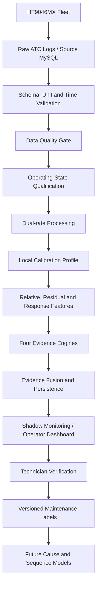
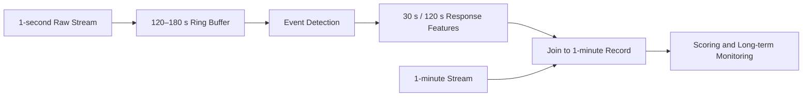
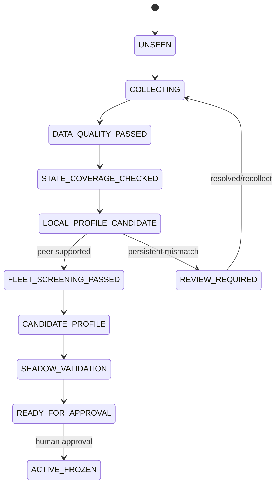
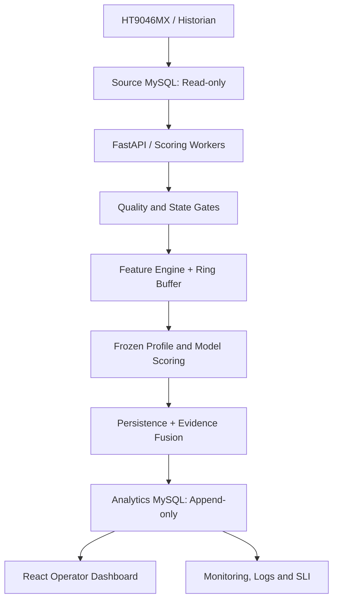

# HT9046MX Predictive Maintenance

## สรุป Data Pipeline และ Architecture ฉบับปรับปรุง

**วันที่จัดทำ:** 15 กันยายน 2026  
**สถานะเอกสาร:** Architecture and Implementation Summary  
**ขอบเขต:** Compressor Modules ของเครื่อง HT9046MX สำหรับ Fleet Monitoring, Anomaly Screening และการเตรียมข้อมูลสู่ Predictive Maintenance

---

## 1. Executive Summary

ระบบนี้มีเป้าหมายเพื่อเรียนรู้พฤติกรรมปกติที่เปรียบเทียบกันได้ของ Compressor แต่ละเครื่องและแต่ละ Module จากนั้นตรวจจับการเบี่ยงเบน การเสื่อมสภาพ และความผิดปกติของการตอบสนอง พร้อมแสดงหลักฐานให้ช่างหรือวิศวกรตรวจยืนยัน

ในระยะปัจจุบัน ระบบยังเป็น **Anomaly Screening + Condition Monitoring + Technician Decision Support** ไม่ใช่ระบบวินิจฉัยสาเหตุเสียอัตโนมัติ เนื่องจากยังไม่มีประวัติ Fault และ Maintenance Label ที่ยืนยันโดยช่างเพียงพอ

ทิศทาง Production หลักคือ:

```text
Local Calibration
        ↓
Self + Dynamic + Peer + Temporal Evidence
        ↓
Persistence
        ↓
Shadow Monitoring
        ↓
Technician Verification
```

ส่วน Shared LSTM/TCN และ Wang-style transfer fine-tuning จะอยู่ในฐานะ **Future Challenger** เมื่อข้อมูลลำดับเวลาแบบ 1 วินาทีมี coverage และคุณภาพเพียงพอ


## 2. เป้าหมายและขอบเขตการตัดสินใจ

### 2.1 สิ่งที่ระบบต้องทำในปัจจุบัน

- ตรวจสอบว่าข้อมูลมีคุณภาพพอสำหรับการวิเคราะห์หรือไม่
- แยกข้อมูลตาม Machine, Module, State, SV และ Service Epoch
- สร้าง Calibration Profile เฉพาะบริบท
- ตรวจจับการเปลี่ยนจากอดีตของเครื่องเอง
- ตรวจจับความผิดปกติของ Dynamic Response เช่น Valve-to-Pressure response
- เปรียบเทียบกับ Peer/Subfleet ที่มีบริบทเดียวกัน
- ตรวจจับ Drift หรือ Degradation ที่สะสมตามเวลา
- รวมหลักฐานและใช้ Persistence ลด False Alert
- ส่งผลให้ Operator/Technician ตรวจสอบ พร้อมเก็บผลยืนยันกลับเป็น Label


---

## 3. Architecture ภาพรวม



ระบบ Production ต้องอ่านข้อมูลจาก Source MySQL แบบ Read-only แล้วเขียนผลวิเคราะห์ไปยัง Analytics Database แบบ Append-only เพื่อแยกเส้นทาง Operational Data ออกจากผลของ ML และทำให้ตรวจสอบย้อนหลังได้

---

## 4. Data Contract หลัก

ทุก Record ต้องมี Key ขั้นต่ำดังนี้:

```text
timestamp
machine_id
module_id
```

Sensor และ Controller Fields หลัก:

| Field | ความหมาย |
|---|---|
| `Hp_1st` | High Pressure ของ Compressor Stage 1 หรือ COM1 |
| `Lp_1st` | Low Pressure ของ Compressor Stage 1 หรือ COM1 |
| `Hp_2nd` | High Pressure ของ Compressor Stage 2 หรือ COM2 |
| `Lp_2nd` | Low Pressure ของ Compressor Stage 2 หรือ COM2 |
| `Valve_n` | ตำแหน่งของ Expansion Valve |
| `Status_n` | สถานะหรือคำสั่งของระบบควบคุม Valve |
| `TempHigh_n` | อุณหภูมิ Compressor |
| `TempLow_n` | อุณหภูมิ Discharge Pipe |
| `SV_n` | คำสั่งเปิด/ปิด Bypass Valve |

Metadata ที่ควรเพิ่มเมื่อระบบต้นทางรองรับ:

```text
recipe
mode
phase
temperature_setpoint
actual_controlled_temperature
DUT_or_load
facility_water_condition
service_event
refill_event
sensor_or_configuration_version
```

Metadata เหล่านี้จำเป็นต่อการแยก Fault ออกจากการเปลี่ยนแปลงที่เกิดจาก Operating Condition

---

## 5. Data Pipeline ตั้งแต่ต้นจนจบ

### Stage 0 — Data Ingestion

แหล่งข้อมูลหลักคือ ATC Record/Handler Logs ที่ถูกนำเข้าสู่ MySQL โดยระบบดึงไฟล์เป็นรอบ และข้อมูล 1 วินาทีที่ใช้วิเคราะห์ transient หรือ valve-response

ข้อกำหนดสำคัญ:

- บันทึกเวลาต้นทางและเวลาที่ระบบรับข้อมูล
- กำหนด Timezone ให้ชัดเจนและใช้มาตรฐานเดียวกัน
- เก็บ Source File, Row Number หรือ Source Record ID เพื่อ Trace ย้อนกลับ
- ไม่แก้ไข Raw Data หลังรับเข้า
- Version Schema และ Unit ของแต่ละ Sensor
- รองรับ Late Arrival, Duplicate และข้อมูลย้อนหลังที่ถูกนำเข้าใหม่

### Stage 1 — Schema, Unit and Time Validation

ตรวจสอบก่อนเข้าสู่ ML:

- ชื่อและชนิดข้อมูลของ Column
- Unit ของ Pressure และ Temperature
- Timestamp ขาดหาย ซ้ำ สลับลำดับ หรืออยู่นอกช่วง
- Machine/Module ID ถูกต้อง
- ค่า Sensor อยู่ในช่วงที่อุปกรณ์สามารถวัดได้
- Feature Version ตรงกับ Model/Profile Version

ถ้าไม่ผ่าน ให้ผลเป็น:

```text
DATA_QUALITY
```


### Stage 2 — Data Quality Gate

ตัวอย่างข้อมูลที่ต้อง Reject, Quarantine หรือ Abstain:

- Missing timestamp หรือ key สำคัญ
- Duplicate timestamp ที่ยังแก้ความขัดแย้งไม่ได้
- Gap ยาวเกิน Threshold ที่กำหนด
- ค่า Sentinel เช่น `-200`
- Sensor ค้าง, เป็นศูนย์ต่อเนื่อง หรือไม่อัปเดต
- ข้อมูล Stale หรือมาถึงช้าเกินขอบเขต
- Schema/Unit ไม่ตรงกับที่ Profile รองรับ
- Coverage ต่ำจนสร้าง Window ที่เชื่อถือไม่ได้

ผลลัพธ์ Gate ที่แนะนำ:

```text
ELIGIBLE
DATA_QUALITY_REVIEW
INSUFFICIENT_COVERAGE
STALE_DATA
UNSUPPORTED_SCHEMA
```

### Stage 3 — Operating-State Qualification

ข้อมูลจะเปรียบเทียบกันได้เมื่ออยู่ในบริบทเดียวกันเท่านั้น จึงต้องแยกตาม:

```text
Machine
× Module
× Operating State
× SV State
× Control Status
× Service Epoch
```

และเพิ่มเมื่อมีข้อมูล:

```text
× Recipe
× Process Phase
× Load
× Facility-water Band
```


- Startup และ Shutdown
- Emergency Down
- MValveHome
- Pump-down
- Busy หรือ Transition
- ChangeValve
- Negative Valve Command
- Mixed SV/Status ภายใน Window เดียวกัน
- Unknown Operating Regime

### Stage 4 — Cleaning, Segmentation and Windowing

แนวทางสำหรับข้อมูล 1 วินาที:

- Sort ตาม Machine, Module และ Timestamp
- ลบ Exact Duplicate โดยเก็บ Audit Record
- Resample ภายใน State เดียวกันเท่านั้น
- Interpolate เฉพาะ Gap สั้นไม่เกินประมาณ 5 วินาที
- Break Segment เมื่อ Gap ยาวกว่าเกณฑ์
- ไม่ Interpolate ข้าม OFF, Busy, Valve Transition หรือ State Change
- แบ่ง Train/Test ตามเวลา **ก่อน** สร้าง Overlapping Windows
- Window ที่ข้าม State หรือ Service Epoch ต้องถูก Reject
- Target Coverage ต่อ Window ควรไม่น้อยกว่า 95%

Window เดิมสำหรับ sequence analysis:

```text
Lookback: 1 hour
Resolution: 1 second
Stride: 5 minutes
Expected timestamps: 3,600 rows/window
```


---

## 6. Dual-rate Data Architecture

ระบบใช้ข้อมูลสองความละเอียดสำหรับคนละหน้าที่



### 6.1 1-minute Stream

ใช้สำหรับ:

- Local baseline
- Long-term trend
- EWMA/CUSUM
- Operational server scoring
- Historical dashboard
- Condition monitoring ระยะยาว

### 6.2 1-second Stream

ใช้สำหรับ:

- Valve transition response
- Pressure response delay
- Gain, slope, t50 และ t90
- Overshoot และ settling time
- Oscillation และ transient shape
- Sequence model ในอนาคต

ข้อมูลรายนาทีที่ Aggregate แล้วไม่สามารถสร้าง trajectory รายวินาทีย้อนกลับได้ จึงต้องสกัด Dynamic Features จาก Ring Buffer ก่อนลดรายละเอียด

---

## 7. Local Calibration Profile

Baseline ต้องเป็น Profile เฉพาะบริบท:

```text
Machine
× Module
× State
× SV
× Service Epoch
```


- Median และ MAD
- Quantiles เช่น Q05, Q50 และ Q95
- Feature distribution
- Pressure differential reference
- Trend reference
- ARX residual distribution
- Eligible coverage และ source dates
- Bootstrap uncertainty
- Schema/feature version
- Profile status และ approval metadata

Robust deviation ของ Feature ใด ๆ คำนวณได้จาก:

$$
z_{robust}=\frac{x-\operatorname{Median}_{profile}}{1.4826\,MAD_{profile}+\epsilon}
$$

หาก Profile ยังไม่พร้อม ระบบต้อง Abstain และแสดง:

```text
PROFILE_NOT_READY
```


---

## 8. Service Epoch และ Profile Versioning

เมื่อเกิดเหตุการณ์ที่เปลี่ยนพฤติกรรมเครื่อง เช่น:

- เติมหรือเปลี่ยน Refrigerant
- ซ่อมหรือเปลี่ยน Compressor
- ซ่อมหรือเปลี่ยน Valve
- เปลี่ยน Pressure/Temperature Sensor
- เปลี่ยน Control Parameter หรือ Configuration

ต้องปิด Epoch เดิมและเริ่ม Epoch ใหม่:

```text
Epoch 001
    ↓ Service Event
Epoch 002
```

ข้อกำหนด:

- Profile เก่าต้องเก็บไว้สำหรับ Audit และ Rollback
- Profile ใหม่ต้องผ่าน Auto-bootstrap, Shadow Validation และ Approval ใหม่
- ทุกผล Score ต้องอ้างอิง `profile_id`, `profile_version`, `model_version` และ `feature_version`

---

## 9. Feature Engineering

### 9.1 Raw Features

```text
Hp_1st, Lp_1st, Hp_2nd, Lp_2nd
Valve
TempHigh, TempLow
SV, Status, Busy
```

### 9.2 Physics-informed Features

$$
\Delta P_1=Hp_{1st}-Lp_{1st}
$$

$$
\Delta P_2=Hp_{2nd}-Lp_{2nd}
$$

ตัวอย่างเพิ่มเติม:

- Pressure ratio ที่มีการป้องกันการหารด้วยศูนย์
- Temperature difference
- CP1-to-CP2 relationships
- Pressure-temperature residual

### 9.3 Trend and Distribution Features

- Slope ของ `Hp_2nd`, `Lp_2nd` และ `ΔP2`
- Rolling median และ rolling MAD
- Variance และ variance ratio
- First difference และ change rate
- Distribution shift
- Change-point count

### 9.4 Valve and Dynamic-response Features

- `ΔValve` และ Valve rate
- เวลาหลัง SV/Valve command เปลี่ยน
- Response delay
- Response gain
- t50/t90
- Overshoot
- Settling time
- Oscillation count
- Cross-correlation lag

### 9.5 Low-side Screening Feature

ตัวอย่าง Rule Feature:

$$
d_{Hp2-low}=\max(0,180-Hp_{2nd})
$$

Feature นี้ใช้เป็นเพียง **Undercharge/Low-side Screening Evidence** ไม่ใช่หลักฐานยืนยัน Leak

---

## 10. Four-Evidence Architecture

ระบบที่ปรับปรุงแล้วใช้หลักฐานสี่กลุ่ม:

$$
\boxed{\text{Self}+\text{Dynamic}+\text{Peer}+\text{Temporal}}
$$

### 10.1 Self Evidence — เปรียบเทียบกับอดีตของตัวเอง

ตอบคำถามว่า:

> Machine/Module นี้เปลี่ยนจาก Baseline ของตัวเองหรือไม่?

วิธีที่ใช้:

- Robust Z/MAD
- Quantile distance
- Local residual
- Profile-relative feature

Output:

```text
self_score
self_top_contributors
local_profile_distance
```

### 10.2 Dynamic Evidence — ความสัมพันธ์ของระบบเปลี่ยนหรือไม่

ตอบคำถามว่า:

> เมื่อ Control Input หรือ Valve เปลี่ยน Pressure/Temperature ตอบสนองเหมือนอดีตหรือไม่?

ตัวอย่าง ARX model:

$$
y_t=c+\sum_i a_i y_{t-i}+\sum_j b_j u_{t-d-j}+\gamma^T w_t+e_t
$$

Residual:

$$
e_t=y_{actual}-y_{expected}
$$

Residual สูงต่อเนื่องหมายถึง Dynamic Behavior ไม่ตรงกับ Model แต่ยังไม่เท่ากับยืนยัน Leak

Output:

```text
dynamic_score
arx_residual
response_delay
response_gain
settling_mismatch
```

### 10.3 Peer Evidence — เปรียบเทียบกับ Fleet/Subfleet

ตอบคำถามว่า:

> ภายใต้ Context เดียวกัน Machine/Module นี้ต่างจาก Peer Population หรือไม่?

Peer ต้องถูกเลือกจาก:

```text
Same module role
+ Same operating state
+ Same SV state
+ Similar valve regime
+ Same recipe/phase/load เมื่อมีข้อมูล
```

Candidate detectors:

- Robust fleet residual
- Isolation Forest
- ECOD/COPOD
- PCA-SPE
- RRCF ในอนาคตหากต้องการ streaming detector

Output:

```text
peer_score
peer_coverage
peer_population_size
peer_definition_version
```

`Fleet mismatch` หมายถึงควรตรวจสอบเพิ่มเติม ไม่ได้หมายถึง Fault โดยอัตโนมัติ

### 10.4 Temporal Evidence — ความผิดปกติสะสมหรือไม่

ตอบคำถามว่า:

> สิ่งที่พบเป็น transient สั้น ๆ หรือเป็น degradation ที่ต่อเนื่อง?

วิธีที่ใช้:

- EWMA
- CUSUM
- Page-Hinkley
- Slope
- Change point
- Persistence
- Distribution shift

Output:

```text
trend_score
drift_slope
change_point_state
persistence_duration
```

---

## 11. Evidence Vector และ Fusion


Backend ควรเก็บ Evidence Vector:

```json
{
  "data_quality": "PASS",
  "profile_readiness": "ACTIVE_FROZEN",
  "self_score": 0.82,
  "dynamic_score": 0.75,
  "peer_score": 0.61,
  "trend_score": 0.88,
  "peer_coverage": 0.93,
  "persistence_windows": 7,
  "top_contributors": ["Hp_2nd", "Lp_2nd", "DeltaP2"]
}
```

Fusion Layer ควรแปลผลเป็น Evidence Category เช่น:

```text
NORMAL_WITHIN_PROFILE
LOCAL_DEVIATION
PERSISTENT_DEGRADATION
DYNAMIC_RESPONSE_MISMATCH
PEER_MISMATCH
LOW_SIDE_SUSPECT
HIGH_SIDE_SUSPECT
COMMON_CAUSE_SUSPECT
SENSOR_OR_DATA_QUALITY_SUSPECT
REVIEW_REQUIRED
```

ลำดับความหมายของผล:

```text
DATA_QUALITY
    ↓
DEVIATION
    ↓
PERSISTENT_PATTERN
    ↓
FAULT_SUSPECT
    ↓
CONFIRMED_FAULT
```

เฉพาะ Technician/Service Evidence เท่านั้นที่ยกระดับเป็น `CONFIRMED_FAULT`

---

## 12. Persistence และ Alert Policy


Starting policy สำหรับ Pilot:

```text
Warning:
2 จาก 3 windows ล่าสุด

Investigate:
3 consecutive windows × 5 นาที

Persistent degradation:
เกิดซ้ำหลาย cycle หรือหลายช่วงเวลา
```

ค่า Threshold และ Persistence จริงต้อง Calibrate จาก:

- Alerts per machine-day
- Worst-machine alert rate
- Operator workload
- False-alert review
- State/shift distribution
- Maintenance response capacity


---

## 13. Auto-bootstrap Profile Lifecycle

Auto-bootstrap คือ Lifecycle สำหรับสร้างและอนุมัติ Calibration Profile ไม่ใช่ Anomaly Model



### 13.1 Contamination Defense


ลำดับที่ถูกต้อง:

```text
Candidate Data
    ↓
Data Quality Gate
    ↓
State Qualification
    ↓
Extreme-residual Quarantine
    ↓
Persistent-pattern Quarantine
    ↓
Independent Peer/Fleet Screening
    ↓
Profile Stability Test
    ↓
Shadow Validation
    ↓
Human Approval
```


### 13.2 Profile Readiness


- จำนวน Calendar Days
- Eligible Windows
- Cycle Diversity
- State/SV Coverage
- Profile Stability
- Bootstrap Uncertainty
- Shadow Alert Behavior
- Peer Support

Starting policy:

```text
≥ 7 calendar days
Prefer ≥ 14 calendar days
≥ 200 eligible windows
```

ค่าดังกล่าวเป็น Provisional Policy และควรถูกปรับด้วย Profile-stability Curve และ Block-bootstrap Evidence

---

## 14. Validation Architecture

ลำดับ Validation:

```text
Past-only Temporal Split
        ↓
Leave-One-Machine-Out
        ↓
Sparse/New-machine External Test
        ↓
Service-epoch Holdout
        ↓
Offline Shadow Replay
        ↓
Live Shadow Monitoring
```

Data Split ที่ถูกต้อง:

```text
TRAIN
  ↓
INNER VALIDATION
  ↓
CALIBRATION
  ↓
OUTER TEST
```


### 14.1 Metrics ก่อนมี Fault Labels

Metrics ที่รายงานได้:

- Flag rate
- Alerts per machine-day
- Persistence distribution
- Score drift
- Seed stability
- Leave-One-Machine-Out dispersion
- Worst-machine alert rate
- Peer mismatch rate
- Abstention rate
- Profile stability
- Coverage by state/SV
- Latency, memory และ restart consistency

Metrics ที่ยังอ้างไม่ได้:

```text
Leak accuracy
Fault precision/recall/F1
Failure probability calibration
RUL error
```

---

## 15. Server and Deployment Architecture



### 15.1 Production Requirements

- Source Database user เป็น Read-only
- Analytics tables เป็น Append-only สำหรับ Score/Event/Audit
- แยก Worker สำหรับ ingestion, feature และ scoring ตามโหลด
- Idempotent processing เพื่อป้องกันการเขียนซ้ำ
- Checkpoint และ recovery หลัง service restart
- Immutable model/profile registry
- ระบุ exact rollback target
- Log model/profile/feature version ทุกผลลัพธ์
- ตรวจ late arrival, stale input และ processing lag
- ไม่มี ML-to-PLC write path

### 15.2 Shadow Mode

ก่อนเปิด Alert จริง:

```text
Live MySQL
    ↓
Read-only ingestion
    ↓
Frozen feature/model/profile versions
    ↓
Shadow scoring
    ↓
Append-only analytics database
    ↓
Alert-budget and stability review
```

สิ่งที่ต้องตรวจใน Shadow:

- End-to-end latency
- Missing/stale/late data
- Restart behavior
- Version mismatch
- Alert burden
- Worst machines/modules
- State and shift bias
- Deterministic replay consistency

---

## 16. Dashboard and Operator Experience


ตัวอย่าง:

```text
Machine: MX080
Module: 6
Condition: INVESTIGATE

Profile: MX080-M06-SVOFF-E02-v3

Evidence
- Self deviation: High
- Dynamic residual: High
- Peer deviation: Medium
- Temporal drift: Persistent

Persistence: 35 minutes

Top contributors
- Hp_2nd
- Lp_2nd
- ΔP2
- Valve response

Compared with
- Local baseline
- Peer subfleet
- Previous 7-day trend

Probable cause
- ยังระบุสาเหตุไม่ได้ รอการตรวจยืนยัน
```

หน้า Operator ควรมี:

- Fleet overview และจำนวนเครื่องตามสถานะ
- Machine/Module drill-down
- Real-time และ historical trend
- Hover แสดง timestamp/value/context
- State/SV/Busy overlay
- Threshold และ profile band
- Change-point และ alert marker
- Evidence breakdown
- Top contributing features
- Local-versus-peer comparison
- Technician feedback form
- CSV export และ audit history

---

## 17. Technician Feedback and Label Loop

กระบวนการสร้าง Ground Truth:

```text
New alert after prospective-feedback start time
    ↓
Technician Inspection
    ↓
Equipment anomaly?  Yes / No / Unresolved
    ↓
Optional audit note (not a class)
    ↓
Append-only PENDING_QA binary label store
```

ข้อมูลที่ควรเก็บ:

```text
alert_id and immutable alert/evidence version
machine_id and module_id from the alert
alert_detected_at and feedback-policy boundary
confirmed IANA timezone policy for alert_detected_at (`DATETIME(6)`)
inspection_time and technician_id_or_role
confirmation_status: EQUIPMENT_ANOMALY / NO_EQUIPMENT_ANOMALY / UNRESOLVED
optional free_text_note for audit only
label_status and Label-QA record
```

กติกา dataset สำหรับ supervised model รุ่นแรก:

```text
only QA-approved EQUIPMENT_ANOMALY and NO_EQUIPMENT_ANOMALY
only alert episodes after the prospective-feedback start time
reject confirmation when the alert timestamp timezone policy is not configured
features must be available at or before the alert decision time
UNRESOLVED, historical alerts and free-text notes are excluded from targets
temporal + leave-one-machine-out validation only
```

Label จากช่างเป็นสะพานที่เปลี่ยนระบบจาก Anomaly Screening ไปสู่ **binary anomaly confirmation** ที่มีหลักฐานจริง. Phase นี้ไม่เก็บ cause, action, refrigerant refill หรือ percentage. หากต้องการ cause diagnosis ภายหลัง ต้องเปิด project phase และ contract ใหม่ ไม่อนุมานจาก note หรือ binary label.

### 17.1 Automatic Calibration Profile on Server

เมื่อ source mapping, unit, IANA timezone, state contract, controller codebook และ service epoch ถูกยืนยันแล้ว Server สามารถอ่าน historical telemetry แบบ `SELECT` เท่านั้น, สร้าง robust candidate profile ตาม `machine × module × SV × qualified state`, และกันสามวันท้ายเป็น forward-only shadow validation. หน้าจอ Approval แสดงกราฟ score สามวัน: เขียวสำหรับ qualified window ใต้ candidate threshold และแดงสำหรับเหนือ threshold. สีเป็น local deviation evidence ไม่ใช่ Health percentage หรือ diagnosis.

Worker สร้าง candidate, graph และ audit registry อัตโนมัติ แต่ไม่ approve ตัวเอง. Reject คง active pointer เดิมแล้วรอข้อมูลใหม่ก่อน retry; Approve โดยผู้มีอำนาจเปลี่ยน pointer แบบ transactional พร้อม rollback target. ขั้นตอนนี้ไม่ retrain fleet model โดยอัตโนมัติ.

---

## 18. Future Model Roadmap

### 18.1 Supervised Binary Anomaly Model

เมื่อมี Independent Confirmed Incidents เพียงพอ สามารถทดลอง:

- Extra Trees
- CatBoost
- Gradient Boosting

Classes ที่อนุญาต:

```text
EQUIPMENT_ANOMALY
NO_EQUIPMENT_ANOMALY
```

Gate การเปิดใช้ต้องดู:

- จำนวน Independent Incidents
- จำนวน Machines และ Modules ที่ครอบคลุม
- Temporal diversity
- Binary class coverage และ imbalance
- LOMO performance
- PR-AUC
- Binary probability calibration
- Abstention behavior

Cause classifier ไม่อยู่ใน current roadmap. ต้องสร้าง dataset/taxonomy/validation/gate ใหม่หาก owner อนุมัติในอนาคต

### 18.2 Sequence Model Challenger

เมื่อ 1-second coverage ผ่าน Gate ให้ทดลอง:

```text
TCN Autoencoder / Forecasting
LSTM Autoencoder
PatchTST/Transformer ในระยะหลัง
```

Shared model ต้องถูกเทียบกับ Shallow Hybrid Production Baseline โดยใช้ข้อมูล Split และ Alert Budget เดียวกัน

### 18.3 Wang-style Transfer Learning

แนวทางสำหรับ Machine ใหม่:

```text
Qualified Normal Sequences
    ↓
Shared LSTM/TCN
    ↓
Local Calibration First
    ↓
Machine-domain Shift Test
    ├─ Shift ต่ำ → ใช้ Shared Model
    └─ Shift สูง → ทดลอง Target Fine-tuning
```


### 18.4 RUL

RUL ยังไม่พร้อมจนกว่าจะมี:

- Failure/Service endpoint ที่นิยามชัด
- Incident history เพียงพอ
- Consistent maintenance records
- Censoring-aware evaluation
- หลักฐานว่า degradation trajectory เชื่อมโยงกับเวลาถึงเหตุเสียจริง

---

## 19. บทบาทของ Model แต่ละ Layer

| Layer | Production/Current Direction | Future Challenger |
|---|---|---|
| Data Quality | Schema, time, unit, state rules | — |
| Local Baseline | Median, MAD, quantile | Contextual probabilistic profile |
| Drift | EWMA, CUSUM, Page-Hinkley | ADWIN |
| Dynamic | ARX-Ridge residual | State-space model |
| Multivariate | Isolation Forest | ECOD, COPOD, PCA-SPE, RRCF |
| Peer/Fleet | Relative/residual detector | Learned subfleet embedding |
| Sequence | Engineered 30/120-second features | TCN-AE, LSTM-AE, Transformer |
| Cause | Technician evidence category | Extra Trees, CatBoost |
| RUL | Not ready | Future only |

---

## 20. Project Status

### 20.1 สิ่งที่มีหรือวางโครงแล้ว

- Data contract และ sensor definitions
- Data/state qualification
- Local calibration concept
- Relative and physics-informed features
- Isolation Forest screening
- ARX-Ridge dynamic path
- `ARX-Ridge hp180` release candidate ในขอบเขต offline shadow evidence
- Persistence logic
- Auto-bootstrap candidate lifecycle
- Offline deterministic shadow replay
- FastAPI/React scaffold
- Technician label schema/UI concept

### 20.2 งานที่ต้องเพิ่มหรือทำต่อ

1. Independent Peer/Fleet Screening ที่ไม่ใช้ Candidate Profile รับรองตัวเอง
2. Live 1-second ring buffer และ event feature extraction
3. Live MySQL/server staging แบบ Read-only/Append-only
4. Unit, timezone และ service-epoch verification
5. Profile/model immutable registry
6. Exact rollback target และ release manifest
7. Alert-budget approval จากการใช้งานจริง
8. Live technician label workflow
9. Coverage monitor แยกตาม Machine/Module/State/SV
10. Sequence challenger เมื่อ coverage ผ่าน


- LSTM/TCN/Transformer
- Automatic fault classification
- Automatic leak diagnosis
- RUL prediction
- Automatic profile activation
- Health score ที่ถูกอธิบายเป็น failure probability

---

## 21. Implementation Priority

### Priority 1 — Production Safety and Data Trust

- Verify unit/timezone/schema
- Verify service epochs
- Enforce data/state gates
- Add audit IDs and version fields
- Freeze current `ARX-Ridge hp180` candidate

### Priority 2 — Independent Fleet Evidence

- Define comparable peer groups
- Build peer-relative feature set
- Train/evaluate fleet detector with Past-only and LOMO validation
- Integrate as Auto-bootstrap screening gate

### Priority 3 — Live Shadow Readiness

- Source MySQL read-only connector
- Append-only analytics schema
- Deterministic scoring worker
- Restart/checkpoint tests
- Alert-budget dashboard
- Exact rollback procedure

### Priority 4 — Ground-truth Collection

- Deploy technician review workflow
- Standardize cause/action codes
- Record service timestamps and pre/post evidence
- Audit label revisions

### Priority 5 — Future Challengers

- Improve 1-second data coverage
- Train TCN/LSTM shared model
- Test shared-only versus target fine-tuning
- Build probable-cause classifier after label gate passes

---

## 22. Acceptance Gates

### Data Gate

- Schema และ Unit ถูกต้อง
- Timestamp/Timezone ตรวจสอบแล้ว
- Duplicate, gap และ stale policy ทำงาน
- State/SV/Busy qualification ทำงาน

### Profile Gate

- Coverage และ cycle diversity ผ่าน
- Profile stable ตาม bootstrap evidence
- Peer screening ไม่พบ persistent mismatch ที่ยังไม่อธิบาย
- Profile มี version และ service epoch ชัดเจน

### Model Gate

- Past-only evaluation
- LOMO ผ่านเกณฑ์
- Stable across seeds
- ไม่มี threshold leakage
- Alert burden อยู่ใน budget
- Worst-machine behavior ยอมรับได้

### Shadow Gate

- Deterministic replay
- Restart consistency
- Latency/memory ผ่าน
- Missing/stale/late data ถูกจัดการ
- Dashboard อธิบาย evidence ได้
- Rollback target พร้อม

### Production Gate

- Human approval
- Model/Profile registry immutable
- Monitoring และ audit พร้อม
- Source access เป็น Read-only
- ไม่มี PLC/Safety write path

---

## 23. Final End-to-End Flow

```text
Raw HT9046MX Data
        ↓
Schema / Unit / Timestamp Validation
        ↓
Data Quality Gate
        ↓
Operating-State Qualification
        ↓
1-minute Steady Stream + 1-second Ring Buffer
        ↓
Machine–Module–State–SV–Epoch Calibration
        ↓
Relative / Residual / Response Features
        ↓
Self Evidence
+ Dynamic Evidence
+ Peer Evidence
+ Temporal Evidence
        ↓
Evidence Fusion
        ↓
Persistence
        ↓
Normal / Watch / Investigate / Abstain
        ↓
Shadow Monitoring and Operator Dashboard
        ↓
Technician Verification
        ↓
Versioned Maintenance Labels
        ↓
Future Probable-cause Classifier
        ↓
Future TCN/LSTM/Transfer Challenger
        ↓
Controlled Production Release
```

สมการแนวคิดของระบบ:

$$
\boxed{
\text{Condition Evidence}
=f(\text{Self},\text{Dynamic},\text{Peer},\text{Temporal})
}
$$

โดยมี:

$$
\boxed{
\text{Data Quality}
+\text{Profile Readiness}
+\text{Coverage/OOD}
}
$$

เป็น Gate ก่อนอนุญาตให้ตีความผล ไม่ใช่ส่วนหนึ่งของ Anomaly Score

---

## 24. Final Decision

Production Direction:

```text
Local Calibration
→ Self + Dynamic + Peer + Temporal Evidence
→ Persistence
→ Human Verification
```

Future Challenger:

```text
Shared LSTM/TCN
+ Wang-style Transfer Fine-tuning เมื่อจำเป็น
```

สะพานสำคัญที่สุดของ Project:

```text
Technician-confirmed Maintenance Events
```

Architecture นี้ทำให้ระบบขยายจาก Fleet ปัจจุบันไปสู่เครื่องจำนวนมากขึ้นได้ โดยไม่ต้องสร้าง Model แยกให้ทุก Machine/Module ขณะเดียวกันยังรักษา Machine-specific Baseline และป้องกันความเสี่ยงสำคัญของระบบ Unlabeled คือการนำเครื่องที่ Degraded ตั้งแต่ต้นไปสร้าง Baseline แล้วรับรองตนเองว่า Normal

## Change Log

- **15 Sep 2026 — Server calibration automation:** added the deployable read-only historical calibration candidate worker, immutable registry, three-day green/red shadow review graph and transactional human approval. No live Server/MySQL run, active profile or model retraining occurred.
- **15 Sep 2026 — Alert-clock integrity:** prospective confirmation now requires the Server to declare the IANA timezone for alert `DATETIME(6)` before comparing the feedback boundary; absent configuration fails closed. This does not add score, percentage or cause output.
- **15 Sep 2026 — Prospective binary feedback:** เปลี่ยน label loop เป็นคำยืนยัน anomaly/no-anomaly/unresolved สำหรับ alert ใหม่เท่านั้น พร้อม optional audit note ที่ไม่เป็น class. ตัด cause/action/refill/percentage ออกจาก current feedback และ supervised roadmap

- **15 Sep 2026 — System-only scope:** ตัดการจัดสรรข้อมูลส่วนขยายที่ยังไม่ดำเนินการออกจากเอกสารฉบับนี้ เพื่อคงไว้เฉพาะ data pipeline, four-evidence architecture, Auto-bootstrap, Server shadow deployment และ technician feedback system
- **15 Sep 2026 — Busy semantics alignment:** ปรับ `Busy_n` ให้ตรง `README_System.md` ว่าเป็น controller flag ที่ยังใช้ยืนยัน motor/compressor run state โดยลำพังไม่ได้
