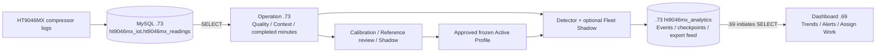

# HT9046MX Compressor Operation System

ระบบวิเคราะห์ข้อมูล Compressor ของเครื่อง HONTECH HT9046MX สำหรับสร้าง Reference แยกรายเครื่อง–รายโมดูล ตรวจการเปลี่ยนแปลงของแรงดัน อุณหภูมิ และพฤติกรรมการตอบสนอง แล้วเก็บผลและช่วงเหตุการณ์ใน MySQL ให้ตรวจย้อนหลังได้

Repository นี้เป็นฝั่ง **Operation / Calibration / Detector** ส่วนหน้า Dashboard งานบำรุงรักษาอยู่ที่ [Compressor_and_VacuumPump_final](https://github.com/Bookkapp/Compressor_and_VacuumPump_final)

คู่มือติดตั้งฉบับรวม ปรับปรุง 29 ตุลาคม 2026 โดยอ้างอิงโค้ดรุ่น `c238c203cb12f0e71652b9f03dd23d31b3352d56` การแก้เอกสารครั้งนี้ไม่ได้เปลี่ยนโค้ดหรือยืนยันสถานะบริการบน Server ปัจจุบัน

## 1. ติดตั้งที่ไหน และข้อมูลเดินทางอย่างไร

| ส่วน | ตำแหน่ง | หน้าที่ |
| --- | --- | --- |
| Operation API + Web + Worker | **10.195.17.73**, Windows Server | สร้าง/ทบทวน Profile วิเคราะห์ข้อมูล เก็บ Events และผลส่งออก |
| MySQL | **10.195.17.73:3306** | เก็บข้อมูลต้นทางและผลวิเคราะห์ในคนละ schema |
| Dashboard งานบำรุงรักษา | **10.195.17.69** | แสดงสถานะ Alerts และงานที่ผู้ใช้ตรวจสอบ |
| Operation Web/API ภายใน Server | `http://127.0.0.1:8000` | Web และ API ใช้ origin เดียวกันผ่าน ASGI entry point |



Dashboard `.69` เป็นฝ่ายเชื่อมต่อ MySQL `.73` เพื่อดึงผล Operation ไม่ต้องเชื่อมย้อนกลับไป `.69` จึงใช้ `HT9046MX_DETECTOR_BRIDGE_ENABLED=false` สำหรับ topology นี้

การเปิดเว็บจากคอมเครื่องอื่นต้องผ่าน reverse proxy/gateway ของ Server ซึ่งส่งต่อไป `127.0.0.1:8000` ชื่อ DNS, HTTPS และพอร์ตทางเข้าต้องตั้งในโครงสร้างเครือข่ายจริง การติดตั้งตามคำสั่งด้านล่างไม่ได้เปิด URL `http://10.195.17.73:8000` ให้ LAN โดยอัตโนมัติ

## 2. ระบบทำอะไรบ้าง

1. อ่าน raw telemetry ด้วยบัญชี SELECT และแยก Machine × Module × operating context โดยเก็บสถานะ Valve, SV, Busy และ Compressor ไว้ช่วยอธิบายเหตุการณ์
2. ตรวจความครบถ้วน ช่องว่าง และข้อมูลซ้ำ ก่อนรวมวินาทีที่สังเกตจริงเป็นนาทีที่ปิดครบแล้ว
3. ผู้ใช้เลือกเครื่อง/ช่วงประวัติในหน้า Calibration ระบบเสนอช่วง Reference ให้ทบทวน สร้าง Steady Reference และ Transition evidence เท่าที่มีข้อมูลรองรับ
4. เก็บ Candidate และ thresholds เป็นรุ่นที่ตรึงไว้ ตรวจ Shadow ตาม workflow ของ Profile แล้วให้ผู้รับผิดชอบทบทวนและอนุมัติเป็น Active Profile การเปิด Worker ไม่ได้อนุมัติ Profile
5. Detector เทียบข้อมูลใหม่กับ Reference ที่รองรับบริบทนั้น ตรวจความเบี่ยงเบน การตอบสนอง และความต่อเนื่อง เก็บ score/evidence กับ Events และ checkpoint ในฐานวิเคราะห์
6. Fleet bundle ที่ติดตั้งเป็นอีกช่องทาง Shadow สำหรับเปรียบเทียบพฤติกรรม การติดตั้ง bundle ไม่ได้สร้าง Active Profile ของแต่ละเครื่อง
7. Dashboard ดึง STATUS/EVENT feed ไปแสดง โดยผล Shadow หรือข้อมูลที่ไม่มี Reference รองรับแสดงเป็นยังประเมินไม่ได้ ไม่แปลงเป็นสถานะปกติ

ระบบเป็น detector ของการเปลี่ยนแปลงทางสถิติ เหตุการณ์ที่พบใช้เป็นข้อมูลให้วิศวกรตรวจสอบ ยังไม่มีหลักฐานยืนยัน fault labels เพียงพอสำหรับรายงานความแม่นยำวินิจฉัยความเสียหายจริง

## 3. สิ่งที่ต้องเตรียม

- Windows Server ที่ `.73`, Python 3.12 หรือ runtime ที่ทดสอบกับ dependencies ชุดนี้แล้ว, Node.js 20.19+ หรือ 22.12+, Git และ Git LFS
- MySQL พร้อม schema `ht9046mx_iot` และ `ht9046mx_analytics`; ตาราง raw มีข้อมูลไหลเข้าและ index ที่เหมาะกับการค้นเครื่อง/เวลา/id
- บัญชีอ่าน raw แยกจากบัญชีเขียน analytics และบัญชี DBA สำหรับสร้าง schema/ตารางตอนติดตั้ง
- พื้นที่ local disk สำหรับ checkout, virtual environment, model store และ `runtime/server-logs`
- ข้อมูล mapping จริง: machine ID, timestamp/timezone, pressure unit, state codes และ Module 1–8

## 4. ดาวน์โหลดและติดตั้ง dependencies

ตัวอย่างใช้ `C:\Services\HT9046MX-Operation` เป็นโฟลเดอร์ติดตั้ง เปลี่ยนได้ แต่ `.env`, API และ Worker ต้องชี้ checkout เดียวกัน

```powershell
git clone https://github.com/Bookkapp/CompressorML_and_AutomaticCalibration_final.git C:\Services\HT9046MX-Operation
Set-Location C:\Services\HT9046MX-Operation
git lfs install
git lfs pull
git lfs fsck
git rev-parse HEAD

py -3.12 -m venv .venv
.\.venv\Scripts\python.exe -m pip install --upgrade pip
.\.venv\Scripts\python.exe -m pip install -r apps/api/requirements.txt
.\.venv\Scripts\python.exe -m pip install -r deployment/server_setup/requirements.txt
.\.venv\Scripts\python.exe -m pip check

Push-Location apps/web
npm ci
npm run build
Pop-Location
```

GitHub อาจขอให้ login สำหรับ private repository หาก Server ใช้ Python รุ่นอื่นอยู่ ให้สร้าง environment แยกและตรวจ compatibility ก่อนใช้แทน `py -3.12`

## 5. ตั้งค่า `.env`

API อ่าน `.env` จาก working directory ส่วน Windows supervisor โหลด `.env` ที่ root ของ checkout โดยตรง ถ้ามีไฟล์อยู่แล้ว ให้รวมค่าที่ต้องใช้กับไฟล์นั้น ตัวอย่างด้านล่างเป็นรายการค่าที่ต้องตั้ง ไม่ใช่คำสั่งให้เขียนทับ config ที่ติดตั้งอยู่

```dotenv
HT9046MX_APP_MODE=live
HT9046MX_PROJECT_ROOT=C:/Services/HT9046MX-Operation
HT9046MX_API_CORS_ORIGINS=http://127.0.0.1:8000

HT9046MX_ANALYTICS_DB_HOST=10.195.17.73
HT9046MX_ANALYTICS_DB_PORT=3306
HT9046MX_ANALYTICS_DB_NAME=ht9046mx_analytics
HT9046MX_ANALYTICS_DB_USER=<ANALYTICS_WRITER_USER>
HT9046MX_ANALYTICS_DB_PASSWORD=<ANALYTICS_WRITER_PASSWORD>

HT9046MX_SOURCE_DB_HOST=10.195.17.73
HT9046MX_SOURCE_DB_PORT=3306
HT9046MX_SOURCE_DB_NAME=ht9046mx_iot
HT9046MX_SOURCE_DB_USER=<SOURCE_SELECT_USER>
HT9046MX_SOURCE_DB_PASSWORD=<SOURCE_SELECT_PASSWORD>
HT9046MX_SOURCE_TABLE=ht9046mx_readings
HT9046MX_SOURCE_TIMESTAMP_COLUMN=recorded_at
HT9046MX_SOURCE_MACHINE_COLUMN=machine_number
HT9046MX_SOURCE_GLOBAL_STATUS_COLUMN=Status
HT9046MX_DETECTOR_SOURCE_ID_COLUMN=id
HT9046MX_SOURCE_HP1_TEMPLATE=Hp_1st_{module}
HT9046MX_SOURCE_LP1_TEMPLATE=Lp_1st_{module}
HT9046MX_SOURCE_HP2_TEMPLATE=Hp_2nd_{module}
HT9046MX_SOURCE_LP2_TEMPLATE=Lp_2nd_{module}
HT9046MX_SOURCE_VALVE_TEMPLATE=Valve_{module}
HT9046MX_SOURCE_TEMP_HIGH_TEMPLATE=TempHi_{module}
HT9046MX_SOURCE_TEMP_LOW_TEMPLATE=TempLo_{module}
HT9046MX_SOURCE_MODULE_STATUS_TEMPLATE=Status_{module}
HT9046MX_SOURCE_BUSY_TEMPLATE=Busy_{module}
HT9046MX_SOURCE_SV_TEMPLATE=SV_{module}

# ตรวจให้ตรงกับ timestamp, หน่วย และ state codes ของต้นทางจริง
HT9046MX_SOURCE_TIMEZONE=Asia/Bangkok
HT9046MX_ALERT_DATETIME_TIMEZONE=UTC
HT9046MX_SOURCE_PRESSURE_UNIT=psi
HT9046MX_SOURCE_COMPRESSOR_ON_STATUS=Run
HT9046MX_SOURCE_MODULE_ON_STATUS=On,Run,Off
HT9046MX_SOURCE_BUSY_NORMAL_VALUES=0,False,Off
HT9046MX_SOURCE_SV_ON_VALUES=On,1,True
HT9046MX_SOURCE_SV_OFF_VALUES=Off,0,False

HT9046MX_PROFILE_WINDOW_CONTRACT=qualified_observed_1m
HT9046MX_SOURCE_EXPECTED_CADENCE_SECONDS=1
HT9046MX_QUALIFIED_1M_MINIMUM_COVERAGE=0.95
HT9046MX_QUALIFIED_1M_MAXIMUM_GAP_SECONDS=5
HT9046MX_QUALIFIED_1M_LATE_ARRIVAL_SECONDS=30
HT9046MX_QUALIFIED_1M_PREVIEW_ENABLED=true
HT9046MX_DASHBOARD_REFRESH_MINUTES=5
HT9046MX_SCORING_INTERVAL_MINUTES=1

HT9046MX_DETECTOR_WORKER_ENABLED=true
HT9046MX_DETECTOR_CRON=*/5 * * * *
HT9046MX_DETECTOR_OVERLAP_MINUTES=30
HT9046MX_DETECTOR_MAX_SOURCE_ROWS=10000
HT9046MX_DETECTOR_MACHINES=MX017,MX024,MX041,MX058,MX080,MX081
HT9046MX_DETECTOR_SHADOW_ONLY=true
HT9046MX_DETECTOR_FLEET_SHADOW_ENABLED=false
HT9046MX_DETECTOR_BRIDGE_ENABLED=false
HT9046MX_DETECTOR_ALERTS_ENABLED=false
HT9046MX_FLEET_STABLE_STORE=C:/Services/HT9046MX-Operation/runtime/fleet-store

HT9046MX_PROFILE_CANDIDATE_ENABLED=false
HT9046MX_PROFILE_CANDIDATE_COMMAND=
HT9046MX_MODEL_CANDIDATE_COMMAND=
HT9046MX_SHADOW_SCORE_COMMAND=
```

| กลุ่มค่า | ความหมาย / สิ่งที่ต้องตรวจ |
| --- | --- |
| `SOURCE_*` | mapping ไปยัง raw table; `{module}` แทนเลข 1–8; รายชื่อเครื่องต้องตรงกับต้นทาง |
| `ANALYTICS_*` | ฐานเก็บผล แยกจาก schema raw; ผู้ใช้ runtime ต้องเขียนตารางผลได้ |
| Timezone / pressure | ตัวอย่าง raw เป็น Bangkok และ alert เป็น UTC ต้องตรวจให้ตรงกับระบบที่เขียน DATETIME จริง; `psi` ใช้ประกาศหน่วย Shadow ส่วน psig/psia ต้องระบุในหลักฐาน Profile |
| Module status | ค่า `On,Run,Off` ตรงกับ default รุ่นนี้ เป็นชุดค่าที่ reader รับ ไม่ได้หมายความว่า Off คือกำลังทำความเย็น ต้องดู context ร่วมกับ global Status/SV/Busy |
| Window quality | ข้อมูลวินาทีอย่างน้อย 95%, gap ไม่เกิน 5 วินาที, เว้น late arrival 30 วินาที; ข้อมูลที่ไม่ผ่านอาจไม่ถูกให้คะแนน |
| Worker schedule | `DETECTOR_CRON` เป็นตัวกำหนดรอบ Worker จริง ตัวอย่างทุก 5 นาที แม้หลักฐานที่วิเคราะห์เป็นราย 1 นาที; `SCORING_INTERVAL_MINUTES` ไม่ได้แทน cron นี้ |
| Shadow | เก็บหลักฐานทดลอง; ตั้ง Fleet Shadow เป็น true หลังติดตั้งและเลือก bundle แล้ว; Operational output ยังต้องมี approved Context และนโยบาย live ที่รองรับ |
| Row budget | 10,000 แถวต่อ slice หากข้อมูล/ข้อมูลซ้ำเกิน budget ต้องตรวจปริมาณและปรับให้เหมาะ ไม่ถือว่าข้อมูลที่ถูกตัดเป็นช่วงครบ |
| Candidate schedule | ตัวอย่างใช้การเตรียม Profile ผ่านหน้าเว็บ; detector-only service ไม่เรียก scheduled training แม้จะตั้ง candidate flag |

ตัวเลือกเพิ่มเติมอยู่ใน `apps/api/app/config.py` และ `apps/api/.env.example` เช่น history 28 วันตาม default โค้ด, shadow 3 วัน, minimum calibration 7 วัน/200 windows และเวอร์ชัน state contract/controller codebook/service epoch ค่าเหล่านี้เป็นคนละส่วนกับ Fleet bundle และหน้า Context review ให้ตรวจ workflow ที่ใช้ก่อนปรับ

`HT9046MX_FLEET_REFERENCE_ROOT` ใช้เมื่อมี prepared historical study สำหรับดูหลักฐานหรือ retrain; inference จาก frozen bundle ไม่จำเป็นต้องมี raw dataset/Notebook outputs ทั้งหมด การใช้ technician feedback API ต้องตั้ง `HT9046MX_TECHNICIAN_FEEDBACK_START_AT` เป็น ISO8601 พร้อม offset ตามวันเริ่มใช้งานจริง

## 6. สร้างตาราง analytics

สำหรับติดตั้งใหม่ ให้ DBA สร้าง `ht9046mx_analytics` และสิทธิ์บัญชีก่อน ตัวอย่างใน MySQL client ที่ login ด้วยสิทธิ์ DBA (`mysql -h 10.195.17.73 -u <DBA_USER> -p`) แล้วรันจาก root ของ checkout:

```sql
CREATE DATABASE IF NOT EXISTS ht9046mx_analytics CHARACTER SET utf8mb4;
USE ht9046mx_analytics;
SOURCE deployment/mysql_shadow_schema.sql;
SOURCE deployment/mysql_phase6_calibration_registry.sql;
SOURCE deployment/mysql_reference_review.sql;
SOURCE deployment/mysql_detector_worker_audit.sql;
```

จากนั้นใช้ environment ที่ตั้งไว้สร้าง Context/Event และ Detector/export tables:

```powershell
.\.venv\Scripts\python.exe -m apps.api.app.context_migrate --allow-remote
.\.venv\Scripts\python.exe -m apps.api.app.qualified_detector --allow-remote --migrate-only
```

ติดตั้งบนฐานเดิมควรสำรอง analytics และเทียบ schema ก่อน คำสั่ง `create_all`/`CREATE TABLE IF NOT EXISTS` เพิ่มตารางที่ขาด แต่ไม่ได้แก้คอลัมน์เดิมที่ incompatible; `deployment/server_setup/mysql_checkpoint_capacity.sql` เป็นไฟล์ปรับขนาด checkpoint สำหรับรุ่นที่คอลัมน์เล็กเกินไป ให้ตรวจฐานจริงก่อนใช้

## 7. ติดตั้ง Fleet bundle (เมื่อใช้ Fleet Shadow)

ไฟล์ที่มาพร้อม release คือ `deployment/models/fleet-stable-v1-586e67981fc6d695467f0d01.zip` ตรวจ SHA256 กับ `deployment/models/SHA256SUMS`:

```powershell
Get-FileHash deployment/models/fleet-stable-v1-586e67981fc6d695467f0d01.zip -Algorithm SHA256
.\.venv\Scripts\python.exe -m apps.api.app.fleet_bundle --store C:/Services/HT9046MX-Operation/runtime/fleet-store install deployment/models/fleet-stable-v1-586e67981fc6d695467f0d01.zip
.\.venv\Scripts\python.exe -m apps.api.app.fleet_bundle --store C:/Services/HT9046MX-Operation/runtime/fleet-store status
```

ใช้ bundle ID ที่คำสั่ง install ส่งกลับและ revision ปัจจุบันจาก status เพื่อเลือก Shadow:

```powershell
.\.venv\Scripts\python.exe -m apps.api.app.fleet_bundle --store C:/Services/HT9046MX-Operation/runtime/fleet-store switch <BUNDLE_ID> --expected-revision <CURRENT_REVISION> --actor <SETUP_USER> --reason "Server Shadow setup"
```

ตั้ง `HT9046MX_DETECTOR_FLEET_SHADOW_ENABLED=true` แล้ว restart API/Worker ให้ใช้ store เดียวกัน ถ้ามี bundle/pointer เดิมอยู่ ให้ใช้รุ่นและ revision นั้นตามแผนติดตั้ง ไม่จำเป็นต้องสลับทุกครั้งที่ update โค้ด

## 8. ทดลองรันและเปิดเว็บ

รันจาก root ของ checkout เมื่อ config และ schema พร้อม:

```powershell
.\.venv\Scripts\python.exe -m apps.api.app.qualified_detector --allow-remote
.\.venv\Scripts\python.exe -m uvicorn deployment.server_setup.asgi:app --host 127.0.0.1 --port 8000 --workers 1
```

คำสั่งแรกอ่าน source จริงและเขียนผลลง analytics ที่ตั้งไว้ คำสั่งที่สองเปิด Web/API ให้เปิด `http://127.0.0.1:8000` บน Server หรือเช็กจากอีก PowerShell:

```powershell
Invoke-RestMethod http://127.0.0.1:8000/health
```

`/health` ยืนยันว่า API ตอบ แต่ไม่ได้ยืนยันว่า SQL, Profile, freshness และ Worker สำเร็จ ต้องตรวจผล cycle, Event History และ checkpoint เพิ่มด้วย ตัว `release_state` ใน endpoint เป็นข้อความที่ระบุในโค้ด ไม่ใช่ผลตรวจสถานะ Profile แบบ realtime

ใช้หน้า Calibration เลือกเครื่อง/ประวัติ ตรวจ Reference และ scope ของแต่ละโมดูล ดู Shadow/Validation evidence และอนุมัติตามเงื่อนไขที่ UI แสดง ช่วงข้อมูลที่ไม่พอหรือ context ไม่รองรับอาจยังไม่มี Active Profile และยังประเมินไม่ได้

## 9. ตั้งให้ทำงานอัตโนมัติหลังเปิด Server

เมื่อจบทดลอง foreground ให้ปิด process ที่ทดลองก่อน แล้วเปิด PowerShell แบบ Run as administrator:

```powershell
Set-Location C:\Services\HT9046MX-Operation
.\deployment\server_setup\install_tasks.ps1
Get-ScheduledTask -TaskName 'HT9046MX-Operation-*' | Select-Object TaskName,State
Get-Content runtime/server-logs/worker.log -Tail 80
Get-Content runtime/server-logs/api.log -Tail 80
```

สคริปต์สร้าง `HT9046MX-Operation-api` และ `HT9046MX-Operation-worker` รันด้วย SYSTEM ตอน startup ผ่าน supervisor ที่มี lock, restart/backoff และ rotating logs โดย Worker ใช้ `--detector-only` หากมี task ชื่อเดิม สคริปต์จะหยุดให้ตรวจ task ที่ติดตั้งอยู่ก่อน บัญชี SYSTEM ต้องเข้าถึง checkout, model store และ log directory ได้

ทางเข้า LAN ใช้ reverse proxy ที่ส่ง `/`, `/api/` และ `/health` มายังบริการนี้ และผูก `X-Approver-Id` กับผู้ใช้ที่ยืนยันตัวตนผ่าน gateway สำหรับงาน review/approval การใส่ header เองไม่ได้สร้างระบบ login

## 10. เชื่อม Dashboard ที่ 10.195.17.69

Detector ส่งออกผ่านตารางใน `ht9046mx_analytics`:

- `ht9046mx_dashboard_feed`: STATUS/EVENT ตามลำดับ sequence
- `ht9046mx_dashboard_sequence`: sequence ที่ commit แล้ว
- `ht9046mx_dashboard_identity`: ตัวระบุ producer สำหรับตรวจฐานที่ถูกเปลี่ยน
- `ht9046mx_dashboard_latest`: สถานะล่าสุด/การจำกัด heartbeat

DBA ให้บัญชี reader ของ Dashboard จาก host `.69` มี SELECT บนสามตารางแรก จากนั้นตั้งใน `.env` ของ **Dashboard repository**:

```dotenv
TELEMETRY_DB_HOST=10.195.17.73
TELEMETRY_DB_PORT=3306
OPERATION_PULL_ENABLED=true
OPERATION_DB_SCHEMA=ht9046mx_analytics
OPERATION_DB_USER=<DASHBOARD_SELECT_USER>
OPERATION_DB_PASSWORD=<DASHBOARD_SELECT_PASSWORD>
OPERATION_PULL_INTERVAL_SECONDS=5
OPERATION_PULL_BATCH_SIZE=500
OPERATION_PULL_ALERTS_ENABLED=true
COMPRESSOR_HEALTH_ENABLED=false
```

Dashboard เก็บ receipt/cursor และงานบำรุงรักษาของตนเองที่ฝั่ง `.69` การ polling ทุก 5 วินาทีคือความถี่รับ feed ไม่ใช่ความละเอียดของ raw หรือรอบ detector; หน้า `/api/db/status` ของ Dashboard ใช้ดู connectivity/cursor/backlog ได้

## 11. ตรวจผล แก้ปัญหา และอัปเดต

| อาการ | ตรวจอะไร |
| --- | --- |
| Web เปิดไม่ได้ | build `apps/web/dist`, API log, พอร์ต 8000 และ reverse proxy |
| `/health` ผ่านแต่ไม่มีผล | `APP_MODE=live`, worker flag, cron, source timestamp ล่าสุด, SQL grants, รายชื่อเครื่องและ finalized minutes |
| Reference review storage unavailable | รัน `mysql_reference_review.sql` ใน analytics schema ที่ API ใช้ แล้วตรวจสิทธิ์ |
| Worker ไม่รันหลัง reboot | Scheduled Task, สิทธิ์ SYSTEM, path `.venv`, working directory และ supervisor log |
| Source มาแต่ไม่ถูก score | quality coverage/gaps, late quarantine, supported context, approved frozen Profile และ scope SV |
| Fleet ไม่ถูกโหลด | checksum, bundle install/status, shadow pointer, store path และ Fleet Shadow flag |
| Dashboard ไม่มี Alerts | feed มีข้อมูลหรือไม่, reader SELECT grants, cursor, Shadow/live mode และ Active Context; feed ว่างไม่เท่ากับเครื่องปกติ |
| MySQL 1044/1045 | schema/user/host grants และค่าบัญชีใน Server `.env` |

การ update ครั้งต่อไปให้บันทึก Git revision และสำรอง config, analytics, model store/Profile pointers ก่อนดึงโค้ด ติดตั้ง dependencies/build/migration ที่จำเป็น แล้ว restart supervisor เดิม ตรวจ cycle กับ cursor ซ้ำให้ทำงานต่อได้

สั่งหยุด task/supervisor ของระบบนี้ได้ด้วย:

```powershell
.\deployment\server_setup\stop_tasks.ps1
```

สคริปต์นี้ disable tasks ด้วย เมื่อต้องการเปิดอีกครั้งให้ `Enable-ScheduledTask` และ `Start-ScheduledTask` สำหรับชื่อ api/worker ที่มีอยู่ การ rollback ใช้โค้ด revision และ config ที่สำรองไว้ โดยรักษาข้อมูล analytics/Profile/model store

## 12. Docker และตำแหน่งไฟล์สำคัญ

Windows supervisor ด้านบนเป็นเส้นทางหลักของคู่มือนี้ ส่วน `deployment/docker-compose.analytics.yml` เป็นอีกเส้นทางที่มีอยู่ใน Repo: API loopback 8000, Web loopback 8080 และ scheduler แยก container หากเลือก Docker ให้ตั้ง `deployment/.env.analytics` เป็น path ภายใน container, mount model store ให้ถาวรและร่วมกันระหว่าง API/scheduler, ติดตั้ง DB driver ที่ต้องใช้ และปรับ scheduler เป็น `python -m apps.api.app.worker --detector-only` ก่อนใช้งานแบบเดียวกับ Windows เนื่องจาก compose เดิมเรียก scheduler รวม

| Path | ใช้ทำอะไร |
| --- | --- |
| `apps/api/app/config.py` | ชื่อ config/default/validation |
| `apps/api/app/worker.py` | cron และ detector-only scheduler |
| `apps/api/app/qualified_detector.py` | durable read/scoring/checkpoints |
| `apps/api/app/context_*.py` | Context/Profile/reference/review |
| `apps/api/app/fleet_*.py` | Fleet bundle/Shadow/version management |
| `apps/web` | React + TypeScript + Vite frontend |
| `deployment/server_setup` | Windows ASGI/supervisor/tasks |
| `deployment/mysql*.sql` | analytics migrations |
| `deployment/models` | frozen bundle และ SHA256 |
| `notebooks` / `research` | code/artifacts การวิเคราะห์ย้อนหลัง ไม่จำเป็นต่อ inference ทุกไฟล์ |

เอกสาร `.md` เดิมถูกยุบเหลือ README นี้ตามคำขอ เรียกดูย้อนหลังได้จาก [ต้นฉบับก่อนจัดเอกสาร](https://github.com/Bookkapp/CompressorML_and_AutomaticCalibration_final/tree/c238c203cb12f0e71652b9f03dd23d31b3352d56) ส่วน `RELEASE_MANIFEST.json`/`RELEASE_SHA256.json` เดิมเป็นหลักฐาน release ก่อนจัดเอกสาร อาจอ้างไฟล์ Markdown ที่ลบแล้ว จึงไม่ใช่ checksum receipt ของ checkout ฉบับจัดเอกสารนี้
