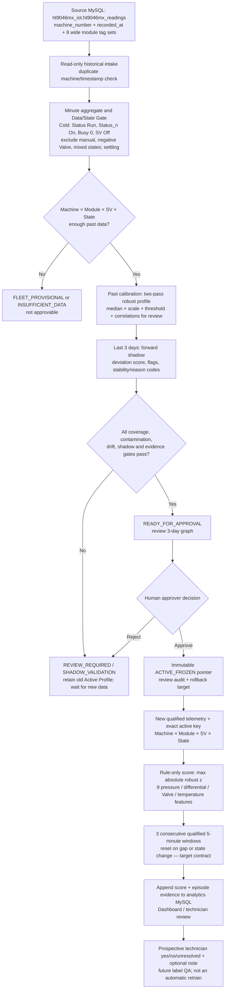

# Compressor ML and Automatic Calibration Profile — rule-only pipeline

> **2026-09-25 cadence update:** The selected candidate/scoring window is now strict observed-second → completed **one-minute** Cold (`qualified-cold-observed-1m-v1`), while Dashboard refresh stays five minutes. Auto-Calibration can create a versioned candidate and three-day shadow; runtime inference is read-only preview and cannot yet emit operational score/Health/PM alerts. The five-minute implementation gaps and parameters below are the historical decision audit, not the current target contract. Current details: `deployment/QUALIFIED_1M_CALIBRATION_CHECKPOINT.md`.

**Status:** architecture and code audit, **not** production acceptance. The current `inference.py` already computes robust z-score only, but the live data-grain, state/missing-data and profile parity gaps listed below must be closed before the Server owner enables operational scoring/alerts. This document intentionally distinguishes the code that exists from the required five-minute production contract.

## 1. One-page data pipeline

## 2. Sources, grain and storage ownership

| Stage | Actual input / output | Grain and purpose |
|---|---|---|
| Raw source | `ht9046mx_iot.ht9046mx_readings` on the Server-configured source MySQL; default columns `machine_number`, `recorded_at`, `Status`, `Hp_1st_n`, `Lp_1st_n`, `Hp_2nd_n`, `Lp_2nd_n`, `Valve_n`, `TempHi_n`, `TempLo_n`, `Status_n`, `Busy_n`, `SV_n` for n=1–8 | Wide source row, historically near one second. Source username must be read-only. The source host/clock/unit/codebook must be confirmed by the Server owner. |
| Candidate calculation | `apps/api/app/calibration.py`; historical source read through `source_connection()` | SQL groups by machine and minute, AVG of numeric tags; MIN/MAX of discrete state tags reject mixed-value minutes. This is **one-minute** candidate data, not one-second event-response fitting. |
| Analytics registry | `ht9046mx_analytics.ht9046mx_calibration_batch`, `_profile`, `_shadow_point`, `_review`, `_active_calibration_profile` | Candidate, evidence, human audit and one active pointer per machine/module/SV/state. Intended analytics host `10.195.17.73`; the workspace has not verified a Server deployment. |
| Rule-only scoring output | `ht9046mx_analytics.ht9046mx_shadow_score`, `_shadow_alert_episode`; optional `ht9046mx_iot.compressor_health_scores` and Dashboard `predictive_maintenance` diagnostic/alert tables | One row per scored sample/module/release currently; target is a qualified five-minute window. OPERATION owns Compressor alerts. |
| Technician feedback | `ht9046mx_technician_confirmation` linked to a new prospective alert episode | `EQUIPMENT_ANOMALY`, `NO_EQUIPMENT_ANOMALY` or `UNRESOLVED`, plus optional audit note. It does not change today's profile or threshold automatically. |

Configuration is supplied on the Server through the environment settings in `apps/api/app/config.py` and the non-secret template `deployment/.env.analytics.example`. MySQL account/password values belong on-host, not in Git. The application itself runs on the application host; `10.195.17.73` is the intended database host, not proof that this local workspace is connected to it.

## 3. How a candidate becomes ACTIVE_FROZEN

### 3.1 Intake and state qualification

`run_candidate_calibration()` takes the latest source timestamp \(T\). Defaults read **30 days for calibration** before a separate **3-day forward shadow**: calibration \([T-33d,T-3d)\), shadow \([T-3d,T]\). It first rejects duplicate `machine_number × recorded_at` source keys. If `HT9046MX_SOURCE_TIMEZONE` or either DB connection is missing, the job skips safely. A daily candidate cron is configured for **02:00 Asia/Bangkok**, but automatic calculation runs only if `HT9046MX_PROFILE_CANDIDATE_ENABLED=true` and the required source/analytics settings exist. Rejected/completed batches wait at least **3 days of new source time** before another ordinary run; a manual `--force` bypass exists and requires operator control.

The currently intended Cold key is `machine_number × module × SV=Off × state=COMPRESSOR_ON_COLD_SV_OFF`. The documented Data Contract requires global Compressor `Status=Run`, module `Status_n=On`, `Busy_n=0`, `SV_n=Off`, nonnegative Valve, finite numeric tags, stable discrete state throughout the minute and settling. The code counts **3 retained minute records** after a new segment by default; it does not yet prove an exact three elapsed minutes or adequate per-minute sample completeness. `SV=On`, manual `Busy=1`, MValveHome/ChangeValve, start/stop and mixed-state windows are not normal Cold baseline. Recipe, load, facility-water and verified service epochs are still missing from the input.

### 3.2 Nine local features and two-pass profile

Each eligible module-minute has nine features:

`hp1`, `lp1`, `hp2`, `lp2`, `dp1=hp1−lp1`, `dp2=hp2−lp2`, `valve`, `temphi`, `templo`.

For each feature \(j\) in the local key, the current calibration implementation computes:

\[
m_j=\operatorname{median}(x_j),\quad
s_j=\max\left(f_j,\ 1.4826\operatorname{MAD}(x_j),\ \frac{Q_{0.75}(x_j)-Q_{0.25}(x_j)}{1.349}\right),\quad
D_t=\min\left(25,\max_j\left|\frac{x_{j,t}-m_j}{s_j}\right|\right).
\]

The scale floor \(f_j\) is **0.10 in source units** for eight numeric features and **1.0 Valve command count** for Valve. This is a numerical floor, not a universal engineering alarm limit. First pass fits provisional \(m,s\), removes calibration windows with \(D_t>8.0\), then refits on retained windows. `statistics_json` stores median/scale and descriptive percentiles; a Pearson correlation matrix is stored **for review only**, not used in the score or profile approval. The local threshold is the retained-calibration \(Q_{0.995}(D)\); the 180–230 psi `Hp_2nd` band is a field reference in profile display, **not** a fault classifier or a replacement for local calibration. Below 180 is only undercharge-screening evidence; above 230 is high-side investigation, with no automatic water/leak cause.

If local coverage is insufficient, code may form a `FLEET_PROVISIONAL` profile from same-module pooled/active priors using \(w_{local}=n/(n+50)\), \(w_{fleet}=50/(n+50)\), and provisional score threshold 3.5. This is a bootstrap aid, **not approvable** into `ACTIVE_FROZEN`; the fallback's peer comparability and source evidence require review. Insufficient without a prior remains `INSUFFICIENT_DATA`.

### 3.3 Forward shadow and readiness gates

The last three calendar days are not used to fit this candidate's median, scale or threshold. Code scores those future minute rows using the candidate and saves per-minute points. It marks raw shadow flag at \(D_t\ge\theta\) and a shadow persistent flag after three **adjacent one-minute** flags. These colors/flags mean local-deviation evidence, not confirmed healthy/fault.

| Gate | Current default |
|---|---:|
| Calibration coverage | ≥7 distinct days **and** ≥200 eligible minute windows |
| Shadow coverage | ≥3 distinct days, ≥200 eligible minute windows and ≥71 hours between first/last shadow minute |
| First-pass quarantine | ≤5% of calibration windows |
| Half-period median shift | ≤1.5 local scales (largest of 9 features) |
| Shadow raw-flag rate | ≤1.0% of shadow minute windows |
| Evidence versions | nonempty state-contract, controller-codebook, service-epoch version and source IANA timezone |

High quarantine, drift, shadow flag rate or all-window quarantine yields `REVIEW_REQUIRED`; low coverage yields `CANDIDATE_PROFILE`/`INSUFFICIENT_DATA`; missing evidence versions holds at `SHADOW_VALIDATION`. Passing all gates yields `READY_FOR_APPROVAL`, **not** Active automatically. A single current active profile is not proof that its source history or future interval is healthy; approver must inspect the graph and context.

## 4. After Active Profile: selected rule-only anomaly screen

The scorer should load the exact approved key and immutable `profile_id`, median, scale and threshold. For each **complete, qualified five-minute** window, compute the same nine features and \(D_t\) as above. A raw deviation is \(D_t>\theta\) under the current runtime implementation; the `>=` used in candidate shadow is a parity mismatch to resolve before launch. Only **three consecutive qualified five-minute** flags of the same key should open an anomaly episode; any missing, stale, out-of-order or changed-state window resets/abstains. Display dominant feature, baseline and observed value, local z, threshold, profile/version, window end time and continuity. If no valid Active Profile exists, return `NO_ACTIVE_PROFILES`/`INSUFFICIENT_PROFILE`, not a green Health Score.

The current `apps/api/app/inference.py` is already **robust-z-envelope-v1** and does not load ARX, Isolation Forest or another trained detector. Its actual equation is \(\max_j |(x_j-m_j)/\max(s_j,\texttt{scale_floor},0.05)|\), rounded to 0.001, using the stored profile statistics. `compute_relative_z()` defaults to `scale_floor=0.15` when the profile JSON omits that key; calibration uses 0.10 for non-Valve features, another parity difference. It also calculates a **heuristic** 0–100 Health/Condition index from score/threshold and persistence; that number is not a calibrated probability, fault class or technician confirmation. For current score \(D\), threshold \(\theta\), persistent flag \(P\): if \(D\le\theta\), \(H=\operatorname{round}(100-35D/\theta)\); above threshold without persistence, \(H=\operatorname{round}(65-\min(20,10(D-\theta)))\); after persistence, \(H=\operatorname{round}(\max(15,45-15(D-\theta)))\). The UI classifies \(H\ge75\) as `NORMAL`, \(60\le H<75\) as `WATCH`, nonpersistent lower scores as `WARNING`, and persistent lower scores as `MAINTENANCE_REQUIRED`. These cutoffs are display heuristics, not a fitted disease model; \(\theta=0\) is not safely handled and must fail closed before use. Alerts/diagnostics are written to analytics and optionally PM/Dashboard, subject to the source-time freshness and deduplication policy. `MODEL_CANDIDATE_COMMAND` is blank in Server templates; ARX artifacts remain offline comparison only. If the application keeps a weekly model-candidate cron for experiments, it must remain disconnected from live score/alert activation.

**Important implementation reality:** current inference reads recent raw source rows on each cron call, does not form five-minute windows and counts three *rows* for persistence. It can also substitute zero for missing profile features, accept missing module-state defaults, and label unsupported/non-Cold rows `NORMAL`/Health 90. These behaviors are not the target contract and cannot be presented as a valid 15-minute alert or healthy classification. The current `source_module_on_status` default also includes `Off` even though the shipped Server template uses `On`; the gate must be reconciled to the owner-confirmed codebook. Candidate medians/scales are rounded to two decimals in stored detailed stats, whereas candidate shadow scores use unrounded fitting values. Scoring currently obtains source rows via the analytics `connection()` and cross-schema name; the dedicated source read-only connection is used for candidate building but **not** this inference query. It also hardcodes `source_timezone='Asia/Bangkok'` in stored score rows, writes `sample_count=60` without measuring the source samples, writes CP2 pressure into a PM column named `pressure_kpa` without unit conversion, and writes `ai_confidence=0.95` without a calibrated probability. These are explicit release blockers, not reasons to add ARX.

## 5. Parameters, tools and responsibilities at a glance

| Component | Current tool / method | Parameter / role |
|---|---|---|
| Source/database | MySQL via SQLAlchemy + PyMySQL; Pandas/NumPy minute processing | Read-only source connection for candidates; `recorded_at` clock and pressure units must be confirmed |
| Automation | APScheduler + cron | Candidate daily 02:00; scoring command scheduled every 5 min; weekly model-candidate command blank/unused for rule-only policy |
| Gate | discrete Status/Busy/SV, finite sensors, Valve ≥0, settling | Cold only; mixed/manual/transient excluded; 3 retained minute rows now, exact time/quality still to harden |
| Profile | median, MAD, IQR/1.349, floors, two-pass quarantine | 30 past days, ≥7 days/200 windows, quarantine \(D>8\), max quarantine 5% |
| Threshold | calibration score quantile | local 99.5th percentile, versioned with profile; not a learned fault probability |
| Candidate shadow | future-only 3-day replay | ≥3 days/200 windows/71h, max raw flags 1%, half-shift ≤1.5 scales |
| Approval | FastAPI + MySQL transaction, append-only review | `READY_FOR_APPROVAL` → human action → `ACTIVE_FROZEN`, exact rollback pointer |
| Live detector | robust z-score envelope only | 9 features, score=max abs local z, active local threshold, desired 3×5-min persistence |
| Evidence/UI | FastAPI + React Dashboard, analytics MySQL | profile graph, score/episode trend, quality state, prospective technician yes/no/unresolved/note |
| Excluded from selected live path | Cold ARX-Ridge, Isolation Forest, LSTM/TCN, peer model, cause classifier | research or later versions only; no current live vote, threshold or cause percentage |

## 5A. Why this system and these methods?

The operational question is **“does this module, in a comparable Cold state, now behave unlike its own reviewed history?”** It is not yet “which component has failed?”. Across the primary historical snapshot, the median between-machine to within-profile variability ratio was **4.64** (maximum **24.0**); a fleet-wide raw pressure limit would confuse normal unit-to-unit differences with a local change (`SOT.md`, primary snapshot 4 Aug–1 Sep 2026). Only normal-like histories are broadly available, while verified fault labels, recipe/load, facility-water and service/refill timestamps are incomplete. This supports an explainable local statistical screen and prospective technician feedback before any fault classifier. It does **not** prove that every historical calibration period was healthy. A profile is a versioned reference conditional on observed state, not a universal physical “normal” certificate.

### Why the analytical steps are ordered this way

| Step | Reason and trade-off | Evidence status |
|---|---|---|
| State/Data Gate **before** fitting | OFF/Hot/post-Cold, manual `Busy=1`, homing and transitions can swing pressure naturally. Mixing them into Cold raises spread, shifts medians and can teach the detector that abnormal operation is normal. | Owner-confirmed state semantics; controller literals, elapsed settling, recipe and data completeness still need Server validation. |
| Machine × module × SV × state profile | The historical cross-machine baseline difference is larger than within-profile variation. Conditional keys prevent one machine's offset or a module's piping/load from dominating another. | Historical data support local differentiation; missing recipe/water/service strata remain confounders. |
| Median + MAD/IQR scale | Mean and standard deviation can be pulled by spikes or contaminated tails. Median, MAD and IQR describe the central operating band more robustly; the scale floor prevents division by zero on quantized/flat sensors. [NIST's scale guidance](https://www.itl.nist.gov/div898/handbook/eda/section3/eda356.htm) supports the statistical principle, not the HT9046MX-specific floor values. | Method rationale supported; floors and contamination budget remain provisional policy. |
| Both absolute pressure and CP1/CP2 differentials | Absolute levels catch a local shift; `dp1`/`dp2` expose a change in high–low relationship even when raw channels move together. They are not proof of leak, water cause or physical flow. | Feature design; empirical added value still needs a fresh holdout. |
| Past fit → future three-day shadow → human review | A future block reveals baseline drift or alert overload without leaking its values into the candidate fit. Human review protects against the rule approving an already damaged period. [NIST's outlier guidance](https://www.itl.nist.gov/div898/handbook/eda/section3/eda35h.htm) distinguishes a flagged observation from a proven error or fault. | Implemented candidate lifecycle; live Server shadow and secure approver identity are open. |
| Persistence after per-window scoring | Several consecutive deviations are more actionable than a single noisy spike; a gap or changed state must break continuity. Because samples are time-dependent, the quantile or a three-window rule cannot be translated directly into an independent-sample false-alarm probability. [NIST on autocorrelation](https://www.itl.nist.gov/div898/handbook/eda/section3/eda35c.htm). | Three adjacent **minute** flags exist in shadow and three raw rows in runtime; three qualified five-minute windows remain a target, not a completed result. |
| Technician yes/no/unresolved feedback | The anomaly screen can nominate review intervals, while the technician determines whether an equipment anomaly was observed. Notes stay audit context, not an automatically inferred cause or training class. | API/UI contract exists; prospective label quality and Server operation are not accepted. |

### Parameter register: reason, not just value

“Current default” describes the implementation/configuration; it does **not** mean an optimized or production-approved parameter. Changing the window grain, feature units or scale requires a **new profile and threshold version**, not reusing the old threshold.

| Parameter / current value | Why it exists | What still has to be demonstrated |
|---|---|---|
| Calibration history **30 calendar days** | Includes repeated operating days rather than deriving a baseline from one short stable-looking run. | Stability by machine, coverage of actual regimes, and no unrecorded service epoch within the block. Longer is not always better if the machine changed. |
| Forward shadow **3 calendar days** | Reserves unseen later observations for a first drift/alert-burden check before approval. | A clean, complete 72-hour interval; three days are an operating gate, not a statistical confidence guarantee. |
| Minimum **3 shadow days, 200 minutes, 71 h span** | Requires the shadow evidence to cover almost the full three-day horizon; day count alone could be only fragments. | Per-minute source completeness and sufficient cycles across the span. |
| Settling **3 retained minute records** | Omits the first observations after a detected state segment to reduce start/stop transients. | Replace row count with actual elapsed time and event/codebook evidence; the present rule is not an exact 3-minute stability proof. |
| First-pass quarantine `D > 8`, at most **5%** removed | Tries to prevent a few extreme historical points from widening the candidate; a large removed fraction warns that the proposed baseline is questionable. | These are provisional review limits, not fault thresholds. A long shifted regime may evade pointwise quarantine and must trigger review rather than automatic re-baselining. |
| Local threshold `Q0.995(D)` on retained calibration | Sets a high-tail reference *within that key* without using a single fleet-wide pressure limit. | With time dependence, this is not a 0.5% guaranteed live false-alert rate. Review per-machine-day burden on a future block. |
| Shadow raw-flag rate ≤**1%** | Tolerates modest future variation yet stops candidates that immediately flag too much of the next three days. | Owner-approved alert budget, worst-machine outcomes and independent fresh shadow. It is not a validated fault-performance metric. |
| Calibration half-period median shift ≤**1.5 local scales** | Detects a baseline that moves inside the training block, which a single pooled median could conceal. | Sensitivity to load/recipe/service changes; no causal interpretation of the shift. |
| Provisional fleet blend `n/(n+50)` and threshold **3.5** | Gives sparse keys a visible reference while local observations gradually gain weight. The “50” is a shrinkage strength; 3.5 is a temporary display/screening bound. | Comparable-peer evidence and a fresh local shadow. `FLEET_PROVISIONAL` cannot become Active under current policy. |
| Retry after **3 new source days** | Prevents refitting/re-reviewing essentially the same rejected history every daily cron run. | A changed source snapshot/verified service epoch and operator review. Manual `--force` needs access control and audit. |
| Candidate cron **02:00 Asia/Bangkok daily**; score cron **every 5 min** | Separates slower profile calculation from operational refresh, and aligns score attempts with the Dashboard's five-minute update. `02:00` is a convenient scheduling default, not a measured off-peak optimum. | Source clock/timezone, job duration and missed-cycle replay; cron firing is not proof of complete five-minute features. Weekly model-candidate command stays blank on the rule-only path. |
| Target **5-minute complete window × 3 consecutive flags** | Aligns review with Dashboard cadence, limits noisy one-second fluctuations and asks for ~15 minutes of sustained evidence. | **Not implemented in the runtime.** It can miss short but serious events; PLC alarms/safety remain independent, and fresh shadow must measure delay versus alert burden. |
| `Hp_2nd` **180–230 psi** field band | Provides the owner-confirmed, qualified field context for interpretation; `<180` is one-sided undercharge screening and `>230` is a separate high-side investigation. | It is not the local score threshold, a universal safety band, a leak label or a water-cause rule. |
| Health **75/60** display boundaries and piecewise 0–100 formula | Converts relative deviation/persistence into a quick triage view for the UI. | Heuristic only: no probability calibration or fault-label validation. Suppress it when data/profile/state fail rather than display a reassuring number. |
| Alert freshness **−2 to +15 min**, daily issue suppression, acknowledged suppression up to **7 days** | Prevents historical/future-dated replays and repeated notifications from flooding the maintenance workflow while allowing severity escalation. | Source timezone and Dashboard policy parity; a suppressed alert is not proof of recovery. These are notification rules, separate from anomaly detection. |

### Why these software tools?

| Tool | Job and reason for choosing it | Boundary |
|---|---|---|
| **MySQL** | The plant already writes the wide telemetry table there; a separate analytics schema can hold versioned candidates, immutable review evidence, score history and rollback pointers without rewriting source rows. | Source account should be `SELECT`-only; DB availability and least privilege need Server tests. |
| **SQLAlchemy + PyMySQL** | Explicit source/analytics connections and transactions support a single audited Active-pointer promotion. [SQLAlchemy documents transaction boundaries](https://docs.sqlalchemy.org/en/20/core/connections.html). | Current inference still uses an analytics connection for a cross-schema source read; access separation is incomplete. |
| **Pandas + NumPy** | Group the wide source by minute/module, test stable states and compute vectorized median/quantile/deviation statistics; this is sufficient for a small, interpretable candidate algorithm without a model-serving stack. | Large history must be bounded by machine/date; memory, missing seconds and exact window completeness remain operational gates. |
| **Pydantic Settings** | Centralizes typed environment values and validates timezone strings/parameter ranges, while secrets remain on the Server. | A syntactically valid setting is not a verified controller codebook or source unit. |
| **FastAPI** | Defines the candidate/review/evidence/feedback HTTP boundary and typed responses, so each human approval and technician confirmation has an explicit contract. [FastAPI offers authentication/authorization mechanisms](https://fastapi.tiangolo.com/tutorial/security/), but the current approver ID is still unverified. | Secure approver identity and role enforcement are release blockers. |
| **Dockerfiles / Server environment template** | Package API/UI dependencies and keep deploy-time source credentials, hostnames and clock settings separate from code. | A reproducible image is not a validated production deployment; the supplied template deliberately leaves scoring and candidate jobs disabled until acceptance. |
| **pytest + versioned registry** | Contract tests check deterministic behavior and failure gates; independent profile/feature/threshold versions permit traceability and rollback. | Passing local tests is not target-Server acceptance, sensor-unit proof or diagnostic accuracy. |

## 6. Before calling this production-ready

1. Make calibration and inference consume the same completed qualified window builder, nine complete features, local profile key and precise persisted median/scale/threshold. Add source completeness, settling by elapsed time, stale/late/out-of-order and unit gates.
2. Replace inference's cross-schema analytics connection to raw telemetry with the configured read-only source connection, or prove and govern an equivalent read-only route. Ensure idempotent score writes and preserve raw/alert history.
3. Secure reviewer identity with actual authentication and authorization; review the shadow graph/rollback evidence. The present header/body approver ID alone is insufficient for production authority. Remove hardcoded source timezone, synthetic `sample_count=60` and uncalibrated `ai_confidence=0.95`; map/convert pressure units before writing any `pressure_kpa` field.
4. Review Compressor Alerts/Health advisory with the project owner and production approver after completing the release evidence.

## Evidence and code map

- System/data semantics: `README_System.md`; state and status: `SOT.md`, `Roadmap.md`.
- Source gates/profile calculation: `apps/api/app/calibration.py`; defaults: `apps/api/app/config.py`.
- Human activation: `apps/api/app/repository.py` and endpoints in `apps/api/app/main.py`.
- Current rule-only runtime: `apps/api/app/inference.py`; scheduling: `apps/api/app/worker.py`.
- Tables: `deployment/mysql_phase6_calibration_registry.sql`, `deployment/mysql_shadow_schema.sql`, `deployment/mysql_phase8_confirmation_only.sql`.
- Why ARX is not promoted: `notebooks/outputs/ht9046mx_rule_arx_matched_v1/README.md` and v2 candidate manifest. MX080 uses a four-day forensic profile and is not Active Profile parity evidence.

## QA and claim boundary (25 September 2026)

- Code/document checks: `py -3 -m pytest apps/api/tests -q` passed **31/31**; `git diff --check` passed. The non-secret Server environment template parsed with candidate/score commands disabled. These checks validate the local code/document state, **not** source-MySQL access or an operational release.
- Data evidence: the historical candidate uses past minute aggregates and a separate three-day shadow as described above. No new target-Server rows, active-profile graph, technician labels, alert-burden sample or unit/codebook proof were collected in this documentation pass.
- Acceptance: complete the seven release checks in Section 6 and the system/data/model/evidence/presentation/production/governance QA loop of `README_System.md` §21 before an operator enables Server scoring or Compressor alerts.

**Change log:** 2026-09-25 — Added source-backed design rationale, parameter status/trade-offs and software-tool responsibilities. This explains existing defaults and the owner-selected rule-only policy; it does not retune, approve or activate anything. Earlier on 2026-09-25, recorded the rule-only operating policy, exact existing algorithm/parameters and the distinction between intended five-minute contract and current raw-row implementation. No profile, threshold, live model or Server state changed.
