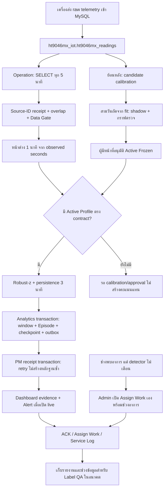

# คู่มือรัน Detector และ Dashboard บน Server

**Presentation follow-up — 1 Oct:** Sensor panels now show stored feature-specific threshold contributors during unchanged global persistence; global result remains on score chart. Startup/settling qualification is still not implemented/fitted. Review `STARTUP_SETTLING_VALIDATION_PLAN.md` and validate normal starts plus known anomalies before claiming detector specificity; this UI change does not approve a Profile or Server activation.

วันที่: 1 ตุลาคม 2026 · ชุด integration: qualified one-minute durable detector v1

เอกสารนี้สำหรับผู้ที่จะรับช่วงติดตั้ง **ภายหลัง** รอบพัฒนานี้ทดสอบบนคอมเครื่องเจ้าของโครงการเท่านั้น ไม่ได้เชื่อมต่อ ติดตั้ง หรือเปิด worker ที่ `10.195.17.73` และยังไม่ได้ push การแก้ไขรอบนี้ไป GitHub

## 1. ระบบสองส่วนทำหน้าที่อะไร

**OPERATION_P** อ่านข้อมูล Compressor จาก MySQL, สร้าง calibration candidate, ตรวจ shadow สามวัน, รับการอนุมัติ Profile และรัน detector เบื้องหลัง ส่วน **Compressor_and_VacuumPump** คือ Dashboard ที่ช่างใช้ดู Alert, รับงาน, เปิดงานเอง และบันทึก Service Log ทั้งสอง repository ต้องส่งมอบเป็น snapshot ที่เข้าคู่กัน



Server นี้ไม่ได้สั่งวาล์วหรือควบคุม Compressor และไม่ได้เรียนรู้สาเหตุจากหมายเหตุโดยทันที ผลหลักคือ **Anomaly Score และ Episode** ไม่ใช่เปอร์เซ็นต์ความน่าจะเป็นของสาเหตุหรือ Health % ที่สร้างขึ้นใหม่

## 2. ฐานข้อมูลและสิทธิ์ที่ต้องเตรียม

| Connection | Schema / table | หน้าที่ |
|---|---|---|
| Source reader | `ht9046mx_iot.ht9046mx_readings` | SELECT raw wide rows; `machine_number`, `recorded_at`, `Status`, Module 1–8 |
| Operation analytics | `ht9046mx_analytics` | Registry, exact baseline/threshold, completed windows, Episode, checkpoint, outbox |
| Operation PM bridge | `predictive_maintenance` | อ่าน identity ของ `pm_devices`, `pm_modules`; เพิ่ม derived evidence และ Alert ตาม policy |
| Dashboard metadata | `predictive_maintenance` | อ่านหลักฐาน; จัดการ users, Alerts, Work Orders และ Service Logs |
| Dashboard source readers | Source schemas ของ Compressor/Vacuum | กราฟ raw ที่ระบบเดิมมี; แยกจาก detector evidence |

`10.195.17.73` คือเป้าหมายฐานข้อมูลที่ผู้ใช้ระบุ แต่ Source host และ Web/API host อาจเป็นคนละเครื่อง ผู้ติดตั้งต้องใส่ค่าจริงของทุก connection ไม่ใช้ `localhost` ใน container เพื่อหมายถึง host MySQL โดยอัตโนมัติ

แยกบัญชีสำหรับ source SELECT, analytics runtime, PM bridge และงาน DDL migration เพื่อเห็นชัดว่าการอ่านเครื่องกับการเขียนผลเป็นคนละเส้นทาง Runtime ต้องอ่าน registry, เขียน `ht9046mx_detector_*` และ audit ได้; PM bridge ต้อง SELECT identity และ SELECT/INSERT/UPDATE ตาราง derived/Alert รวมถึง row lock ที่ใช้ใน transaction ไม่มีการเขียน raw source

รายการใหม่:

| Schema | Table suffix / name | Grain / identity |
|---|---|---|
| Analytics | `ht9046mx_detector_stream` | run_id; frozen contract, stream/scorer/Episode checkpoint, revision |
| Analytics | `ht9046mx_detector_batch` | run × batch; digest และ durable result |
| Analytics | `ht9046mx_detector_evidence` | run × machine × module × minute |
| Analytics | `ht9046mx_detector_episode` | run × Episode UUID |
| Analytics | `ht9046mx_detector_raw_evidence` | run × batch × row index; observed review seconds |
| Analytics | `ht9046mx_detector_source_receipt` | run × stable source ID + digest |
| Analytics | `ht9046mx_detector_data_issue` | append evidence ของ row แก้ไขหรือเข้าช้าหลัง finalize |
| Analytics | `ht9046mx_detector_outbox` | event hash, revision, delivered status |
| Analytics | `ht9046mx_detector_current` | machine → current scoring run; เก็บ context ที่มี Profile ตรงกัน |
| PM | `pm_detector_delivery_receipts` | event hash; กันการส่งซ้ำหลัง PM commit |
| PM | `pm_detector_windows` | run × machine × module × UTC minute; window/score/exact baseline |
| PM | `pm_detector_episodes` | run × Episode UUID; มี `pm_alert_id` ที่เชื่อม Alert จริง |
| PM | `pm_detector_data_issues` | issue/event; UTC clock สำหรับ review highlight |
| Analytics | `ht9046mx_automation_run` | audit ของ scheduler; ไม่ใช่เวลาเริ่มอาการ |

`episode_id` ไม่ใช่ `pm_alerts.id` และไม่ใช่ `pm_work_orders.id` โดย `pm_detector_episodes.pm_alert_id` เชื่อม Alert → `pm_work_orders.source_alert_id` → Service Log ที่ snapshot รายงานต้นฉบับ

## 3. เตรียมโค้ดและ environment

ส่ง source ของทั้งสองระบบพร้อม commit/snapshot identifier, requirements และ frontend package lock ของแต่ละระบบ ตรวจว่าไฟล์ใหม่ตาม `DURABLE_DETECTOR_LOCAL_QA.md` มาครบ การ clone repo เดิมที่ยังไม่มีการแก้ไขรอบนี้จะยังไม่มี worker/bridge ใหม่

ฝั่ง Operation ใช้ `deployment/.env.analytics.example` เป็นแบบกรอกค่า เก็บไฟล์ใช้งานจริงที่ `deployment/.env.analytics` เมื่อใช้ Compose ค่า password/API secret อยู่ใน environment ของ Server ไม่ต้องอยู่ในเอกสารนี้

ค่าหลักที่ผู้ติดตั้งต้องกรอก:

```dotenv
HT9046MX_APP_MODE=live
HT9046MX_ANALYTICS_DB_HOST=10.195.17.73
HT9046MX_ANALYTICS_DB_NAME=ht9046mx_analytics
HT9046MX_ANALYTICS_DB_USER=<analytics-runtime-user>
HT9046MX_ANALYTICS_DB_PASSWORD=<analytics-password>
HT9046MX_SOURCE_DB_HOST=<source-host>
HT9046MX_SOURCE_DB_NAME=ht9046mx_iot
HT9046MX_SOURCE_DB_USER=<source-select-user>
HT9046MX_SOURCE_DB_PASSWORD=<source-password>
HT9046MX_SOURCE_TABLE=ht9046mx_readings
HT9046MX_SOURCE_TIMEZONE=Asia/Bangkok
HT9046MX_SOURCE_PRESSURE_UNIT=<psig-or-psia-confirmed-by-source-owner>
HT9046MX_SOURCE_COMPRESSOR_ON_STATUS=Run
HT9046MX_SOURCE_MODULE_ON_STATUS=On
HT9046MX_SOURCE_BUSY_NORMAL_VALUES=0,False,Off
HT9046MX_SOURCE_SV_OFF_VALUES=Off,0,False
HT9046MX_DETECTOR_WORKER_ENABLED=false
HT9046MX_DETECTOR_CRON=*/5 * * * *
HT9046MX_DETECTOR_SHADOW_ONLY=true
HT9046MX_DETECTOR_MACHINES=<comma-separated-MX-codes>
HT9046MX_DETECTOR_SOURCE_ID_COLUMN=id
HT9046MX_DETECTOR_OVERLAP_MINUTES=30
HT9046MX_DETECTOR_MAX_SOURCE_ROWS=10000
HT9046MX_DETECTOR_BRIDGE_ENABLED=false
HT9046MX_DETECTOR_ALERTS_ENABLED=false
HT9046MX_DETECTOR_PM_DB_HOST=10.195.17.73
HT9046MX_DETECTOR_PM_DB_NAME=predictive_maintenance
HT9046MX_DETECTOR_PM_DB_USER=<pm-bridge-user>
HT9046MX_DETECTOR_PM_DB_PASSWORD=<pm-bridge-password>
HT9046MX_SHADOW_SCORE_COMMAND=
HT9046MX_MODEL_CANDIDATE_COMMAND=
```

`id` ต้องเป็น identity ที่ไม่ซ้ำและไม่เปลี่ยนค่าในตารางจริง หากชื่อ primary key ต่าง ให้เปลี่ยน source ID column; worker ไม่ถือว่า auto-increment ID คือ commit-order watermark ใช้ timestamp overlap + ID/digest receipt แทน

ฝั่ง Dashboard ใช้ `.env.example` ของ Dashboard: `DB_HOST/DB_NAME/DB_USER/DB_PASSWORD` ต้องชี้ PM schema เดียวกับ bridge, `APP_TIMEZONE=Asia/Bangkok`, กำหนด `APP_ENV=production`, `SECRET_KEY` แบบสุ่มถาวร และรหัสจริงสำหรับ admin/maintenance ก่อนใช้งาน `SEED_DEMO_DATA=false` ช่วยแยกข้อมูลจริงจาก demo; source reader host/accounts ต้องกรอกแยก ใช้ `TELEMETRY_POLL_INTERVAL_SECONDS=300` หากเลือก polling cadence ห้านาที ส่วน `COMPRESSOR_HEALTH_ENABLED=false` ได้ เพราะ evidence bridge ใหม่ไม่สร้าง Health % table แทน detector

Environment ของ Operation มี prefix `HT9046MX_`; Dashboard ใช้ชื่อ `DB_*` และ `COMPRESSOR_*` การคัดลอก `.env` ของระบบหนึ่งไปอีกระบบโดยตรงจะไม่เท่ากับตั้งค่าครบทั้งสองระบบ

## 4. สร้างตาราง: ทำครั้งแรก / ตรวจ migration ซ้ำ

ตัวอย่างคำสั่งด้านล่างสำหรับ Linux Server ในอนาคต หากใช้ Python นอก Docker ต้องโหลดค่า `.env` เข้า process ก่อน; `Settings` อ่าน `.env` จาก working directory ไม่ได้เลือก `apps/api/.env` ให้เองทุกคำสั่ง

ผู้ติดตั้งใช้ account สำหรับ migration ชั่วคราว สำรอง metadata ก่อนแก้ schema สำหรับ analytics ใหม่ ให้สร้าง `ht9046mx_analytics` แล้วใช้ SQL เหล่านี้ตามลำดับ:

```bash
mysql --login-path=analytics-admin --database=ht9046mx_analytics < deployment/mysql_shadow_schema.sql
mysql --login-path=analytics-admin --database=ht9046mx_analytics < deployment/mysql_phase6_calibration_registry.sql
mysql --login-path=analytics-admin --database=ht9046mx_analytics < deployment/mysql_phase8_confirmation_only.sql
mysql --login-path=analytics-admin --database=ht9046mx_analytics < deployment/mysql_detector_worker_audit.sql
```

`--login-path` คือบัญชีที่ DBA ตั้งด้วย mysql_config_editor; คำสั่งนี้ไม่ได้ฝัง password ไว้ใน command line Migration Phase 8 เดิมที่มี cause taxonomy เป็น historical design; new install ใช้ confirmation-only migration

สร้าง API image ก่อน แล้วสร้างตาราง detector/bridge โดย **ยังไม่อ่าน source, score หรือส่ง Alert**:

```bash
docker compose -f deployment/docker-compose.analytics.yml build api
docker compose -f deployment/docker-compose.analytics.yml run --rm api \
  python -m apps.api.app.qualified_detector --migrate-only --allow-remote
docker compose -f deployment/docker-compose.analytics.yml run --rm api \
  python -m apps.api.app.qualified_bridge --migrate-only --allow-remote
```

`--allow-remote` เป็น opt-in สำหรับผู้ติดตั้งบน Server เท่านั้น ไม่ได้ใช้ใน local QA รอบนี้ หลัง DDL เปลี่ยนกลับไป runtime role ตารางเก่าควรเทียบ column/index กับ snapshot นี้ เพราะ SQLAlchemy `create_all()` เพิ่ม table ที่ยังไม่มี แต่ไม่แปลงโครงสร้าง table เก่าทุกชนิดให้เอง

Dashboard ติดตั้ง dependencies และ build frontend ของตัวเอง:

```bash
python -m venv .venv
source .venv/bin/activate
pip install -r requirements.txt
npm ci
npm run frontend:build
python -m uvicorn app.main:app --host 127.0.0.1 --port 5001
```

Startup ของ Dashboard ใช้ metadata migrations เดิมและเพิ่ม `pm_diagnostic_snapshots.source_recorded_at DATETIME(6)`/index สำหรับ Fleet Trend พร้อม occurrence-time/report snapshot ที่มีอยู่ จึงต้องจัด account/migration step ให้เหมาะกับวิธีรันจริง `source_recorded_at` เก่าเป็น NULL ไม่ย้อนสร้างเวลา source จากเวลา insert

Frontend QA page `/tests/evidence-qa.html` อยู่ใน Vite development tests และไม่ใช่ production build entry ไฟล์ fixture QA ไม่จำเป็นสำหรับติดตั้งจริง

## 5. Calibration จนได้ Active Profile

เปิด `HT9046MX_PROFILE_CANDIDATE_ENABLED=true`, ใช้ `HT9046MX_PROFILE_WINDOW_CONTRACT=qualified_observed_1m` และกรอก state-contract/controller-codebook/service-epoch versions ที่ผ่านการทบทวนจริง ค่าเริ่มต้น history 30 วัน + shadow 3 วัน, fit อย่างน้อย 7 วัน/200 windows, shadow อย่างน้อย 200 qualified windows

Auto-calibration คำนวณ candidate จากส่วน fit เท่านั้น แล้วนำช่วง **ถัดจาก fit** มาตรวจ shadow ไม่ใช้ข้อมูลอนาคตไปปรับ median, scale หรือ threshold ย้อนหลัง สามวัน shadow เป็นช่วงแยกที่มี observed source coverage ตรวจได้ ไม่ใช่แค่เลือกสาม calendar labels

เปิด Operation API/web เพื่อดู source coverage, quarantine, distribution shift, shadow flag rate, กราฟสามวันและ reason codes หากเป็น `INSUFFICIENT_DATA` ให้สะสมข้อมูล; ถ้า `REVIEW_REQUIRED` ให้ตรวจ quality/regime/อาการก่อนเริ่ม candidate รอบใหม่ ไม่ใช้ค่าที่ผิดปกติเป็น baseline ปกติโดยอัตโนมัติ เมื่อผู้มีหน้าที่ตรวจกราฟและอนุมัติ จะได้ `ACTIVE_FROZEN`

Loader ใหม่รับเฉพาะ feature `qualified-cold-observed-1m-v1`, exact nine-feature baseline, threshold method/version ตรงกัน, review และ reason codes ผ่าน, units/timezone ตรง, evidence fit/shadow ผ่าน minimum และประมาณ 72 ชั่วโมง/≥95% observed shadow coverage Old minute-snapshot/5m Profile หรือ MX777 mock ไม่ได้ถูกแปลงเป็น Active 1m อัตโนมัติ

## 6. เปิด persistent shadow ก่อน live

เมื่อตาราง/connection พร้อม ตั้ง worker enabled=true, bridge enabled=true, แต่คง shadow_only=true และ alerts_enabled=false จากนั้นรันหนึ่งรอบก่อนเปิด scheduler:

```bash
docker compose -f deployment/docker-compose.analytics.yml run --rm api \
  python -m apps.api.app.qualified_detector --allow-remote
docker compose -f deployment/docker-compose.analytics.yml run --rm api \
  python -m apps.api.app.qualified_bridge --allow-remote
```

ตรวจว่าเครื่องที่มี Profile ตรงกันได้ windows/score/Episode และเครื่องที่ยังไม่มีได้ `NO_MATCHING_ACTIVE_PROFILE` ไม่สร้างคะแนนหรือสีปกติแทน ตรวจจำนวน source-second, minute coverage, alias/module, source timezone, backlog/outbox และ actual report API

การ polling ทำทุกห้านาที แต่คำนวณ windows รายหนึ่งนาที ใช้ 30s grace ก่อน finalize; จึงตรวจ persistence จากสามนาทีต่อเนื่องได้เมื่อ batch นั้นส่งถึง worker ไม่ใช่ realtime หนึ่งวินาทีบนจอ เวลาเริ่ม deviation, เวลาที่ worker ตรวจได้ และเวลาสร้าง Alert เป็นคนละค่า

## 7. เปิด live เมื่อทดสอบบน Server ผ่าน

เปลี่ยน `HT9046MX_DETECTOR_SHADOW_ONLY=false`, `HT9046MX_DETECTOR_ALERTS_ENABLED=true` ตามการอนุมัติ rollout แล้วเปิด/recreate scheduler/API/web ด้วย snapshot เดียวกัน:

```bash
docker compose -f deployment/docker-compose.analytics.yml up -d --build api web scheduler
docker compose -f deployment/docker-compose.analytics.yml logs --tail=100 scheduler
```

เริ่มได้ครั้งละเครื่องหรือโมดูลที่มี Profile ตรงกัน `DETECTOR_MACHINES` ระบุ machine allowlist; module ที่ไม่มี matching profile ยังไม่ถูก scored โดย worker ที่ configured นี้

Primary: \(z_j=(x_j-m_j)/s_j\), \(A=\max_j|z_j|\); threshold คือ retained-fit q99.5%, persistence 3 adjacent qualified minutes ไม่มีการ train ARX/LSTM/IF ใหม่ในเส้นนี้ EWMA/CUSUM เป็น shadow evidence ไม่ได้เพิ่ม live votes

Episode recovery ใช้ห้านาที qualified ที่ไม่ flag; missing/manual/non-Cold เป็น UNKNOWN ไม่ใช่ recovery ส่วน Alert เป็น notification ที่อาจถูก suppression แม้ Episode ยังเก็บหลักฐาน Severity warning/critical ใช้ peak score/threshold ratio, critical default ≥2 เป็น routing policy ตั้งต้น **ไม่ใช่ probability และยังต้องประเมิน alarm burden หน้างาน**

Bridge ส่ง Alert เฉพาะ live, Episode เปิด/กำลัง recovery, last-deviation สดตาม policy 900s และ run ยังเป็น current context หากเป็น shadow/history/profile superseded จะเก็บหลักฐานโดยไม่สร้าง notification ใช้ daily severity limit และ seven-day ACK suppression ของ Dashboard; severity escalation สามารถผ่าน suppression ได้ ไม่มีการลบ Alert เก่าโดย bridge

## 8. ช่างใช้ Dashboard อย่างไร

1. เปิด Alerts → กราฟหลักฐาน: pressure, differential, temperature, valve, score ratio
2. เทียบเส้นประ baseline กับค่าที่วัดจริง; แดง=persistent detector flag, ฟ้า=ช่วงที่รายงาน, เหลือง=data issue; เส้นขาด=unqualified/missing ไม่ interpolate
3. ACK ตาม workflow เดิม; critical ACK สร้าง Assigned Work ส่วน warning ACK ไม่สร้าง work ให้อัตโนมัติทุกครั้ง
4. ช่างรับงานและกรอก Service Log; `DONE` คือจบงาน ไม่ได้ยืนยัน detector recovery หรือสาเหตุ
5. ถ้าช่างพบอาการแต่ไม่มี Alert: Admin → Assign Work ระบุเครื่อง/โมดูล, Description, วันที่–เวลาเริ่ม/จบ และ EXACT/APPROXIMATE/UNKNOWN
6. เปิดกราฟจาก Work Order หรือ Service Log ได้ แม้ไม่มี detector Episode ให้เลือกเวลาเอง; ถ้าไม่มีหลักฐานระบบจะแสดงเหตุผล ไม่สร้างกราฟสมมติ

Service Log เก็บ original report snapshot การแก้ใบงานภายหลังไม่เปลี่ยนเรื่องที่บันทึกไว้ย้อนหลัง ข้อมูลสำหรับ supervised ยังต้องผ่าน Label QA และ episode-grouped/time-separated split; ข้อความอิสระไม่ทำให้เพิ่ม cause % หรือเปลี่ยนโมเดลทันที

## 9. Restart / retry / catch-up / storage

- Checkpoint, accepted rows, receipts, score, Episode และ outbox commit ใน analytics transaction เดียวกัน Crash ก่อน commit rollback ทั้งชุด
- PM transaction commit ก่อน outbox ACK; crash ระหว่างสองฐาน retry ใช้ receipt เดิม ไม่สร้าง Alert/หลักฐานซ้ำ
- Source ใช้ timestamp overlap 30 นาที + source-ID digest พบ late low-ID ได้ภายในช่วง scan; rows ที่มาหลัง minute finalize หรือถูกแก้จะเป็น DATA_ISSUE ไม่แก้คะแนน frozen เงียบ ๆ
- ข้อมูลที่ late เกิน overlap ยังไม่มี completeness guarantee ถ้าจะรองรับ arbitrary late commit ต้องเพิ่ม CDC/ingestion timestamp หรือ reconciliation ที่ตกลงกับ source owner
- หลัง downtime worker เดินจาก checkpoint ครั้งละห้านาทีและทำได้สูงสุด 12 catch-up slices ต่อ invocation ไม่กระโดดข้ามไปเวลาปัจจุบัน หาก backlog ยังเหลือจะทำต่อ tick ถัดไป
- Slice เกิน 10,000 rows ต่อเครื่องจะหยุดด้วย SOURCE_SLICE_OVERFLOW โดยไม่ขยับ checkpoint; ปรับ budget หลังวัด source load
- Raw-second evidence เก็บใน analytics อาจโตเร็ว Hot retention 30 วันเป็น inventory policy ตั้งต้น ยังไม่เปิด purge; ต้องรวม reported intervals ของ manual work และสำรอง/export Episode ก่อนกำหนดลบจริง

Export Episode พร้อม run contract/versions และ raw chunks ≤6h ได้ด้วย:

```bash
python -m apps.api.app.qualified_archive --run <run-id> --episode <episode-uuid> \
  --output /srv/ht9046mx-evidence --allow-remote
```

manifest มีจำนวนแถว/SHA-256 และ `coverage_verified=false` ตามข้อจำกัดของ observed archive ตรวจด้วย `verify_export()` ก่อนเก็บระยะยาว; inventory command ที่ไม่ใส่ `--episode` ไม่มีการลบข้อมูล

## 10. ตรวจรับจริงและย้อนกลับ

- ตรวจ source cadence/ID/duplicates/clock และ timezone ของ MySQL session/APP/source เทียบเวลาบนเครื่อง
- ตรวจ DDL ซ้ำ, backup/restore, connection loss, process restart, outbox retry และไม่มี duplicate notification
- ตรวจเครื่องใหม่ไม่มี Profile, โมดูลไม่มี Profile, legacy Profile, fit-end gate, approved Profile ใหม่และการเปลี่ยน Profile
- ตรวจกราฟ/source rows/รายงานเวลา/role permissions ผ่าน browser จริง: Admin สร้างงาน, ช่างบันทึกงาน, คนไม่มีสิทธิ์แก้รายงานไม่ได้
- ตรวจ source freshness และ Health overview เดิมแยกจาก Anomaly evidence ใหม่; ยังไม่ได้สร้างการแปลง Anomaly Score เป็น Health % หรือเปลี่ยน Health model อัตโนมัติ
- วัด load ทุกเครื่องพร้อมกันและ chart history ยาวบน Server; local 75-minute benchmark ไม่แทน production fleet acceptance
- Operation approval API ใช้ identity headers ในระบบเดิม จึงจัด reverse proxy/auth/access control ให้รับ identity จากผู้ใช้ที่ login จริง โดยไม่เปิด header-based approval endpoint สู่ public โดยตรง

หากผล live ไม่เหมาะ ให้กลับ shadow_only=true และ alerts_enabled=false หรือหยุด scheduler เฉพาะ detector; เก็บ registry/outbox/history ไว้และตรวจ candidate ใหม่ ไม่ล้าง source/DB เพื่อแก้ปัญหา ข้อมูลที่เคยส่ง Alert แล้วควรเก็บไว้ในประวัติ

## 11. สถานะที่ยังต้องทำภายหลัง

Local code/transport/replay/visual QA เสร็จตามรายงาน `DURABLE_DETECTOR_LOCAL_QA.md` แต่ **ไม่ใช่คำยืนยันว่า launch Server ผ่านแล้ว** ยังมี actual matching Active Profile qualification, fleet/regime specificity, login-to-work browser UAT, Server clock/persistence/reconnect/latency, notification budget และ automated retention ที่รวม manual reports ทั้งหมด

MX080/M6 candidate ใน QA นี้มีสี่วัน จึงไม่ใช่ Profile ที่ใช้อนุมัติ rollout หลักฐานนี้แสดง parity และตรวจเห็น deviation ไม่ได้พิสูจน์ fault diagnosis หรือ false-positive rate ทุกเครื่อง
