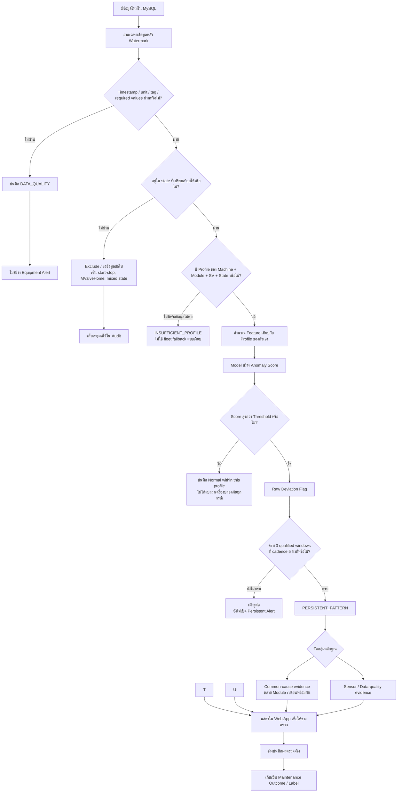
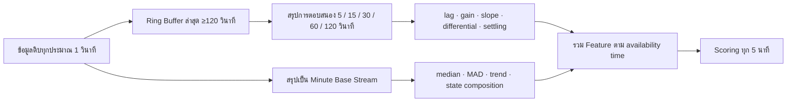
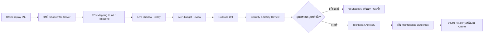

# HONTECH HT9046-MX — System Deployment Flow

> **Current release flow, 2026-09-25:** raw observed seconds → strict qualified completed 1-minute Cold windows → past-only local candidate → future 3-day shadow → human approval/rollback → exact-version read-only score preview. Durable 1m live scoring/Health/PM alerts and target-Server acceptance are still open. Dashboard refresh remains five minutes. Earlier five-minute flow statements below are historical. See `deployment/QUALIFIED_1M_CALIBRATION_CHECKPOINT.md`.

**Updated:** 2026-09-25, Asia/Bangkok
**Current scorer decision:** Active-Profile robust-z rule plus persistence only. Any ARX/Isolation Forest/peer scoring in this older conceptual flow is superseded for the selected launch path; see `deployment/RULE_ONLY_ACTIVE_PROFILE_PIPELINE.md` for implementation-faithful current versus target grain and blockers.
**Audience:** ผู้ใช้งานที่ไม่มีพื้นฐานด้าน Data/ML, ช่าง, Server owner และผู้อนุมัติระบบ
**Current status:** แบบระบบสำหรับ `Shadow screening`; offline replay ผ่านแล้ว แต่ยังไม่ได้อนุมัติให้เป็น Production diagnosis หรือควบคุมเครื่อง

## 1. ระบบนี้นำไป Deploy เพื่ออะไร

ระบบที่นำไปติดตั้งบน Server มีหน้าที่อ่านข้อมูลการทำงานของ Compressor จาก MySQL แล้วช่วยตอบคำถามต่อไปนี้:

1. ข้อมูลรอบนี้ครบและน่าเชื่อถือพอให้วิเคราะห์หรือไม่
2. Machine และ Module กำลังอยู่ในสภาวะที่เทียบกับอดีตได้หรือไม่
3. Pressure, valve, temperature และความสัมพันธ์ตามเวลาเบี่ยงจาก profile ของตัวเองหรือไม่
4. ความเบี่ยงเบนเกิดเพียงชั่วครู่หรือเกิดต่อเนื่องหลายช่วง
5. ควรให้ช่างตรวจ Module ใด และควรเริ่มตรวจหลักฐานกลุ่มใดก่อน

ระบบนี้เป็น **ผู้ช่วยคัดกรองและจัดลำดับงานตรวจ** ไม่ใช่ PLC, safety interlock หรือระบบสั่งเครื่อง จึงไม่มีเส้นทางเขียนคำสั่งกลับไปยัง HT9046-MX

## 2. Flowchart ภาพรวมระบบบน Server

```mermaid
flowchart LR
    subgraph M["เครื่องจักรและข้อมูลต้นทาง"]
        A["HT9046-MX<br/>8 Compressor Modules"] --> B["Controller / Data logger"]
        B --> C[("MySQL Raw Telemetry<br/>ข้อมูลต้นฉบับ")]
    end

    subgraph S["Analytics Server — ทำงานแบบ Shadow"]
        D["1. Ingestion Worker<br/>อ่านข้อมูลใหม่แบบ Read-only"]
        E{"2. Data Contract ผ่านหรือไม่?<br/>เวลา · หน่วย · tag · ลำดับข้อมูล"}
        F["DATA_QUALITY<br/>กักข้อมูลและบันทึกเหตุผล"]
        G["3. State Gate<br/>แยก Module / SV / operating state"]
        I["4B. Minute Base Stream<br/>ข้อมูลหลักสำหรับ trend ระยะยาว"]
        J["5. Feature Engine<br/>relative · slope · differential · lag"]
        K["6. Version & Checksum Guard<br/>ตรวจ feature/profile/model/threshold"]
        L["7. ARX-Ridge Shadow Scorer<br/>คำนวณระดับความเบี่ยงเบน"]
        N["8. Threshold + Persistence<br/>3 qualified windows × 5 นาที"]
        O["9. Evidence Builder<br/>จัดหลักฐานและข้ออธิบายอื่น"]
        P[("Analytics MySQL<br/>append-only scores / alerts / audit")]

        D --> E
        E -- "ไม่ผ่าน" --> F --> P
        E -- "ผ่าน" --> G
        G --> H --> J
        G --> I --> J
        J --> K --> L --> N --> O --> P
    end

    C --> D
    R["Locked Release Registry<br/>manifest · model · profile · threshold"] --> K
    Q["Checkpoint / Watermark<br/>จำจุดที่อ่านและ persistence state"] --> D
    N --> Q

    subgraph U["การใช้งานและการยืนยันโดยคน"]
        T["Read-only API"] --> W["Web App<br/>ภาพรวม · กราฟ · หลักฐาน · ข้อจำกัด"]
        W --> X["Technician Review<br/>ตรวจเครื่องจริง"]
        X --> Y["Maintenance Outcome<br/>สาเหตุจริง · งานซ่อม · ปริมาณน้ำยา"]
    end

    P --> T
    Y --> P

    Z["Monitoring & Audit<br/>worker · database · latency · drift · version"] -. "เฝ้าดูทุกส่วน" .-> D
    Z -.-> K
    Z -.-> P

    NC["ไม่มีเส้นทางเขียนคำสั่งกลับ PLC<br/>Analytics ล้ม เครื่องยังควบคุมและ Safety ได้ตามเดิม"]
    S -. "ขอบเขตความปลอดภัย" .-> NC
```



### วิธีอ่านภาพนี้แบบง่ายที่สุด

- ตรงกลางคือ Server ที่ตรวจคุณภาพ แยกสภาวะ คำนวณ feature และหา deviation
- ด้านขวาคือ Web App และคนที่รับผิดชอบตัดสินใจ
- เส้นทางข้อมูลเดินจากเครื่องไปหาคน แต่ไม่มีเส้นทางจาก ML กลับไปสั่ง PLC
- หากข้อมูลเสีย ระบบต้องหยุดที่ `DATA_QUALITY` ไม่เปลี่ยนให้เป็น alarm ของเครื่อง

### 2.1 แกนของระบบ: Local calibration ก่อน Fleet ML

ระบบเป้าหมายไม่ได้ใช้โมเดลก้อนเดียวอ่าน pressure ดิบของทุกเครื่อง แต่ต้องสร้าง local reference ก่อน แล้วให้ Fleet model เรียนรู้ “รูปแบบความเบี่ยงเบนแบบสัมพัทธ์” จากหลายเครื่อง

```mermaid
flowchart LR
    A["ข้อมูลย้อนหลังที่ผ่าน Data / State Gate"] --> B["Auto-calibration / Auto-bootstrap"]
    B --> C["Local Profile<br/>Machine + Module + SV + State + Service epoch"]
    C --> D["เส้นปกติและความสัมพันธ์<br/>median · MAD · percentile · slope · correlation · lag"]
    D --> E["Relative / Residual Features<br/>เทียบปัจจุบันกับ Profile ของตัวเอง"]

    F["Qualified development data<br/>จากหลายเครื่อง"] --> G["Fleet Model Training<br/>เรียนรู้ pattern ร่วมของความเบี่ยงเบน"]
    E --> G
    G --> H["Anomaly Score"]
    H --> I["Persistence + Evidence Fusion"]
    I --> J["Provisional Condition / Health View"]
    J --> K["Technician Review"]
    K --> L["Confirmed Maintenance Labels"]
    L -. "เมื่อ labels เพียงพอ" .-> M["Probable-cause Classification<br/>โมเดลในอนาคต"]
    M -.-> J
```



สถานะปัจจุบันของแต่ละชั้น:

| Layer | สถานะปัจจุบัน | ความหมาย |
|---|---|---|
| Auto-calibration / Auto-bootstrap | มี Offline implementation | ประเมิน 262 candidate profiles; ยังไม่มี `ACTIVE_FROZEN` |
| Local correlation/baseline | มีผลวิเคราะห์และ profile artifacts | แยก Machine–Module–SV บนข้อมูลที่ผ่าน qualification; recipe/mode/service epoch ยังไม่ครบ |
| Fleet model | มี Offline trained model | ARX-Ridge เรียนจาก relative/regime features ของ development machines |
| Anomaly + persistence | มี Offline deterministic replay | ใช้คัดกรอง deviation; ไม่ใช่ fault probability |
| Health view | ยังต้องออกแบบและ calibrate บน Server | ก่อนมี labels เรียกได้เพียง provisional condition index และต้องแสดง confidence/gates |
| Cause classification | ยังไม่พร้อม | ต้องมี technician-confirmed labels และ Phase 8 label QA ก่อน |


## 3. Flowchart การตัดสินใจต่อหนึ่งรอบข้อมูล



### จุดที่มักเข้าใจผิด

- `Anomaly score` คือระดับความต่างจากพฤติกรรมอ้างอิง ไม่ใช่เปอร์เซ็นต์ว่าเครื่องเสีย
- `Normal within this profile` หมายถึงไม่พบความเบี่ยงตามสิ่งที่ระบบตรวจได้ ไม่ใช่คำรับรองว่าเครื่องปลอดภัยทุกกรณี
- `Hp_2nd < 180 psi` เป็นหลักฐานคัดกรอง undercharge/leak เพียงส่วนหนึ่ง ไม่ใช่ผลยืนยัน leak
- `CONFIRMED_FAULT` เกิดได้เมื่อมี technician/service evidence เท่านั้น




เหตุผลที่ต้องมีสองความละเอียด:

- ข้อมูลหนึ่งวินาทีเห็นการตอบสนองหลัง valve/state เปลี่ยน เช่น ตอบช้า แกว่ง หรือ pressure เปลี่ยนผิดรูป
- ข้อมูลหนึ่งนาทีเหมาะกับ baseline และ trend ระยะยาว ใช้พื้นที่น้อยและดูแลบน Server ง่ายกว่า
- เมื่อสรุปข้อมูลเป็นหนึ่งนาทีไปแล้ว จะย้อนสร้างรูปคลื่นหนึ่งวินาทีที่หายไปไม่ได้ ดังนั้น Server ต้องคำนวณ response feature ขณะที่ข้อมูลหนึ่งวินาทียังอยู่ใน ring buffer

## 5. ส่วนประกอบที่จะอยู่บน Server

### 5.1 Ingestion Worker — ตัวอ่านข้อมูล


สิทธิ์ที่แนะนำ:

- อ่าน source telemetry เท่านั้น
- ไม่มี network/API path ไปเขียน PLC หรือ safety command
- เขียนได้เฉพาะ analytics schema และ audit ที่กำหนด

### 5.2 Canonical Mapper และ Data-quality Gate

ชื่อคอลัมน์จากฐานข้อมูลจริงต้องถูกแปลงเป็นรูปแบบกลาง:

```text
machine_number, timestamp, global_status,
module, module_status, sv, busy,
hp1, lp1, hp2, lp2, valve, temphi, templo
```

ชั้นนี้ตรวจ timestamp ซ้ำ/ย้อนเวลา, missing values, stale data, pressure unit, timezone และ tag ที่ขาด หากไม่ผ่านจะสร้างสถานะ `DATA_QUALITY` แทนการกล่าวว่าเครื่องผิดปกติ

### 5.3 State Gate — เลือกช่วงที่เปรียบเทียบได้


- Start-up, shutdown และ pressure equalization
- `MValveHome`, negative valve command และ pump-down
- `ChangeValve` หรือ state เปลี่ยนกลาง window
- Emergency Down หรือ state ที่ codebook ยังไม่ยืนยัน
- SV เปลี่ยนกลาง window

`Busy_n` จะถูกเก็บเป็น controller flag แต่ไม่ใช้ยืนยันว่า motor กำลังหมุนเพียงตัวเดียว

### 5.4 Feature Engine — เปลี่ยนข้อมูลดิบเป็นหลักฐานที่เปรียบเทียบได้

ตัวอย่าง feature:

- robust z-score: ค่าสูง/ต่ำกว่าค่ากลางประจำ profile มากเพียงใด
- rolling slope: ค่าแรงดันหรืออุณหภูมิกำลังสูง/ลดเร็วเพียงใด
- pressure differential: เช่น `Hp_2nd - Lp_2nd`
- lag response: valve เปลี่ยนแล้ว pressure ตอบสนองช้าหรือเร็วเพียงใด
- low-side deficit: `max(0, 180-Hp_2nd)/10`
- high-side local deviation: วัดการสูงกว่าพฤติกรรมท้องถิ่นและแยกจาก low-side feature
- peer evidence: เปรียบเทียบกับ peer ที่มี module role, qualified state, SV และ control/valve context ที่เทียบได้

ทุก feature ต้องระบุ formula, unit, availability time และ version


### 5.5 Profile Registry — ค่าปกติที่แยกตามบริบท


```text
Machine + Module + SV + qualified operating state + service epoch
```


### 5.6 Release Guard — ป้องกันใช้ของคนละรุ่นร่วมกัน

ก่อนเริ่ม scoring ระบบต้องตรวจว่า feature order, feature version, profile version, model version, threshold version และ checksum ตรงกับ release manifest หากไม่ตรงต้องปฏิเสธการเริ่มงานและสร้าง audit event

รุ่นเริ่มต้นสำหรับ server integration ปัจจุบัน:

```text
release       phase07-shadow-replay-v2-hp180
model         ARX-Ridge__seed_13
threshold     7.650715626730769
cadence       5 minutes
persistence   3 consecutive qualified windows
capability    anomaly screening only
activation    SHADOW_ONLY_NOT_AUTHORIZED
```

### 5.7 Scoring และ Persistence

Model เปรียบเทียบ feature ปัจจุบันกับรูปแบบที่เรียนจาก development data แล้วสร้าง score จากนั้น persistence layer จะเปิด alert เมื่อความเบี่ยงเบนผ่านเงื่อนไขต่อเนื่อง เพื่อลดการเตือนจาก transient จุดเดียว


Evidence fusion ต้องคง source ของหลักฐานไว้จนถึงการแสดงผล: score ของ release ปัจจุบันเป็น anomaly screening เท่านั้น ส่วน `Self / Dynamic / Peer / Temporal` เป็น explanation categories สำหรับ screening, profile quarantine และ technician review ไม่ใช่ cause probability หรือคำวินิจฉัยอัตโนมัติ.

### 5.8 Evidence Builder — อธิบายว่าทำไมจึงเตือน

Alert ที่ส่งให้ Web App ต้องมี:

- Machine, Module, SV และ state
- เวลาเริ่มผิดปกติ เวลาที่ตรวจพบ และระยะเวลาที่ค้าง
- ค่า feature ที่เด่น พร้อม baseline และหน่วย
- Self, Dynamic, Peer และ Temporal evidence ที่ผ่าน gate พร้อม low-side/high-side หรือ sensor/data-quality evidence ที่เกี่ยวข้อง
- คำอธิบายอื่นที่ยังเป็นไปได้
- model/profile/feature/threshold/release version
- ข้อความว่าเป็น screening/advisory ไม่ใช่ confirmed diagnosis


### 5.9 Analytics Database — เก็บผลโดยไม่แก้ย้อนหลัง

Schema ที่เตรียมไว้มีสี่ตารางหลัก:

1. `ht9046mx_shadow_score` — score และสถานะของแต่ละ Machine/Module/เวลา
2. `ht9046mx_shadow_alert_episode` — เหตุการณ์ผิดปกติที่ผ่าน persistence
3. `ht9046mx_shadow_audit_event` — error, version mismatch, restart และเหตุการณ์ระบบ
4. `ht9046mx_maintenance_outcome` — ผลตรวจจริงจากช่างและหลักฐาน service

การเขียนเป็น `append-only` หมายถึงเพิ่มประวัติใหม่ ไม่เขียนทับอดีต และใช้ unique key ป้องกัน alert ซ้ำเมื่อระบบประมวลผลรอบเดิมอีกครั้ง

### 5.10 Read-only API และ Web App

API อ่านผลจาก analytics tables แล้วส่งให้หน้า Web App โดยหน้าแรกควรเรียงลำดับดังนี้:

1. Data quality และสถานะ worker
2. Machine/Module ที่มี persistent pattern
3. หลักฐานเทียบกับ local profile
4. Timeline pressure/valve/temperature และตำแหน่ง alert
5. Alternative explanations และสิ่งที่ช่างควรตรวจ
6. Version และข้อจำกัดของผล


### 5.11 Technician Feedback — เปลี่ยนการคาดเดาเป็นหลักฐานจริง

เมื่อช่างตรวจ alert ใหม่ ให้ยืนยันเพียง `EQUIPMENT_ANOMALY`, `NO_EQUIPMENT_ANOMALY` หรือ `UNRESOLVED` พร้อม technician ID และ optional audit note. ไม่มีช่อง cause, action หรือ refrigerant information ใน current feedback flow.

API รับเฉพาะ alert ที่เกิดหลัง Server-configured prospective-feedback start time และผูก record กับ alert/evidence ที่มีอยู่ก่อนเวลาตัดสินใจ. เนื่องจาก alert `detected_at` เป็น `DATETIME(6)`, Server ต้องตั้ง IANA timezone ที่ยืนยันแล้วก่อน มิฉะนั้น API จะ reject การบันทึกแบบ fail closed. หลัง Label QA เฉพาะ yes/no จึงใช้วัด precision/recall และสร้าง supervised binary anomaly model ในอนาคต; `UNRESOLVED` และ note ไม่เป็น target.

### Auto-bootstrap calibration loop

```text
Read-only historical MySQL (30 days)
        ↓ data/state/service gates
Candidate profile per machine/module/SV/state
        ↓ future-only shadow (latest 3 days)
Green below candidate threshold / Red above threshold graph
        ↓
Human Approve once → transactional ACTIVE_FROZEN + rollback pointer
or Reject → keep current active profile → wait for new source days → next candidate
```


## 6. ตัวอย่างหนึ่งวันทำงานของระบบ

สมมติ `MX017 / Module 6` มีข้อมูลเข้ามาทุกวินาที:

1. Ingestion อ่านเฉพาะข้อมูลที่ยังไม่เคยประมวลผล
2. Data Gate พบว่า timestamp, unit และ tag ครบ
3. State Gate ยืนยันว่าอยู่ใน state ที่เทียบได้และ `SV` ไม่เปลี่ยนกลาง window
4. Ring buffer สรุป response 30/120 วินาที ส่วน minute stream สรุป trend
5. Feature Engine เทียบกับ profile ของ `MX017 / Module 6 / SV / state` เดียวกัน
6. หาก `Hp_2nd` ต่ำกว่า 180 ต่อเนื่องร่วมกับ pressure differential, valve demand และ slope ที่ผิดรูป Model อาจให้ score สูง
7. หาก score สูงเพียงครั้งเดียว ระบบบันทึก raw deviation แต่ยังไม่เปิด persistent alert
8. หากผ่านสาม qualified scoring windows ระบบเปิด `PERSISTENT_PATTERN`
9. Web App แสดง `PERSISTENT_DEVIATION — maintenance review required` พร้อม evidence ที่ผ่าน gate และ alternative explanations; ยังไม่ระบุ leak หรือ probable cause
10. ช่างตรวจตามขั้นตอนโรงงาน แล้วบันทึกเพียงว่าพบความผิดปกติของเครื่องจริง, ไม่พบ, หรือยังยืนยันไม่ได้
11. ระบบเก็บ outcome เป็นหลักฐานสำหรับ QA และการฝึก model รุ่นถัดไป แต่ไม่ retrain หรือ activate เองทันที


| เหตุการณ์ | พฤติกรรมที่บังคับใช้ |
|---|---|
| ข้อมูลหาย เก่า หรือมาผิดลำดับ | สร้าง `DATA_QUALITY`; ไม่สร้าง equipment alert |
| ไม่พบ profile ที่รองรับ | สร้าง `INSUFFICIENT_PROFILE`; ไม่แอบใช้ fleet average |
| Feature order/version ไม่ตรง | ปฏิเสธ batch และบันทึก audit |
| Model checksum ไม่ตรง | ไม่โหลด model |
| MySQL analytics ใช้งานไม่ได้ | queue/retry แบบ idempotent; ไม่แตะเครื่อง |
| Worker restart | โหลด checkpoint และให้ผลเหมือน one-shot replay |
| Release ใหม่มีปัญหา | ต้องย้อนกลับไป exact frozen version; ปัจจุบันส่วนนี้ยังเป็น blocker |
| Web App ล่ม | Scoring/audit อาจทำงานต่อได้ แต่เครื่องและ safety control ไม่ได้รับผลกระทบ |

## 8. สิ่งที่พร้อมแล้วและสิ่งที่ยังต้องทำ

### พร้อมในระดับ Offline / Integration package

- Release manifest รุ่น hp180, portable model และ checksum
- Offline deterministic replay และ checkpoint/restart parity
- Feature/version/order validation และ failure-mode tests 12 รายการ
- MySQL append-only schema
- MX-080 Module 6 acceptance fixture สำหรับตรวจ parity
- Notebook QA 27/27 แบบมี caveat

### ต้องทำบน Server ก่อนเปิด Technician Advisory

- map source table/columns เข้ากับ canonical contract และลงชื่อรับรอง
- ยืนยัน timezone และ pressure unit จาก historian/controller
- สร้าง ingestion, ring buffer, feature worker, scoring worker, API และ Web App จริง
- ทดสอบ late arrival, duplicate, backfill, restart และ MySQL disconnect บนเครื่องเป้าหมาย
- วัด latency, CPU, RAM, storage และ retention
- ตกลง alert budget ต่อเครื่อง/วัน โดยตรวจ MX058 และ MX082 แยก
- สร้าง immutable registry และ exact rollback target
- ทดสอบสิทธิ์ว่า analytics ไม่สามารถเขียน PLC/raw telemetry
- ให้ server owner, data/ML reviewer, technician และ production approver ลงนามตามหน้าที่


- Automatic leak diagnosis
- Auto-bootstrap activation
- Automatic machine stop/control
- การเปลี่ยน threshold จากหน้า Web App
- การใช้ `Hp_2nd` ค่าเดียวเพื่อยืนยันสาเหตุ

## 9. Deployment Gate แบบย่อ



สถานะปัจจุบันอยู่ระหว่าง `Offline replay ผ่าน` และ `ติดตั้ง Shadow บน Server`. ยังไม่ผ่าน live server/MySQL, alert-budget และ rollback gates

## 10. หลักฐานและไฟล์ที่ Server implementer ต้องอ่าน

- `SOT.md` — ตัวเลขและสถานะที่ยืนยันล่าสุด
- `deployment/README_Server_Shadow.md` — release contract และ server acceptance checks
- `deployment/mysql_shadow_schema.sql` — ตารางผลลัพธ์แบบ append-only
- `notebooks/outputs/ht9046mx_phase7_shadow_replay_v2_hp180/shadow_release_manifest.json` — version/feature/threshold ที่ล็อกไว้
- `notebooks/outputs/ht9046mx_phase7_shadow_replay_v2_hp180/` — portable model, replay evidence และ failure tests
- `notebooks/07_HT9046MX_Server_Shadow_Replay_Colab.ipynb` — วิธี replay ที่รันและตรวจแล้ว

## 11. ข้อจำกัดของ Flowchart นี้

- เป็น logical deployment design ไม่ใช่หลักฐานว่าบริการบน Server ถูกสร้างหรือติดตั้งแล้ว
- ยังไม่กำหนดชื่อ host, port, process manager, container platform, backup policy หรือ retention เพราะต้องยืนยันกับ Server owner
- ยังไม่ทราบ source table mapping, timezone, pressure unit และ credentials ของระบบจริง
- ไม่มี P&ID/controller codebook/facility-water telemetry ครบ จึงไม่ใช้ flow นี้ยืนยันสาเหตุเชิงช่าง
- ความแม่นยำของ fault ยังวัดไม่ได้เพราะไม่มี technician-confirmed labels

## Change log


- 2026-09-15 — Added the automatic-calculation/manual-approval calibration loop, including read-only 30-day history, three-day shadow graph and rejected-candidate retry behavior. No live deployment occurred.
- 2026-09-15 — Added a fail-closed IANA timezone gate for the MySQL `DATETIME(6)` alert clock before prospective confirmation. No score, percentage, cause output or deployment state changed.
- 2026-09-15 — Replaced cause/action/refill feedback with prospective binary technician confirmation for new alerts only. This supports a future binary anomaly model, not a cause classifier; no live deployment state changed.

- 2026-09-15 — Clarified the system-only Four-evidence direction and changed the example advisory to a non-diagnostic persistent-deviation state. The locked ARX-Ridge release, threshold, server status and no-PLC-write boundary are unchanged.

- 2026-09-11 — Created the beginner-oriented logical deployment flow for shadow ingestion, dual-rate features, versioned scoring, append-only evidence, Web App review, technician feedback and production gates. No service was deployed and no activation state changed.
