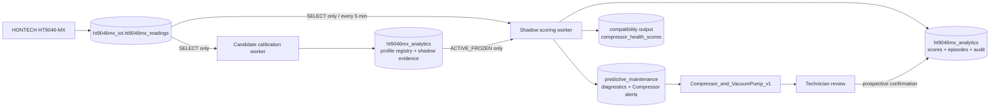
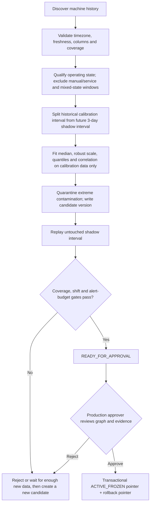
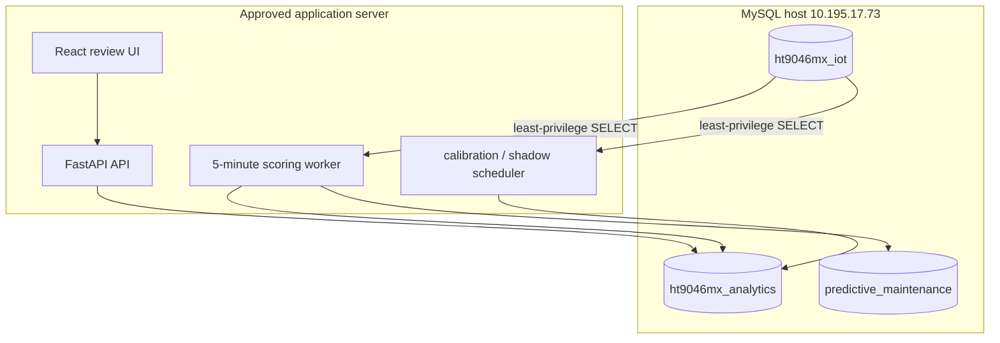

# Compressor ML and Automatic Calibration v1

**Repository:** `Bookkapp/CompressorML_and_AutomaticCalibration_v1`
**Snapshot date:** 2026-09-24
**Purpose:** server-side calibration, anomaly screening, evidence storage and technician confirmation for HONTECH HT9046-MX compressor modules.

This document describes the code that exists in the v1 snapshot. It is a deployment handoff, not approval to enable production alerts or activate a calibration profile.

## 1. Responsibility boundary

It does **not** infer a confirmed mechanical cause. Current technician feedback is one of `EQUIPMENT_ANOMALY`, `NO_EQUIPMENT_ANOMALY` or `UNRESOLVED`, plus an audit-only note.

## 2. System context

## 3. Data ownership and schema contract

| Schema/table | Access by this service | Grain / key | Purpose |
| --- | --- | --- | --- |
| `ht9046mx_iot.ht9046mx_readings` | read-only in production | `machine_number`, `recorded_at`; wide Module 1–8 columns | source telemetry |
| `ht9046mx_analytics.ht9046mx_calibration_batch` | read/write | one calibration run | immutable run bounds and gate result |
| `ht9046mx_analytics.ht9046mx_calibration_profile` | read/write | machine × module × SV × state × version | robust local baseline and threshold candidate |
| `ht9046mx_analytics.ht9046mx_calibration_shadow_point` | append | profile × event time | three-day candidate replay evidence |
| `ht9046mx_analytics.ht9046mx_active_calibration_profile` | controlled write | machine × module × SV × state | pointer to approved `ACTIVE_FROZEN` profile and rollback target |
| `ht9046mx_analytics.ht9046mx_calibration_review` | append | review action | approval/rejection audit |
| `ht9046mx_analytics.ht9046mx_shadow_score` | append/idempotent upsert | machine × module × event time × version | five-minute score evidence |
| `ht9046mx_analytics.ht9046mx_shadow_alert_episode` | controlled update | machine × module × episode | persisted alert episode |
| `ht9046mx_analytics.ht9046mx_shadow_audit_event` | append | event | runtime audit trail |
| `ht9046mx_analytics.ht9046mx_technician_confirmation` | append | one confirmation per alert | prospective binary confirmation and note |
| `ht9046mx_analytics.ht9046mx_automation_run` | append/update | scheduled run | scheduler status and retry evidence |
| `predictive_maintenance.pm_devices` / `pm_modules` | registry sync | equipment/module | dashboard identity and latest state |
| `predictive_maintenance.pm_diagnostic_snapshots` | append | device × module × time | dashboard history |
| `predictive_maintenance.pm_alerts` | Compressor producer only | alert | dashboard notification/work-order source |

Source fields per module are `Hp_1st_n`, `Lp_1st_n`, `Hp_2nd_n`, `Lp_2nd_n`, `Valve_n`, `TempHi_n`, `TempLo_n`, `Status_n`, `Busy_n` and `SV_n`, together with global `Status`. The source timestamp timezone must be explicitly configured as an IANA timezone.

## 4. Calibration lifecycle

For feature `x`, the local coordinate is:

$$rz_x(t)=\frac{x(t)-\operatorname{median}_{train}(x)}{\max(1.4826\,MAD_{train}(x),\epsilon)}$$

Additional evidence includes pressure differentials, rolling slope/variation, lag response and cross-feature correlation. Correlation is descriptive evidence, not causal proof.

## 5. Online scoring chain

Each five-minute run performs:

1. freshness, timezone, schema and state qualification;
2. active-profile lookup for the same machine, module, SV and operating state;
3. relative feature calculation using only that frozen profile;
4. anomaly score and threshold comparison;
5. temporal persistence (v1 target: three consecutive five-minute evaluations / 15 minutes);
6. append score evidence and update one continuous episode;
7. publish latest health/condition compatibility output and one deduplicated Compressor alert;
8. show the evidence to a technician for prospective confirmation.

## 6. Model inventory and an important v1 limitation

The research/offline release selected an ARX-Ridge residual model after time-aware validation. ARX predicts each response from lagged response terms plus exogenous features, with Ridge regularisation:

$$\hat y_t=\beta_0+\sum_{i=1}^{p}\phi_i y_{t-i}+\sum_{j=1}^{q}\beta_j x_{j,t}+\lambda\lVert\beta\rVert_2^2$$

The residual is converted to local robust coordinates and combined with envelope/persistence evidence. This is valid with normal-only data because the regression target is the next observed signal, not a fault class label.

## 7. Deployment topology

### Server setup

1. Clone this private repository and check out tag `v1.0.0-current-architecture`.
2. Install Python and web dependencies. Copy `deployment/.env.analytics.example` to an operator-owned `.env.analytics`; fill credentials only on the server.
3. Apply SQL migrations in `deployment/` in a staging schema first and record the migration version.
4. Configure `HT9046MX_SOURCE_TIMEZONE`, `HT9046MX_ALERT_DATETIME_TIMEZONE` and the prospective feedback start timestamp. The API fails closed if clock semantics are missing.
5. Run API tests, frontend production build, a source read-only smoke test, and a shadow-only scoring cycle.
6. Verify idempotent replay, alert ownership/deduplication, database indexes, p95 latency, restart behavior and rollback.
7. Generate candidates and review the complete three-day shadow graph. Activation records the named approver and rollback pointer.

## 8. Repository and safety boundary

The repository intentionally excludes `.env`, credentials, tokens, keys, raw telemetry, local databases, caches, `node_modules`, reproducible large intermediates and one-off `scratch/` scripts. Mock utilities under `scripts/` and destructive data-reset helpers are test-only; point them only at an isolated schema. Repository publication does not authorize database migration, profile activation, service restart or production alerting.

## 9. Cross-repository contract

`Compressor_and_VacuumPump_v1` consumes the latest health/condition output and `predictive_maintenance.pm_*` records. Any change to machine aliasing, module identity, score timestamp, condition vocabulary, alert ownership or timezone must be versioned and changed in both repositories in the same release. The operations dashboard owns acknowledgement and work-order workflow; it does not independently generate Compressor anomaly scores.
