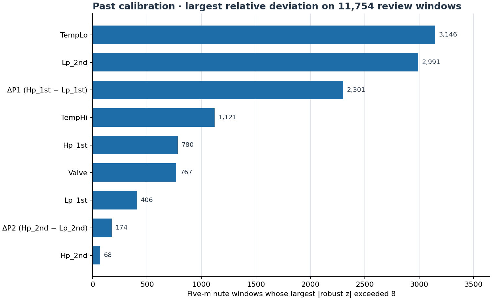
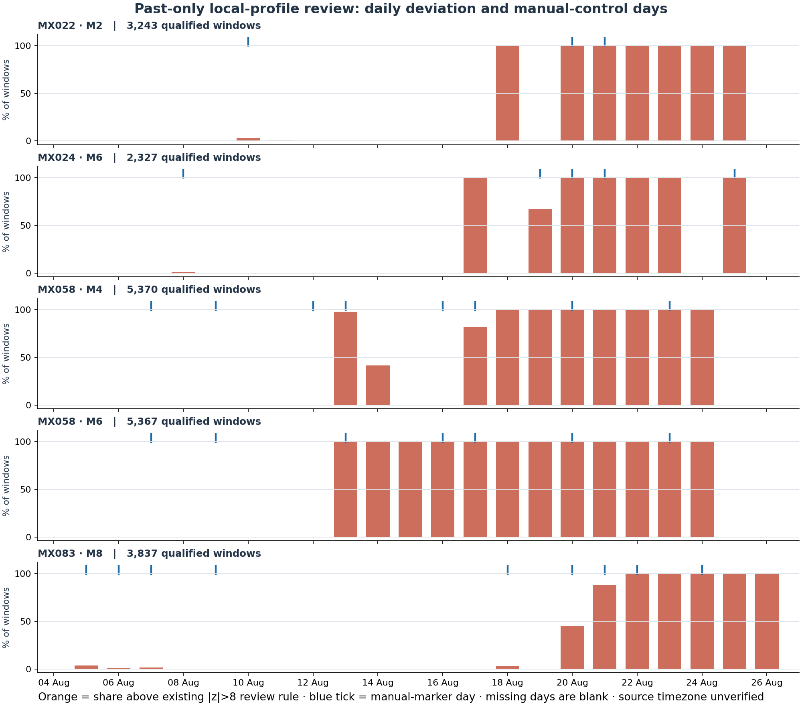

# Phase 7 — ตรวจ Profile v2 ด้วยข้อมูลอดีตก่อนชุดทดสอบ

**สถานะ: `REVIEW_ONLY_NO_MODEL_OR_PROFILE_ACTIVATION` (24 Sep 2026)**

คำถามรอบนี้คือ หลังแก้ Valve แบบจำนวนเต็มใน candidate v2 แล้ว เหตุใด Self deviation ยังสูง และ `ChangeValve` ใน log รายวินาทีเกี่ยวข้องกับการเปลี่ยนระดับค่าหรือไม่ เราใช้เฉพาะช่วง `inner_train`, `inner_validation` และ `calibration` ที่กำหนดไว้เดิมในการคำนวณ diagnostic; การสร้าง split ยังคงอ่านปฏิทินวันของ snapshot เดิม แต่ไม่มีค่า feature ของ `outer_temporal` เข้าไปในผล/การเลือก feature, threshold หรือ epoch ใหม่ ผลนี้ไม่ใช่ fault accuracy และไม่ได้เปลี่ยนโมเดลที่รันจริง

## ขอบเขตและวิธีอ่าน

- Minute cache ที่มาจาก `ht9046mx_readings`: 4–26 Aug 2026 ในส่วนที่ใช้รอบนี้; timestamp ต้นทางไม่บอก timezone และหน่วย pressure ยังไม่ยืนยัน
- หน่วยวิเคราะห์: เครื่อง × โมดูล × หน้าต่าง Cold 5 นาทีที่ผ่าน `Status=Run`, `Status_n=On`, `Busy_n=0`, `SV_n=Off`, Valve ไม่ติดลบ และ settling gate เดิม
- เครื่องพัฒนา 12 เครื่อง: MX017, 022, 024, 029, 041, 057, 058, 070, 072, 081, 082, 083; ใช้ profile v2 จำนวน 87 ชุดที่ fit จาก `inner_train + inner_validation` โดยไม่รวมวันที่ 18 Aug ตาม candidate exclusion เดิม การ audit รอบนี้ *ยังแสดง* หน้าต่างของวันที่ 18 Aug ที่อยู่ในช่วงอดีตเพื่อให้เห็นรูปแบบ แต่ไม่นำไปเปลี่ยน profile
- `review share` คือสัดส่วนหน้าต่างที่ค่า robust z มากที่สุดใน 9 feature เกิน **8** ซึ่งเป็นกฎคัดกรองเดิมของ candidate; ไม่ใช่เปอร์เซ็นต์ความเสียหาย ความแม่นยำ หรือโอกาสเกิด leak
- Manual ledger อ่าน raw Parquet รายวินาทีเฉพาะไฟล์ก่อนวันเริ่ม outer test ของแต่ละเครื่อง; เก็บ run ของ `ChangeValve`, `MValveHome`, `AdjustValve` หรือ `Busy=1` โดยไม่เติมวินาทีที่หายไป และแยก run เมื่อช่องว่างเกิน 2 วินาที

## สิ่งที่พบ

| ช่วงเดิม | หน้าต่างที่มี profile รองรับ | เกินกฎ review เดิม | สัดส่วน |
|---|---:|---:|---:|
| Inner train | 190,974 | 15,907 | 8.33% |
| Inner validation | 63,750 | 8,321 | 13.05% |
| Past calibration | 68,530 | 11,754 | **17.15%** |


อัตรา inner train/validation เป็นการตรวจย้อนหลังบนช่วงที่ทับกับช่วง fit profile จึงไม่ใช่ผลทดสอบอิสระ ส่วน calibration เป็นช่วงอนาคตภายใน development ตาม split เดิม กฎในรายงานนี้ใช้ `>8` เหมือน first-pass profile quarantine; การ flag ของตัว score ที่ใช้ `>= self_threshold` เป็นคนละตัวนับ แม้ threshold เท่ากับ 8

ใน 11,754 calibration review windows ตัวแปรที่มี `|robust z|` สูงสุดคือ `TempLo` 3,146, `Lp_2nd` 2,991, `dp1=Hp_1st−Lp_1st` 2,301; Valve เหลือ 767. นี่บอกว่าแก้ปัญหา scale ของ Valve แล้ว แต่ความต่างของระดับ/สภาวะใน profile ยังไม่หมด ตัวแปรที่เด่นเป็น **สัญญาณประกอบ** ไม่ใช่สาเหตุทางกายภาพ



ตัวอย่างจากช่วงอดีต: MX022/M2 เริ่มมีวัน review 100% ตั้งแต่ 18 Aug (63 หน้าต่าง) ก่อน `ChangeValve` ชุดถัดไปที่พบวันที่ 20 Aug; calibration 23–25 Aug เป็น 741/741 หน้าต่าง โดย `Hp_1st` เด่นทั้งหมด MX024/M6 เริ่ม 100% เมื่อ 17 Aug (31 หน้าต่าง) ก่อน `ChangeValve` ที่พบ 19 Aug; calibration เป็น 491/491 โดย `dp1` เด่น 439 หน้าต่าง ส่วน MX058/M4 และ M6 มีการเปลี่ยนค่ากับ manual marker ในวันที่ 13 Aug แต่แค่การเกิดใกล้กันยังไม่พิสูจน์สาเหตุหรือการซ่อม

กราฟใช้แท่งรายวันเพื่อ **เว้นวันไม่มีข้อมูลไว้จริง**; ขีดสีน้ำเงินหมายถึงวันซึ่ง raw log มี manual marker ในโมดูลเดียวกัน ไม่ใช่จุดเปลี่ยน profile ที่ยืนยันแล้ว ภาพแสดงเพียง 5 context ที่เลือกจากช่วงอดีตเพื่อให้เห็นรูปแบบชัด; ตาราง CSV มีครบทุก context ที่ profile รองรับ




## ผลต่อ Auto-calibration และโมเดล

1. `Busy=1` และ manual status ยังต้องถูกตัดออกจาก Cold baseline เหมือนเดิม แต่ **แถวหลัง manual event ไม่ได้กลายเป็น normal epoch อัตโนมัติ**; บาง context เบี่ยงก่อน event ที่อยู่ใกล้ที่สุดด้วย
2. รอบนี้ไม่ได้ retrain ARX, เปลี่ยน threshold/feature, เขียน MySQL, เปลี่ยน `ACTIVE_FROZEN`, เพิ่ม cause label หรือแก้ live scoring worker

## QA และข้อจำกัด

Split manifest ถูกเทียบกับ candidate v2 ตรงกันและโค้ดยืนยันว่า minute ทุกแถวที่เข้าคำนวณอยู่ก่อน `outer_start` ของเครื่องนั้น (date inventory ของ snapshot เต็มยังถูกอ่านโดย split utility เดิม) Raw manual scan ใช้เฉพาะ day-files ก่อน boundary เดียวกัน ไม่มีการ interpolation และตัด timestamp ซ้ำใน manual subset ก่อนจัด run กราฟสองภาพถูกตรวจการแสดงผลแล้ว: แกนใช้สัดส่วนของ qualified windows ไม่ใช่ raw seconds, มีจำนวนตัวอย่างต่อ context, วันขาดหายเป็นช่องว่าง, ไม่มีข้อความที่ตีความ marker เป็นเหตุของ deviation

ยังไม่มี recipe/load/facility-water context, technician-confirmed service/refill record, timezone/pressure-unit provenance, fresh prospective holdout, approved Active Profile, Server parity หรือข้อมูลพอประเมิน fault recall ผลจึงเป็น **past-only data/profile QA** ไม่ใช่การรับรอง release. ตาม QA Loop §21: system/data/evidence/presentation ตรวจแล้ว, model ไม่ได้ปรับใหม่, production/approval ยังไม่ผ่าน

## ไฟล์และการรันซ้ำ

`summary.json`, `past_context_rates.csv`, `past_daily_context_rates.csv`, `past_flag_contributors.csv`, `past_context_flag_contributors.csv` และ PNG สองภาพเป็นหลักฐานสรุปที่เก็บใน repo ได้ ส่วน `pre_outer_manual_review_ledger.csv` เป็นตารางเหตุการณ์ละเอียดที่สร้างซ้ำจาก raw Parquet ในเครื่องที่มีข้อมูล ไม่ส่งขึ้น Git

```text
py -3 -X utf8 -m notebooks.support.cold_past_profile_audit
py -3 -X utf8 -m notebooks.support.cold_past_profile_audit --figures-only
```

โค้ด: `notebooks/support/cold_past_profile_audit.py`. ต้องมี local minute cache, raw Parquet และ candidate v2 artifacts ตาม path เดิมก่อนรันเต็ม
