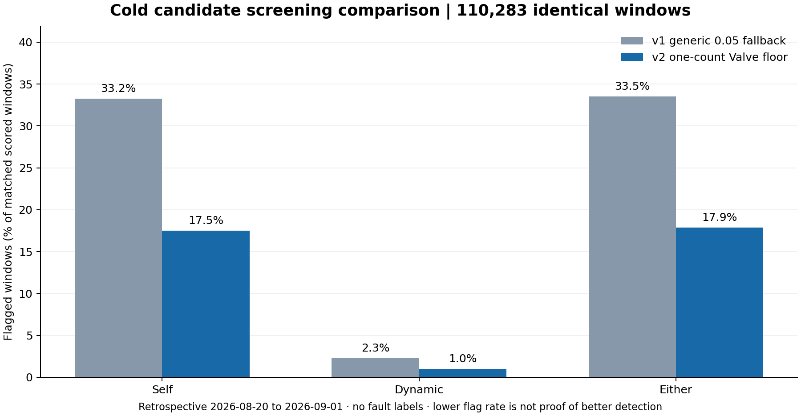

# Cold relationship candidate v2 — Valve quantization checkpoint

**State:** `SHADOW_CANDIDATE_REVIEW_REQUIRED` / `SHADOW_ONLY_NOT_AUTHORIZED`. This is an offline experiment, not a production model or `ACTIVE_FROZEN` calibration. The preceding observed-second investigation is in `../ht9046mx_one_second_valve_audit_v1/README.md`; the model here still uses qualified **five-minute** rows.

## Why a separate version was trained

The v1 local profile divides each feature deviation by `1.4826 × MAD`, and the generic fallback is `0.05` when MAD is zero. `Valve_n` is an integer command in the train input. A one-count change therefore generated `|rz_valve|=20` in affected v1 profiles, above the v1 Self threshold of about 7.69. This v2 candidate changes only the profile scaling rule for Valve:

\[
s_{\mathrm{Valve},v2}=\max(1.4826\,\mathrm{MAD}_{\mathrm{past}}(\mathrm{Valve}),\;1\;\text{source command count}),
\qquad rz_{\mathrm{Valve}}=(\mathrm{Valve}-\mathrm{median}_{\mathrm{past}})/s_{\mathrm{Valve},v2}.
\]

The one-count floor is fixed in the v2 code as the observed command resolution, **not** a newly optimized alarm threshold. It was designed *after inspection of v1's historical outer period*, so that period is no longer independent validation. The code asserts integer Valve commands in each past profile-fit block. All profile medians/scales, Ridge normalization, alpha and score thresholds are fitted or selected within the same past inner-train/validation/calibration hierarchy as v1. The old artifact is unchanged; v2 has distinct release, feature, profile and threshold versions and hash-checked portable files. No `Busy=1`/`ChangeValve` row is admitted into the Cold profile, and no manual episode is automatically adopted as a new normal epoch.

The Server-side candidate-calibration code already specifies `SCALE_FLOORS["valve"] = 1.0`, so v2 removes one obvious mismatch with that code. This is **not** Active-Profile parity: the Server candidate uses different one-minute aggregation, profile/scoring details and human lifecycle, and no approved MySQL profile was read by this experiment. The current worker also does not infer a new service epoch from a `ChangeValve` event.

## Input and QA

- Source: original local minute-module cache derived from `ht9046mx_readings`; 3,548,928 source rows from 19 machines, 2026-08-04 00:00 to 2026-09-01 17:10. Source timezone and pressure units are not encoded. Row grain after qualification is machine × module × five-minute settled Cold window; no duplicate source keys.
- State gate: machine `Run`, module `On`, `Busy=0`, `SV=Off`, nonnegative Valve and settled segment. 493,976 Cold-qualified five-minute rows. MX007/other external extractions and seven sparse machines were not silently added to model-fit rows.
- Twelve development machines: MX017, 022, 024, 029, 041, 057, 058, 070, 072, 081, 082 and 083. Seven sparse/external machines remain outside scoring until target-profile coverage exists.
- Final train-only local profile set: 87 machine–module–SV–state profiles, at least seven days/200 rows each; 75 use the one-count Valve floor. First-pass profile quarantine falls from v1's 18.35% to v2's 7.43%, but **40 profiles still exceed 5% quarantine**, so the profile-readiness gate remains open.

## Retrospective matched-row comparison

The v1 outer period was already inspected before the v2 design. Its 110,283 scored windows (2026-08-20 00:15 to 2026-09-01 17:05, source timezone unverified) all match v2 windows by machine, module and timestamp. V2 additionally scores 11,209 windows; the table below uses **only the 110,283 identical windows**.

| Screening lane | v1 flagged | v2 flagged | Interpretation limit |
|---|---:|---:|---|
| Self deviation | 33.24% | 17.50% | Lower flag burden, not measured false-positive reduction |
| Dynamic ARX residual | 2.30% | 1.03% | Model and calibration changed together; no fault labels |
| Either lane | 33.55% | 17.89% | Descriptive retrospective comparison, not release selection |

With the same three-consecutive-window episode definition on those matched rows, the combined lane has 633 v1 versus 551 v2 episode openings (Self 605→518; Dynamic 76→39). These are **candidate screening episodes**, not verified alerts or faults. On *all* v2-covered rows, the summary counts 641 combined episodes because v2 covers more profiles/windows; comparing that 641 directly against v1's 633 would mix denominators.

The 17,305 rows flagged only by v1 in the combined lane are *not* known false alarms. Thirty-six rows flagged only by v2 are *not* known true faults. On all 121,492 v2-scored windows, Self flags remain 17.81%; the worst machine's combined rate is 41.47%. V2's dominant flagged features move from Valve to `TempLo`, `Lp_2nd` and `dp1`; MX024/M058 remain high-flag contexts. LOMO's worst-machine Dynamic flag rate is 15.41%. The decline in flags, without labels or a fresh holdout, cannot demonstrate sensitivity or accuracy.



## Reproduce

From the project root with the local minute cache present:

```text
py -3 -X utf8 -m notebooks.support.phase7_cold_candidate --quantized-valve
py -3 -X utf8 -m notebooks.support.compare_cold_candidates
py -3 -m apps.api.app.model_bundle --cold-candidate-manifest notebooks/outputs/ht9046mx_phase7_cold_candidate_v2_valve_quantized/candidate_manifest.json
py -3 -m pytest apps/api/tests -q
```

