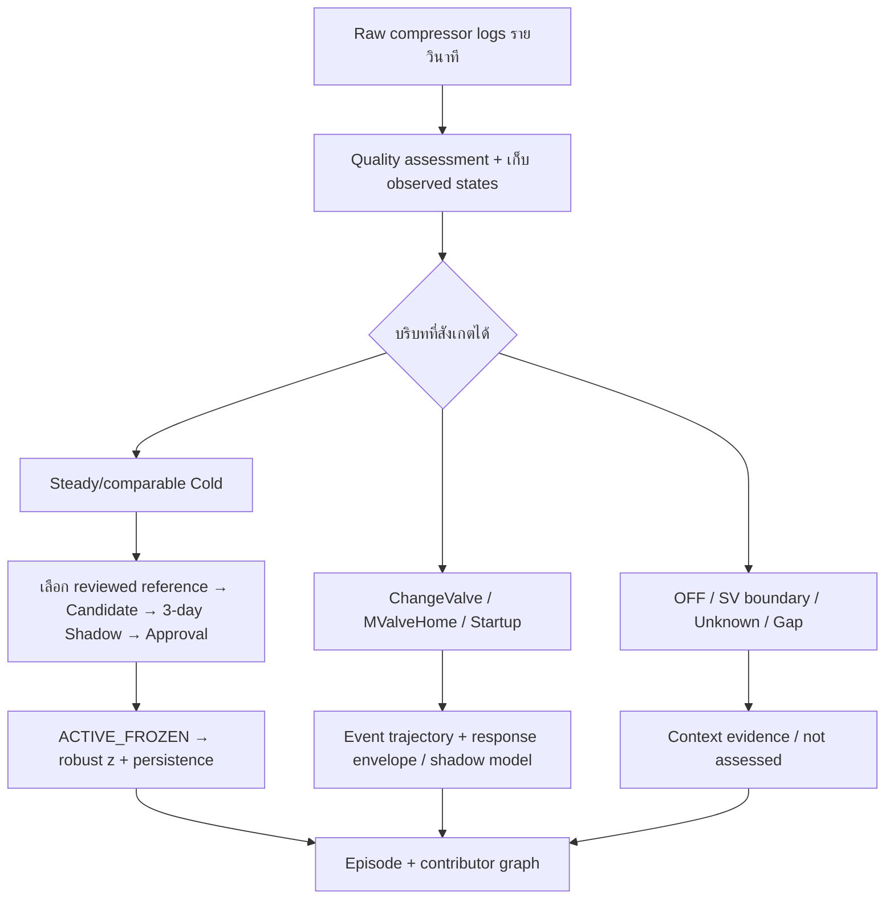

# HT9046MX — เหตุการณ์ควบคุมวาล์ว การเลือกช่วงอ้างอิง และการตรวจพฤติกรรมผิดปกติ

วันที่ค้นคว้า: 1 ตุลาคม 2026 · สถานะ: ข้อเสนอจากงานวิจัยและหลักฐานเดิมของโปรเจกต์

## ข้อสรุปสำหรับการตัดสินใจ

ควรเก็บ `ChangeValve`, `MValveHome`, `Busy`, `SV` และช่วงเริ่ม/หยุดเครื่องไว้ในเส้นทางหลักฐานรายวินาที ข้อมูลเหล่านี้ช่วยอธิบายว่าระบบควบคุมกำลังทำอะไร ไม่ควรทิ้งเพราะไม่ผ่านเงื่อนไข steady Cold อย่างไรก็ตาม การเก็บข้อมูลไว้ไม่ได้หมายความว่าจะนำทุกสถานะไปสร้าง Baseline เดียวกันหรือใช้ threshold เดียวกันได้

ข้อเสนอคือแยก **คุณภาพข้อมูล**, **บริบทการทำงาน**, **สิทธิ์ในการนำไป fit**, และ **สิทธิ์ในการ score** ออกจากกัน จากนั้นเพิ่มเส้นทางวิเคราะห์การตอบสนองหลังคำสั่งวาล์ว โดยยังรักษา Active Profile ที่ frozen ไว้เป็นหลักฐานของระดับเดิม การปรับวาล์วแล้วแรงดันนิ่งในระดับใหม่ไม่ใช่เหตุผลเพียงพอที่จะประกาศว่าระดับใหม่นั้นปกติ

โมเดลที่เหมาะจะทดลองก่อนคือ **event-conditioned ARX-Ridge** และ **PCA/DPCA แยกบริบท** ไม่ใช่เปลี่ยนระบบทั้งหมดเป็น LSTM ทันที ส่วนระบบที่เลือกใช้จริงยังเป็น robust profile z-score กับ persistence 3 qualified นาทีที่ติดกัน; EWMA/CUSUM เป็น shadow evidence เท่านั้น

เอกสารนี้ไม่ได้ implement gate ใหม่, fit/retrain โมเดล, เปลี่ยน tag semantics, อนุมัติ Profile, เขียน MySQL, เปิด Alert หรือ deploy/push Server

## 1. ขอบเขต แหล่งข้อมูล และข้อจำกัดของการอ่าน

อ่านตามลำดับ `README_System.md`, `SOT.md`, `HANDOFF.md`, `Project.md`, `Roadmap.md` และเอกสารที่เกี่ยวข้องก่อนตรวจโค้ด gate/scorer และงานวิจัย

บริบทที่เจ้าของให้มา:

- ไฟล์แนบ `Pasted text.txt` ของข้อความระบบ HT-9046MX/ATC ในรอบนี้ ใช้เป็นคำอธิบายและสมมติฐาน ไม่ถือเป็นคู่มือผู้ผลิตหรือคำสั่งให้เปลี่ยนระบบโดยอัตโนมัติ
- ลิงก์ ChatGPT share เปิดอ่านเนื้อหาไม่สำเร็จ จึงไม่ได้อ้างว่าได้ตรวจรายละเอียดในแชทนั้นแล้ว
- ไม่มี telemetry เพิ่มเติมนอก compressor logs จึงออกแบบข้อเสนอจาก pressure, Valve, temperature และ state tags ที่มี ไม่กำหนดว่าต้องซื้อ sensor หรือหา recipe/load ใหม่จึงจะเดินต่อได้
- ผล raw-second ของ MX017, MX024, MX080 จาก Notebook 08K และ `deployment/THREE_MACHINE_AUTOCALIBRATION_REVIEW.md` เป็นผลที่รันไว้ก่อนหน้านี้ ไม่ได้รัน 23.35 ล้านแถวใหม่ในรอบค้นคว้านี้
- `_Static.txt` ไม่อยู่ในขอบเขตตามคำขอของเจ้าของ

ผลเชิงปริมาณเดิมครอบคลุม 1 กรกฎาคม–1 ตุลาคม 2026 โดยวันที่ 1 ตุลาคมไม่เต็มวัน; grain ต้นทางเป็น observed second, feature หลักเป็น qualified one-minute mean และมี raw event windows รายวินาทีสำหรับ review. เวลาไฟล์ไม่มี offset; Asia/Bangkok เป็นสมมติฐาน local analysis ไม่ใช่การยืนยัน clock ของ Server. Pressure ใช้ source psi และ temperature ใช้ source °C ตาม contract โดยยังไม่ยืนยัน pressure gauge/absolute และใบรับรอง sensor

งานวิจัยบางเรื่องเข้าถึง full text ได้ แต่บางเรื่องอ่านจากบทคัดย่อ/ส่วนที่ publisher จัดทำดัชนี ไม่อ้างว่าอ่านทุกฉบับครบทั้ง PDF. ตารางแหล่งอ้างอิงท้ายเอกสารระบุระดับการเข้าถึงแยกไว้

## 2. สิ่งที่ log บอกได้ กับสิ่งที่ยังบอกไม่ได้

### 2.1 Hp_2nd ลดลง = สงสัยน้ำยารั่วได้ แต่ไม่ใช่การยืนยัน leak

ถ้า Hp2 ลดลงต่อเนื่องจากช่วงอ้างอิงของ **เครื่องและโมดูลเดียวกันในบริบทที่เทียบกันได้** เป็นหลักฐานของ downward deviation ที่มีประโยชน์ โดยเฉพาะเมื่อ LP2, Valve และ temperature เปลี่ยนร่วมกัน แต่ไม่มีความสัมพันธ์หนึ่งต่อหนึ่งระหว่าง Hp2 ต่ำกับ refrigerant leakage

คำอธิบายอื่นยังเป็นไปได้ เช่น การเปลี่ยน load/เป้าหมายที่ไม่อยู่ใน log, การปรับ Valve, การเปลี่ยนการระบายความร้อนหรือ CP1, ข้อจำกัดทางเดินน้ำยา และ sensor offset. บางกรณีระบบควบคุมชดเชยปัญหาจน pressure ยังดูนิ่งได้

[NISTIR 7350](https://www.nist.gov/publications/performance-residential-heat-pump-operating-cooling-mode-single-faults-imposed-nistir) ทดลอง heat pump R410A/TXV และพบว่าการควบคุมของวาล์วทำให้ fault signatures แตกต่างตาม operating condition/สถานะของวาล์ว หลักการนี้สนับสนุนการดูหลายตัวแปรร่วมกัน แต่ไม่ให้ threshold leak สำหรับ HT9046MX/R23

งาน [Llopis-Mengual และ Navarro-Peris (2024)](https://doi.org/10.1016/j.rineng.2024.102832) ศึกษา EEV ของ R290 brine-to-water heat pump. Undercharge และ liquid-line restriction ต่างทำให้วาล์วเปิดชดเชย และเมื่อถึงขอบการเปิดอาจไม่สามารถควบคุมต่อได้ ใช้เป็นเหตุผลให้ติดตาม Valve ร่วมกับ pressure ไม่ใช่ถือว่าพฤติกรรมนี้แยกสองสาเหตุได้แน่นอนในเครื่องเรา

การแสดงผลที่เหมาะสมคือ “Hp2 ต่ำกว่าช่วงอ้างอิงต่อเนื่อง; LP2/Valve เปลี่ยนร่วมกัน; ควรตรวจเครื่อง” ไม่ใช่ “Leak 90%”. ช่วง 180–230 psi เป็น field screening reference ที่เจ้าของยืนยันไว้ ไม่ใช่มาตรฐานสากลของทุกโมดูลหรือสูตรคำนวณปริมาณน้ำยา

### 2.2 กราฟนิ่งมีอย่างน้อยสามความหมาย

1. นิ่งอยู่ในระดับและความสัมพันธ์ที่สอดคล้องกับ Active Profile
2. นิ่งแต่ค้างในระดับที่ผิดจาก Active Profile เช่น MX080/M6 หลัง pressure ขึ้นสูง
3. นิ่งเพราะ sensor/ค่าที่บันทึกไม่เปลี่ยน หรือระบบควบคุมกำลังชดเชยอยู่

ดังนั้น slope ต่ำช่วยระบุความนิ่ง แต่ไม่ได้ยืนยัน health. การเลือก stable reference ต้องตรวจระดับเดิม, joint relationships และช่วงที่เจ้าของยืนยันเป็น anomaly ด้วย ไม่ใช้ “นิ่งที่สุด” หรือ “flag น้อยที่สุด” เป็นเกณฑ์เพียงข้อเดียว

### 2.3 ข้อจำกัดด้านฟิสิกส์ที่ไม่ควรให้โมเดลเดาแทน

- `TempLow` ใช้ความหมาย Discharge Pipe ตาม Data Contract ปัจจุบัน ไม่ใช่ actual DUT temperature หรือ suction temperature ที่ยืนยันตำแหน่งแล้ว
- จึงยังคำนวณ superheat/subcooling ที่ถูกต้อง, pull-down-to-setpoint, cooling capacity หรือ leak amount จาก tags นี้ไม่ได้
- `dp2 = Hp2-Lp2` ใช้เป็น pressure differential ได้เมื่อสองช่องใช้ฐานหน่วยเดียวกัน แต่ไม่เท่ากับ pressure drop คร่อม EEV โดยตรง
- pressure ratio ต้องใช้ absolute pressure ที่ตรวจฐานแล้ว ไม่หาร gauge pressure ตรง ๆ โดยเฉพาะ LP ใกล้ศูนย์
- ไม่ควรบังคับว่า Valve เปลี่ยนแล้ว LP2 ต้องเปลี่ยนทิศ/ขนาดเดียวกันทุกเครื่องและทุก event; เป็น closed-loop system ที่อาจมีเงื่อนไขอื่นเปลี่ยนพร้อมกัน

## 3. ความหมายของ tag ที่ต้องรักษา และความขัดกันในข้อความใหม่

| ประเด็น | สถานะตามเอกสารหลัก | การใช้ในข้อเสนอรอบนี้ |
|---|---|---|
| `Status` | Compressor ON/OFF; runtime map literal `Run` | ใช้ตรวจช่วง Run และขอบเขตเริ่ม/หยุดที่สังเกตได้ |
| `Status_n` | Expansion Valve state; ต้องใช้ codebook | `ChangeValve`/`MValveHome` เป็น observed event kinds ไม่ใช่ health labels |
| `Busy_n` | เจ้าของเคยยืนยัน manual/service flag เช่น ChangeValve/MValveHome | ไม่เปลี่ยนเป็น motor-run proof จากประโยค “Turning of the whole Compressor” ในข้อความใหม่ |
| `SV_n` | Bypass-valve state; contract เดิมใช้ Off ใน qualified Cold | เก็บ ON/OFF เป็น context; ไม่ประกาศ Hot/Room/Cold จาก SV เพียงช่องเดียว |
| CP1/CP2 และชนิดน้ำยา | โครงสร้าง cascade/R507A/R23 ตาม owner project contract | ใช้เป็นกรอบของโปรเจกต์ แต่ไม่อ้างว่า public product page ยืนยัน piping ของรุ่นติดตั้ง |
| Negative Valve command/Homing | ไม่เข้า steady scorer ปัจจุบัน | เก็บ raw command ไว้; ไม่ตีเป็น physical negative opening หรือ invalid sensor โดยอัตโนมัติ |

ไฟล์แนบมีรายละเอียด SV/Hot/Room ที่ต่างจาก contract เดิม และคำอธิบาย Busy ของข้อความใหม่ก็ต่างจากคำยืนยันก่อนหน้า จึงยังไม่แก้ semantics ใน README. รายละเอียดเช่น `-200`, LP2 ต้องถึง `0` จึงจบ Homing หรือช่วง module 1–8 ทำหน้าที่ตำแหน่งใด ต้องตรวจ controller/codebook ของเครื่องจริงก่อนใช้เป็น production rule

## 4. Current gate ทำอะไรจริง

ตรวจจาก `apps/api/app/qualified_windows.py`, `qualified_calibration.py`, `qualified_candidate_registry.py` และ `qualified_scoring.py`:

- หนึ่งนาทีต้องมีอย่างน้อย 57 occupied second bins จาก 60, ไม่มี duplicate machine-second และ maximum gap รวมขอบนาทีไม่เกิน 5 วินาที
- ทุกแถวในนาทีต้อง `Status=Run`, module status `On`, Busy อยู่ในชุด 0/False/Off และ SV อยู่ในชุด Off/0/False ตาม mapping ที่ยืนยัน
- sensor ทั้งเจ็ดต้องเป็นตัวเลข finite; negative Valve command ไม่เข้า steady window
- feature เป็น mean ของ observed seconds, พร้อม `dp1` และ `dp2` รวมเก้า features
- นาที manual/state ที่ไม่ผ่านได้ `STATE_NOT_ELIGIBLE` พร้อม reason เช่น `MODULE_NOT_STABLE_ON` หรือ `MANUAL_OR_UNKNOWN_BUSY`; features ของ steady branch เป็น None

**นี่เป็นการไม่ใช้กับ steady fit/scoring ไม่ใช่คำสั่งลบ source rows.** แต่ current steady scorer ก็ยังไม่ได้เรียนรู้ event-response ของช่วงเหล่านั้น การยืนยันว่า raw manual rows ครบใน analytics archive ต้องตรวจเส้นทาง retention/export จริงอีกครั้ง ไม่สรุปจาก window builder เพียงไฟล์เดียว

อีก limitation คือ gate ตรวจภายในหนึ่งนาที ยังไม่มี causal multi-minute settling gate. `On` ไม่ได้แปลว่า thermal behavior กลับเข้าช่วงอ้างอิงแล้ว

## 5. โครงสร้างที่เสนอ: เก็บข้อมูลทั้งหมด แต่ใช้คนละวิธี

ผังนี้เป็น **proposed extension** ไม่ใช่แผนผังว่า runtime มีทุกกิ่งอยู่แล้ว. Quality assessment เก็บ reason/mask ไม่ใช้การ interpolate เติมวินาทีแล้วประกาศว่าข้อมูลครบ

แยกสถานะผลอย่างน้อยเป็น `data_quality`, `operating_context`, `fit_eligible`, `score_eligible`, `assessment_status`. ไม่รวมเหตุการณ์ที่อ่านได้ถูกต้องกับข้อมูลเสียไว้ในความหมายเดียวกัน

| บริบท | เก็บข้อมูลหรือไม่ | นำไป steady baseline หรือไม่ | วิเคราะห์เพิ่มเติมอย่างไร |
|---|---|---|---|
| Reviewed steady Cold | เก็บ | ได้เมื่อผ่านคุณภาพและ fit policy | ระดับ, pressure differential, joint relationships |
| ChangeValve | เก็บทั้งก่อน–ระหว่าง–หลัง | ไม่รวมระหว่าง event กับ steady fit โดยตรง | ทิศ/ขนาด Valve step, LP2/Hp2 response, delay, overshoot, final level |
| MValveHome | เก็บ sequence/command/state | ไม่รวมกับ ChangeValve หรือ steady fit | เวลา sequence, return state, command progression, sequence repeat |
| Startup/settling | เก็บ trajectory | แยกจาก steady reference | elapsed observed start, causal slope/variation และ distance-to-profile |
| OFF/SV/unknown/gap | เก็บ context/quality reason | ไม่ฝืนสร้าง Cold baseline | ไม่ assessed, event overlap, continuity/coverage |

ช่วง manual ที่ไม่มี trained/reviewed event reference ให้ขึ้น “control event — not assessed” ไม่ใช่เขียว Normal. ถ้าต้องการตรวจ anomaly ระหว่าง manual จริง ต้องสร้างและ validate event lane แยก ไม่เปิด gate เดิมให้รับทุกสถานะเฉย ๆ

## 6. ใช้ ChangeValve และ Homing รายวินาทีอย่างไร

### 6.1 สร้าง event จากสถานะ ไม่จากการเดาปัญหา

กำหนด event start จากการเปลี่ยนเข้า state และ event end จากการออก state ที่สังเกตได้ เก็บ machine/module, source start/end, precision, preceding state, following state, Busy/SV, source digest และ coverage. ถ้าเริ่มอ่านตอนอยู่ใน event ให้ระบุ left-censored; ไม่สร้างเวลาเริ่มเทียม

`ChangeValve` ไม่บอกว่าปิดหรือเปิด: ดู `Delta Valve = V_post - V_pre` ตาม raw ก่อน/หลังที่มีคุณภาพ. ค่าปิดลงอาจสัมพันธ์กับ LP2 ที่ลดลงภายหลังได้ แต่ log อย่างเดียวไม่ยืนยันว่าคนต้องการ setpoint เท่าไรหรือ physical valve เดินตรงกับ command ทุกครั้ง

### 6.2 Feature สำหรับทดลอง ไม่ใช่ production defaults ใหม่

| Feature | เหตุผล | เงื่อนไขการตีความ |
|---|---|---|
| Pre-event median/variation ของ HP2/LP2/Valve/Temp | รู้จุดเริ่มและบริบท | มี pre-window จริง; ไม่ปน event ก่อนหน้า |
| Valve direction และ step magnitude | แยกเปิด/ปิดและขนาดคำสั่ง | command count ไม่ใช่ % opening ที่ยืนยันแล้ว |
| Delta LP2/HP2 ที่ 5/15/30/60/120 วินาที | เห็นรูปแบบ/เวลาเหลื่อมโดยไม่ถูก mean กลบ | horizon เป็น trial grid; ใช้เมื่อข้อมูล horizon นั้นเข้ามาแล้ว |
| Robust slope, observed range, step/peak และ oscillation | แยกไต่ระดับ, spike, swing, plateau | threshold ต้อง fit จากอดีตของบริบทที่เหมาะสม |
| CP1 response และ dp1/dp2 | ดูสิ่งที่เกิดร่วมกันทั้งสองวงจร | ไม่ตี CP1 เป็น cause ที่ยืนยันหรือ EEV differential |
| Distance-to-frozen-profile หลัง event | รู้ว่าเข้าระดับเดิมหรือค้างระดับใหม่ | ไม่รีเซ็ต Baseline ตาม level ใหม่โดยอัตโนมัติ |
| Event duration, incomplete/repeated/overlapping sequence | รู้ว่าลำดับควบคุมเปลี่ยนหรือค้าง | ยังไม่มี expected Homing duration ของรุ่นติดตั้ง |

ตัวอย่าง descriptive response gain:

\[
G_{LP2,V}=\frac{\operatorname{median}(LP2_{post})-\operatorname{median}(LP2_{pre})}
 {\operatorname{median}(V_{post})-\operatorname{median}(V_{pre})}.
\]

คำนวณเมื่อ Valve step ใหญ่กว่า command quantization, pre/post ต่อเนื่อง, ไม่มี overlapping action/Run/SV boundary และมี comparable context เท่านั้น ค่า G นี้เป็น observed association ไม่ใช่ open-loop physical gain. ไม่คำนวณเมื่อ denominator ใกล้ศูนย์. Response lag ต้องแสดง coverage และอาจตอบว่าไม่พบ/ไม่ทราบ แทนเลือก correlation peak อัตโนมัติจากกราฟที่มีแนวโน้มร่วมกัน

Homing แยกต่างหาก: negative command อาจเป็น overdrive/reference procedure ได้ แต่ยังไม่มีคู่มือยืนยันลำดับ HT9046MX จึงใช้ sequence timing/state completion ที่สังเกตได้ ไม่สร้างกฎว่า LP2 ต้องเป็นศูนย์

### 6.3 ทำงานจริงโดยไม่มองอนาคต

เก็บ bounded pre-event ring buffer และ event pending state; 5-second evidence พร้อมเมื่อมีข้อมูลถึง horizon 5 วินาที ส่วน 120-second result ต้องรอครบ horizon ไม่สวมเวลาเผยแพร่เป็น event start. worker รับข้อมูลทุก 5 นาทีจึงอาจส่งหลักฐานย้อนหลังภายใน batch แม้คำนวณจากรายวินาทีได้

แยก `observed_at/source_time` จาก `available_at/scored_at`, รองรับ event ข้ามวัน, restart/checkpoint, late arrival และ unknown onset. ไม่หักวินาทีออกจากไฟล์เพราะไม่ผ่าน steady branch และไม่ผสม minute z-threshold กับ second-level event score

## 7. Auto-Calibration ต้องเปลี่ยนหลักการเลือกข้อมูลก่อนเพิ่มความซับซ้อนของโมเดล

ผลก่อนหน้านี้จาก MX017/024/080: qualified Cold 2,036,991 module-minutes จาก 279 dynamic files/23,347,480 rows ไม่ใช่ normal labels. M7 ยังข้อมูลไม่พอทั้งสามเครื่อง และ 81.23% ของ qualified minutes ไม่มี observed onset ตามเกณฑ์ continuity ของการทดลองเดิม ไม่ควรบังคับตัด 20 นาทีแรกทุกครั้งโดยเดาจุดเริ่ม

ตัวอย่าง pooled-qualified M1 Hp2 median คือ 194.87/205.27/181.93 source psi และ within-day-centered Spearman LP2–TempLo คือ +0.57/-0.49/-0.27 สำหรับ MX017/024/080 ตามลำดับ. บริบท recipe/load ยังไม่ matched; ผลนี้ชี้ว่าห้ามสมมติ global relationship เดียว ไม่ใช่พิสูจน์ว่ามี fault ในเครื่องใด

สำหรับ MX080/M6 การ fit หลาย plateaus รวมกันทำให้ scale Hp2 กว้างจน shadow ดู flag น้อยมาก. วันที่ตัด 26 Sep, 7/14-day fits มี scale 97.79/87.34 psi และ flag 0/3,420 ตามลำดับ; ไม่ใช่ proof ของ calibration ที่ดี

ข้อเสนอ:

1. เก็บ raw/state/quality evidence ครบก่อนคัด fit
2. แยก known states และ transition/event sequences ก่อน อย่าใช้ clustering ให้ stable anomaly กลายเป็น healthy regime อัตโนมัติ
3. เลือก reference period ที่คงระดับและสัมพันธ์กับหลักฐาน health ที่มี; quarantine owner-confirmed cases และ unexplained shifts. ถ้าไม่มีช่วงพอ ให้ insufficient/review แทนสร้าง normal label เอง
4. Candidate ใหม่มี phase/reference/event policy version แยกจาก profile เดิม; วัน/วินาทีจำนวนมากไม่ทดแทนจำนวน independent cycles/events
5. fit, threshold calibration, future shadow/test ตามลำดับเวลา; plot 3 วันพร้อม state/coverage/contributors และ known-case regression
6. Approval จึงเป็น Active Frozen; manual boundary ไม่ใช่ refill/service epoch ที่ยืนยัน และ low shadow burden ไม่ใช่ healthy certification

Steady profile กับ event envelope อาจแยก artifact กัน โดย key มี Machine × Module × observed context; ไม่แตกทุก Valve count เป็น profile เพราะจะทำให้ข้อมูลกระจัดกระจายและกลบความเปลี่ยนแปลงของ Valve. SV เป็น context ที่ตรวจได้ แต่ไม่ใช่ mode label ครบทุกกรณี

## 8. Algorithm/Model ที่แนะนำ พร้อมสมการและ parameter

### 8.1 คง primary detector ปัจจุบัน

\[
m_j=\operatorname{median}(x_j),\quad
s_j=\max\{1.4826\operatorname{MAD}(x_j),\operatorname{IQR}(x_j)/1.349,f_j\},
\quad z_{j,t}=\frac{x_{j,t}-m_j}{s_j},\quad S_t=\max_j|z_{j,t}|.
\]

`f_j` ปัจจุบันคือ 1 command สำหรับ Valve และ 0.1 source unit สำหรับ feature อื่น. Candidate ทำ first-pass retain S≤8, refit และ Q99.5 ของ retained training score; primary flag S≥threshold และ persist 3 qualified minutes ติดกันจริง. Floor/threshold เหล่านี้เป็น current version ไม่ใช่ universal refrigeration constants; ยังมีปัญหา fit/threshold block separation ที่ต้องทำใน candidate version ใหม่ ไม่ย้อนไปอ้างว่า version เดิมแยก block แล้ว

จุดแข็งคือ local level และ contributor ชัดเจน ไม่ต้องมี fault labels. จุดอ่อนคือไม่รู้ joint relationship/trajectory เอง และอาจเทียบ startup กับ narrow steady profile. แก้ qualification/reference ก่อนเพิ่ม threshold ไม่ลบ high plateau เพียงเพราะ slope ต่ำ

### 8.2 ARX-Ridge แยก event/state — dynamic-response challenger ที่ควรทดลองก่อน

เลือก output เช่น LP2 หรือ HP2 โดย input เป็นอดีต Valve, HP1/LP1, temperature และ observed state ที่พร้อมในเวลาทำนาย:

\[
\widehat y_t=c+\sum_{i=1}^{p}a_i y_{t-i}
 +\sum_{\ell}\sum_{i=0}^{q_\ell}b_{\ell,i}u_{\ell,t-d_\ell-i},
\qquad
\widehat\theta=\arg\min_\theta\bigl(\|Y-X\theta\|_2^2+\alpha\|\theta_{nonintercept}\|_2^2\bigr).
\]

\[
e_t=y_t-\widehat y_t,\qquad
z^{res}_t=\frac{e_t-\operatorname{median}(e_{cal})}{s_{e,cal}}.
\]

Regression นี้มี target y จริง จึงเป็น supervised regression ในเชิงคณิตศาสตร์ แต่ target เป็น sensor ที่สังเกตในลำดับเวลา ไม่ใช่ fault label. เมื่อนำข้อมูล expected/reference behavior มาฝึกแล้วใช้ residual ตรวจ novelty คือ normal-trained/self-supervised forecasting anomaly workflow

งาน [Yan et al. (2014)](https://doi.org/10.1016/j.enbuild.2014.05.049) ใช้ ARX กับ **SVM fault classification** บน chiller fault data จึงไม่อ้างว่าทั้ง pipeline ของงานนั้นฝึกแบบไม่มี label. สิ่งที่นำมาใช้ที่นี่คือ dynamic residual identification ไม่คัดลอก fault classifier

Trial parameters: second-level `p,q` เริ่มสำรวจ 5/15/30 samples, delays `d` จาก causal event lag review, standardized-input Ridge alpha 0.1/1/10/100. เป็น grid ที่เสนอ ไม่ใช่ค่าที่ fit หรือ activate แล้ว; ห้ามใช้ lag grid เดียวกันโดยไม่แปลงเมื่อ grain เปลี่ยนเป็นนาที. Separate open/close/Homing contexts เมื่อ support พอ; ไม่เพิ่ม past/future sensor หรือ future state ที่ยังไม่พร้อมตอน prediction

Ridge ช่วย collinearity ของ lags แต่ไม่แก้ omitted load/feedback ทั้งหมด. Valve กับ pressure อยู่ใน closed loop; [MathWorks n4sid documentation](https://www.mathworks.com/help/ident/ref/n4sid.html) แสดงความสำคัญของวิธี identification ภายใต้ feedback. ไม่ตี correlation/ARX coefficient เป็น causal gain โดยอัตโนมัติ

One-step ARX ที่ใช้ actual y ล่าสุดอาจตาม bad plateau จน residual ลดลงได้ จึงต้อง **คง frozen-level Self lane**; ทดลอง multi-horizon/event response เพิ่มได้ แต่ไม่ให้ residual ต่ำล้างหลักฐาน primary. Historical rule-versus-ARX replay ของโปรเจกต์ไม่ได้พบ ARX-only benefit ใน MX080/M6 incident ที่ตรวจแล้ว จึงยังไม่มีเหตุผลให้แทน detector เดิม

### 8.3 PCA/DPCA — joint-relationship challenger

ใช้ standardized vector และเพิ่มเฉพาะ past lags เพื่อเก็บความสัมพันธ์หลายช่อง:

\[
\widetilde x_t=[z_t,z_{t-1},\ldots,z_{t-L}],\quad
\widehat x_t=PP^\top\widetilde x_t,\quad
Q_t=\|\widetilde x_t-\widehat x_t\|_2^2,
\quad T_t^2=t_t^\top\Lambda^{-1}t_t.
\]

[Ku, Storer และ Georgakis (1995)](https://doi.org/10.1016/0169-7439(95)00076-3) เสนอ time-lag embedding สำหรับ dynamic PCA. ข้อเสนอของเราคือทดลองว่าความสัมพันธ์เสียทั้งที่ individual levels ยังอยู่ใน band ได้หรือไม่

Trial: lag L=0/5/15/30 seconds และ retained subspace จาก inner-validation พร้อม variance grids 90/95/99% เป็นเพียง candidates. ไม่ใช้ retained variance อย่างเดียวเลือก detector. `dp1/dp2` เป็น linear combinations ของ pressures จึงไม่ใส่ covariance inverse ของทั้งเก้าช่องแบบไม่ตรวจ rank; เลือก independent base channels/SVD และ eigenvalue floor ที่บันทึก version

Global PCA บนทุก state อาจสร้าง false alarms ใน transition. [Zhao et al. (2010)](https://doi.org/10.1016/j.ces.2010.08.024) วิเคราะห์ multimode processes พร้อม between-mode transitions สนับสนุนให้แยก transition structure ไม่ใช้ steady model เดียวครอบทุกสถานะ. Contribution ของ Q/T² บอกช่องที่สัมพันธ์กับ score ไม่ยืนยัน physical cause

### 8.4 EWMA/CUSUM — slow-drift shadow evidence

\[
E_t=\lambda z_t+(1-\lambda)E_{t-1},\qquad
C_t^-=\max(0,C_{t-1}^- -z_t-k).
\]

ใช้ signed HP2/LP2 z เพื่อสะสม downward deviation ตาม [NIST EWMA](https://www.itl.nist.gov/div898/handbook/pmc/section3/pmc324.htm) และ [NIST CUSUM](https://www.itl.nist.gov/div898/handbook/pmc/section3/pmc323.htm). Current shadow seeds คือ λ=0.20, k=0.50, warmup 3 qualified minute windows; code สามารถ fit family limits จาก past-only separate block ได้ แต่ point-quantile limit ยังไม่ใช่ validated episode false-alarm budget

Trial λ=0.05/0.10/0.20 สำหรับ minute grain; k/h เลือกจาก reference residual และ alarm budget ไม่ยืม 3σ/IID guarantee มาใช้กับ autocorrelated logs. ระหว่าง gap/manual/context break ต้องแสดง readiness/segment reset ไม่เติม z=0 เป็น normal. ยังไม่เป็น live vote และไม่ได้แทน event-response model

### 8.5 Isolation Forest — nonlinear feature challenger

งานต้นฉบับ [Liu, Ting และ Zhou (2008)](https://cs.nju.edu.cn/zhouzh/zhouzh.files/publication/icdm08b.pdf) ตรวจ novelty ด้วยความง่ายในการ isolate points. เหมาะลองบน relative level/slope/variation และ event summaries มากกว่าป้อนทุกวินาทีดิบโดยไม่แบ่ง state

Trial ตาม [scikit-learn API](https://scikit-learn.org/stable/modules/generated/sklearn.ensemble.IsolationForest.html): trees 200/400, max_samples 256/1024, bootstrap=False, fixed seeds 13/42/2026. `contamination` กำหนด score cutoff/offset ไม่ใช่ % fault ที่มีจริง; แนะนำเก็บ continuous score แล้ว calibrate cutoff บนอดีตอีก block

ไม่ต้องมี fault labels สำหรับ fit แต่ reference ที่ปน abnormal จะทำให้เรียนรู้สิ่งผิดเป็นปกติ และ rare healthy manual events อาจถูก flag. Feature importance ไม่ได้แปลว่าพิสูจน์สาเหตุ; ยังไม่แนะนำเปิด OR เพิ่มกับ primary โดยไม่วัด alert burden

### 8.6 LSTM Encoder–Decoder / fleet transfer — reserve challenger

[Malhotra et al. (2016)](https://arxiv.org/abs/1607.00148) เรียนรู้ normal sequence reconstruction. เหมาะกับ nonlinear trajectories แต่ window/state support และ threshold calibration สำคัญ งานทดลองที่ optimize F-score ด้วย anomalies ไม่สามารถคัดลอกขั้นนั้นมายังโครงการที่ไม่มี labels ครบ

[Wang et al. (2026)](https://doi.org/10.1016/j.ymssp.2025.113725) ใช้ source pretraining และ target adaptation ของ LSTM Encoder–Decoder. สนับสนุน shared representation + local adaptation มากกว่า universal raw-pressure model. ในงานมี early-stopping patience 30; **ไม่ใช่คำแนะนำว่าเทรนเพียง 30 epochs แล้วพอ**

สำหรับ HT9046MX ควรใช้ same-sensor/state-compatible sequences และ frozen local normalization, compare normal/event behavior ของหลายเครื่องก่อน transfer. ข้อมูลรายวินาทีจำนวนมากมี autocorrelation จึงไม่ได้แปลว่ามี independent healthy sequences จำนวนมาก. ยังไม่มีผลว่า LSTM จะเหนือกว่า primary ในเครื่องนี้ และยังไม่สมควรเลือก epochs/architecture จาก case ที่ตรวจไปแล้ว

### 8.7 Conditional fleet reference — ไม่บังคับมี peers

[Farouq et al. (2022)](https://doi.org/10.1016/j.eswa.2022.116864) ใช้ unit/subfleet references สำหรับ fleet ที่ heterogeneous. ใช้สนับสนุน local model และเปรียบเทียบเฉพาะ peers ที่คล้ายจริง ไม่ใช้ fleet median ของ raw pressures เป็นมาตรฐาน

[Ghauch et al. (2025)](https://doi.org/10.1017/dce.2025.3) ใช้ segmentation/matched segments เพื่อ transfer ภายใต้ operational uncertainty. ศึกษา rotating plant/pumps ไม่ใช่ HT9046MX; improved prediction error ไม่ใช่ fault recall ของโปรเจกต์นี้. Offline PELT เหมาะเสนอช่วงให้ review ไม่ใช้ future-dependent changepoint เป็น live causal gate หรือ healthy label

เครื่องเรามี peers จำกัดและ hidden load จึงอนุญาต “ไม่มี comparable peer”. Conformal tail/rank score อาจช่วย local thresholding แต่ serial dependence/drift ต้องตรวจ ไม่อ้าง p-value เป็น leak probability หรือรับประกัน false alarm โดยไม่มี assumptions รองรับ

## 9. ลำดับทดลองและ acceptance ที่เสนอ

| ลำดับ | งาน | ผลลัพธ์ที่ต้องตรวจ |
|---|---|---|
| A | Raw control-event inventory ของ MX017/024/080 และ existing cases | ทุก event/gap retained, unknown onset ชัด, ไม่ถือ startup=ChangeValve=Homing |
| B | Multi-start/Valve-event trajectories แยก machine/module/direction/context | เห็น coverage, CP1/CP2, before/after frozen level, independent events/day |
| C | Reference/phase candidate design | ไม่รับ stable abnormal plateau; insufficient contexts ไม่ fit ฝืน |
| D | Primary เดิม เทียบ event-ARX/DPCA/IF แบบ shadow | matched windows/events, separate past fit/calibration, no hidden suppression |
| E | Frozen prospective validation + known-case regression | delay, reviewed alarm burden, missed cases, reset/restart/runtime cost |
| F | Versioned registry/3-day shadow/approval/rollback integration | candidate ไม่ auto Active; Server integration แยกจาก local research |

Splits ต้อง grouping ทั้ง event/cycle/connected time interval ไม่สุ่มวินาทีจาก event เดียวกันไป train/test. LOMO ทดสอบ transfer โดย machine ที่ hold out ไม่มีส่วนในการเลือก model/HPO; ถ้าอนุญาต target adaptation ต้องกำหนด past adaptation block และ future target test แยกชัดเจน

ข้อมูลถึง 1 Oct และ known MX080/MX057 cases ถูก inspect แล้ว ใช้ regression/diagnostic comparisons ได้ แต่ไม่เรียกเป็น untouched accuracy test ใหม่. ต้อง lock specification ก่อนใช้ future block ที่ยังไม่ inspect หรือ prospective incoming data

เมื่อ normal/fault labels ไม่ครบ รายงาน flag burden per eligible hour, episodes/day, time-to-detect ของ owner-confirmed cases และ reviewer disagreement. ไม่เรียก flagged-unconfirmed ทุกช่วงว่า false positive และไม่รายงาน leak recall/precision/% สาเหตุที่ยังไม่มี ground truth. เลือก model จาก alert budget, detection delay, explainability และ incremental CPU/memory ไม่ใช่ reconstruction loss หรือ shadow flag ต่ำที่สุดเพียงอย่างเดียว

## 10. รูปแบบกราฟที่ช่วยอธิบายและไม่กลบ anomaly

- แกนเวลาร่วม: HP1/LP1, HP2/LP2, Valve, TempHi/TempLo แยก panel/หน่วย พร้อม state strip ของ Run/Busy/SV/Valve status
- Mark observed ChangeValve start/end, แสดง ΔValve และ trajectory horizon; Homing ใช้คนละ event symbol
- Baseline/scale ของ frozen profile เป็น reference เดิม; event empirical envelope แยกชัดว่า research reference ไม่ใช่ confidence interval/health certification
- Red เฉพาะ panel ที่มี stored contributor ผ่าน threshold ใน primary persistent episode; temporal/model shadow ใช้ลาย/ป้ายแยก ไม่ทาทุกกราฟแดงตาม global score
- Manual/startup/unknown มีข้อความ control event/not assessed แทนเขียวปกติ; missing seconds เป็น gap ไม่ลากเส้นให้ดูมีข้อมูลต่อเนื่อง
- เปรียบเทียบ events ที่มี state/direction/pre-level ใกล้กันแบบ small multiples; ไม่เลือกแค่ตัวอย่างกราฟสวยและไม่ตัด sustained abnormal tail ทิ้งหลัง manual

## 11. Research ledger — แหล่งต้นทางและระดับการเข้าถึง

| แหล่ง | สิ่งที่ใช้ | อ่านได้ระดับใดในรอบนี้ | ขอบเขตที่ไม่อ้าง |
|---|---|---|---|
| [NISTIR 7350, Kim et al., 2006](https://www.nist.gov/publications/performance-residential-heat-pump-operating-cooling-mode-single-faults-imposed-nistir) | Normal residual model, controlled-valve masking | Official abstract | ไม่อ้างว่าอ่านครบ 175-page PDF หรือใช้ thresholds R410A กับ R23 |
| [Llopis-Mengual & Navarro-Peris, 2024](https://doi.org/10.1016/j.rineng.2024.102832) / [author full text](https://www.researchgate.net/publication/383762962_Modeling_the_performance_of_electronic_expansion_valves_in_heat_pumps_under_soft_faults) | EEV compensation/undercharge/restriction; measurement requirements | Publisher abstract; author-uploaded full-text introduction, experimental setup and valve-model sections | ไม่คัดลอก physical model ที่ต้องใช้ flow, geometry, subcooling ที่เราไม่มี |
| [Zhao et al., 2010](https://doi.org/10.1016/j.ces.2010.08.024) | Multimode/transition separation | Publisher-indexed abstract/introduction; author institution metadata | ไม่ได้ implement original MsPCA |
| [Yan et al., 2014](https://doi.org/10.1016/j.enbuild.2014.05.049) | ARX dynamic modeling; distinction from SVM fault classifier | Publisher-indexed abstract/introduction | ไม่ถือว่า full ARX–SVM pipeline label-free |
| [Ku et al., 1995](https://doi.org/10.1016/0169-7439(95)00076-3) | Lag-embedded DPCA | Publisher abstract | ไม่อ้าง HT9046MX performance หรือ cause isolation จาก model bank ที่เราไม่มี |
| [Wang et al., 2026](https://doi.org/10.1016/j.ymssp.2025.113725) | Two-stage fleet LSTM transfer | Publisher-indexed abstract/method/experiment sections; existing Thesis §16 review | ไม่ถือ source/target machinery เหมือนเครื่องเรา |
| [Farouq et al., 2022](https://doi.org/10.1016/j.eswa.2022.116864) | Unit/subfleet reference | Publisher-indexed abstract/introduction; existing Thesis §16 | ไม่รับประกัน calibration ภายใต้ drift/autocorrelation ที่ยังไม่ตรวจ |
| [Ghauch et al., 2025](https://www.cambridge.org/core/journals/data-centric-engineering/article/predictive-monitoring-of-asset-populations-in-a-rotating-plant-under-operational-uncertainty-a-transfer-learning-approach/3547D97510B833B97DCCCEAB4323D393) | Regime matching/negative-transfer reasoning | Open publisher full-text introduction and methodology sections | Prediction MSE ไม่ใช่ fault detection accuracy |
| [Liu et al., 2008](https://cs.nju.edu.cn/zhouzh/zhouzh.files/publication/icdm08b.pdf) / [IsolationForest API](https://scikit-learn.org/stable/modules/generated/sklearn.ensemble.IsolationForest.html) | Isolation-based novelty; parameter semantics | Original-paper abstract; official API parameters | Contamination ไม่ใช่ real fault prevalence |
| [Malhotra et al., 2016](https://arxiv.org/abs/1607.00148) | Sequence reconstruction and threshold caveat | Author preprint HTML/threshold section | Normal-only training ไม่เท่ากับ label-free optimal F-score threshold |
| [NIST EWMA](https://www.itl.nist.gov/div898/handbook/pmc/section3/pmc324.htm), [CUSUM](https://www.itl.nist.gov/div898/handbook/pmc/section3/pmc323.htm) | Temporal accumulation | Official handbook guidance | IID limits ไม่ใช่ validated serial-data episode budget |
| [HON. PREC official product catalogue](https://www.honprec.com/en/products/contact/) | ต่าง generation มี refrigerant/liquid/air ATC; HT9046AT+ supports ATC6.0 | Official indexed catalogue text | HT9046AT+ ไม่ใช่ HT9046MX; ไม่ยืนยัน sensor/codebook/piping ของ installed MX |
| [HON. PREC CSR2020](https://www.honprec.com/upload/csr/HON_PREC_CSR2020.pdf) | Supporting public family information | Indexed extracts only; direct open failed and Python HTTPS certificate verification failed | ไม่ bypass TLS และไม่อ้างอ่าน PDF ครบ |

ค้น exact `HT9046MX`/`HT-9046MX` และ variants รวมข้อมูล HONTECH/HON. PREC แล้ว ยังไม่พบ public primary service manual, controller codebook หรือ P&ID ของรุ่นติดตั้งนี้ในการค้นรอบนี้ ไม่ได้แปลว่าเอกสารเหล่านั้นไม่มีอยู่. รุ่นใกล้ชื่อใน catalogue เป็นคนละ product จึงไม่ใช้ยืนยันโครงสร้างเครื่องเรา

## 12. QA และสถานะงาน

- [x] อ่าน required context และตรวจ actual window/scorer/candidate code ก่อนเสนอวิธี
- [x] แยก owner contract, attached hypotheses, observed local data, primary research และข้อเสนอใหม่
- [x] ระบุ source grain/timezone/period/filter และข้อจำกัด hidden operating context
- [x] แยก manual retention ออกจาก steady fit/score และไม่ auto-normalize shifted plateaus
- [x] ตรวจสูตร differential/residual/DPCA/temporal และระบุ trial parameters ไม่ใช่ fitted defaults
- [x] ระบุ train-only fitting, threshold block, time/event/LOMO separation และ inspected-test limitation
- [x] ตรวจ claims เรื่อง leak, pressure probability, homing completion และ no-label training ไม่ให้เกินหลักฐาน
- [x] ทบทวน QA 7 ด้าน: system/data/model/evidence/presentation/production/governance ในขอบเขตเอกสาร; runtime/production acceptance ยังเปิด
- [x] อัปเดต SOT/Project/Roadmap/Handoff/Thesis และ source ledger; UX/graft/AGENTS ระบุ proposal status
- [ ] Event inventory/response fitting และ phase-aware reference ยังไม่ได้ implement/test
- [ ] ไม่มีผล detector accuracy ใหม่หรือ Server acceptance จากการค้นคว้านี้

Change log: 2026-10-01 — Added research-to-system mapping for retained manual/transition evidence, phase-aware calibration and event-response model challengers. Current algorithm, tag semantics, Profile/DB/Server state unchanged.
